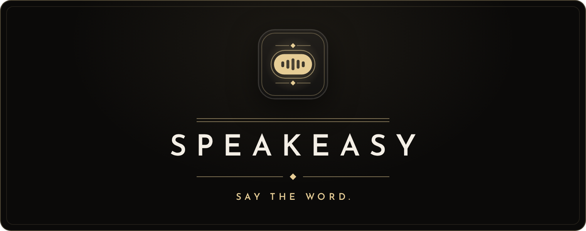
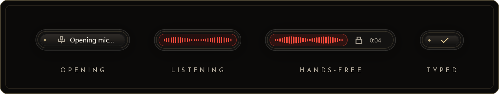

<p align="center">
  
</p>

<p align="center">
  <strong>Private dictation for Windows, macOS, and Linux.</strong><br>
  Hold a shortcut, speak, and your words appear wherever you are typing.<br>
  Local speech engines. No account, no upload, no dictation history.
</p>

<p align="center">
  <a href="#get-started">Get started</a>&nbsp;&nbsp;◆&nbsp;&nbsp;
  <a href="#speech-engines">Speech engines</a>&nbsp;&nbsp;◆&nbsp;&nbsp;
  <a href="#build-and-verify">Build and verify</a>&nbsp;&nbsp;◆&nbsp;&nbsp;
  <a href="docs/architecture.md">Architecture</a>
</p>

## Say the word

A speakeasy was a room behind an ordinary door. You spoke at a small slot, the door opened, and what
was said inside stayed inside. Speakeasy works the same way: it waits in the tray, opens a small
slot on screen while you speak, and keeps every word on your machine.

<p align="center">
  
</p>

| Gesture                                        | Windows                                             | Mac                              |
| ---------------------------------------------- | --------------------------------------------------- | -------------------------------- |
| Dictate while held; release to type            | <kbd>Ctrl</kbd> + <kbd>Win</kbd>                    | <kbd>Fn</kbd>                    |
| Hands-free; press the shortcut again to finish | <kbd>Ctrl</kbd> + <kbd>Win</kbd> + <kbd>Space</kbd> | <kbd>Fn</kbd> + <kbd>Space</kbd> |
| Cancel; the key still reaches your app         | <kbd>Escape</kbd>                                   | <kbd>Escape</kbd>                |
| Show your screen as well; see below            | <kbd>S</kbd> during the hold                        | <kbd>S</kbd> during the hold     |

The shortcuts match Wispr Flow's defaults, and double-tapping the shortcut also starts hands-free.
On Mac, set **System Settings › Keyboard › Press 🌐 key to** to **Do Nothing** so Fn only dictates.
Recordings stop at five minutes, with a countdown for the last 30 seconds. A check means the text
was submitted to your app; **No speech detected** means nothing was sent. **Remove um / uh** is on
by default and removes standalone English hesitation words locally before insertion. Speech
containing only these fillers sends nothing. Turn it off for non-English Parakeet dictation or
literal transcription; Whisper removes fillers only when its language is set to English.

### Show your coding agent

A Show is a narrated screen recording a coding agent can read. Press <kbd>S</kbd> while holding the
shortcut: the pill shows a red screen mark, and Speakeasy records the display under the pointer
along with your voice. Release the shortcut and keep talking; hold <kbd>Shift</kbd> to draw circles
and arrows that fade as you go, and click through as usual. Press the shortcut again to finish.

Speakeasy picks the keyframes your ink, clicks, and words point at, annotates them, and writes a
bundle of keyframes, a contact sheet, `summary.md`, and `show.json`. The pill says **Show copied**:
paste the summary into your agent and it opens the frames itself. Shows record on Windows, and
experimentally on Mac, but not on Linux.

## What's said here stays here

- Speech runs in a local NeMo-Speech.cpp or whisper.cpp process that Speakeasy owns and stops. Setup
  downloads the engine and model once; nothing is uploaded.
- The microphone opens only while you dictate. Audio, transcripts, and engine output are never
  logged.
- The screen is recorded only during a Show you start, and Speakeasy's own windows stay out of it. A
  Show is written to the `shows` folder beside the engine and model, readable only by you, and
  deleted after seven days unless pinned: a file named `.pinned` in its folder keeps it. Cancelling
  leaves nothing behind.
- There are no accounts, cloud providers, telemetry, or dictation history.

## Get started

Download the Windows or Mac zip from the
[latest release](https://github.com/KrishRVH/speakeasy/releases/latest), unzip it, and open
Speakeasy. Linux's experimental AppImage and tar packages are described below.

On a Mac, allow Microphone and Accessibility access when asked, and Screen & System Audio Recording
for Shows. If macOS says it cannot verify Speakeasy, open System Settings → Privacy & Security and
choose **Open Anyway**. After each update, macOS forgets the Accessibility and Screen & System Audio
Recording grants: remove Speakeasy from those lists with − and add it again.

The first launch sets everything up. Speakeasy checks the machine, downloads the matching
[NeMo-Speech.cpp](https://github.com/NVIDIA/NeMo-Speech.cpp) build and NVIDIA's Parakeet v3 model,
about 0.8 GB in all, and turns dictation on:

| Machine                                | Engine build                                    | Speech runs on |
| -------------------------------------- | ----------------------------------------------- | -------------- |
| Windows, NVIDIA GPU with 6 GB or more  | CUDA                                            | GPU            |
| Windows, another GPU with 6 GB or more | Vulkan                                          | GPU            |
| Any other Windows PC                   | Vulkan, or CPU without a Vulkan driver          | CPU            |
| Mac with Apple silicon                 | Metal                                           | GPU            |
| Linux x86_64                           | CUDA, Vulkan, or CPU after compatibility checks | GPU or CPU     |

Then hold <kbd>Ctrl</kbd> + <kbd>Win</kbd> (Windows), <kbd>Fn</kbd> (Mac), or <kbd>Ctrl</kbd> +
<kbd>Super</kbd> + <kbd>Space</kbd> (Linux) in an editor and speak.

Downloads come from pinned GitHub and Hugging Face URLs and are checked against their SHA-256 before
use. They live in `%LOCALAPPDATA%\speakeasy` on Windows and
`~/Library/Application Support/speakeasy` on Mac. **Cancel** pauses setup, and the next attempt
resumes where it stopped.

<details>
<summary>Build from source</summary>

<br>

Speakeasy targets Windows 11 x64, macOS 14+ on Apple silicon, and experimental Linux x86_64 builds
with glibc 2.35 or later. Use the pinned nightly Rust toolchain in `rust-toolchain.toml` (including
rustfmt and Clippy). Workspace dependencies are declared centrally in the root `Cargo.toml`. Windows
builds need the Visual Studio C++ Build Tools and the Windows SDK; macOS builds need the Xcode
command line tools.

```sh
cargo run --locked -p speakeasy -- --demo     # simulated preview
cargo run --locked -p speakeasy               # the app
cargo run --locked -p speakeasy -- show demo  # a scripted Show bundle
```

`--demo` uses simulated audio without the microphone, global shortcut, model, or clipboard. It
previews hands-free, the countdown, submission, a Show with its ink on Windows and Mac, interrupted
dismissal, cancellation, silence, and an error. On Windows and macOS, `--demo-tray` adds the tray
and the Settings hide-and-reopen behavior with dictation disabled. `show demo` writes a scripted
Show bundle and prints its summary. Linux has experimental desktop support; see the Linux
instructions below. GPUI's X11 build needs ALSA, fontconfig, X11/XCB, xkbcommon, and Vulkan
development packages.

</details>

Settings also choose the microphone, GPU use, filler removal, how text is delivered, reduced motion,
and theme: **Jet & Champagne**, **Emerald Lounge**, **Iris**, or **Midnight Chrome**. Changes apply
when you save. Theme and reduced-motion changes keep a recording running; microphone, language,
filler removal, and delivery changes end it but keep the model loaded. On Linux, Shortcuts changes
and most Insert changes restart dictation, which reloads the model. Saving stays responsive and
preserves edits made while the save is running. Pausing during a save keeps dictation paused; Quit
finishes requested saves.

## Linux (experimental)

Download the x86_64 AppImage or tar archive from the release. The application targets glibc 2.35 or
later and needs X11 or Xwayland, Vulkan, and desktop audio support. It shares audio, engines, the
session owner, Settings and the pill with Windows and Mac. Native GNOME/KDE/X11 acceptance is
pending; see [implementation and acceptance](docs/linux-implementation.md) for support limits.

The defaults are **Ctrl+Super+Space** to hold or double-tap for hands-free and **Ctrl+Super+Escape**
to cancel. Linux's cancel chord is reserved; bare Escape is not globally captured. Wayland requests
desktop shortcut and keyboard permissions; Settings shows the actual accepted bindings. Install the
supplied `io.github.krvh.speakeasy.desktop` file in `~/.local/share/applications` (or the
corresponding XDG data directory), and make the executable available as `speakeasy` on your PATH.
Portals use this installed launcher identity. For source builds:

```sh
cargo build --release --locked -p speakeasy
mkdir -p "$HOME/.local/bin"
ln -s "$PWD/target/release/speakeasy" "$HOME/.local/bin/speakeasy"
install -Dm644 packaging/linux/io.github.krvh.speakeasy.desktop \
  "${XDG_DATA_HOME:-$HOME/.local/share}/applications/io.github.krvh.speakeasy.desktop"
```

For the tar package, link its absolute `Speakeasy.AppDir/AppRun` path instead, and install the
desktop file from `usr/share/applications` inside that directory. For AppImage, make it executable,
link its absolute path as `speakeasy`, and install the desktop file from this repository or its
`--appimage-extract` output. The executable stays in the chosen location. Automatic paste needs
compositor modifier feedback and libei; typing needs direct text support as well. Settings'
**Insert** control chooses **Paste (Ctrl+V)**, **Paste (Ctrl+Shift+V)** for terminals, **Type (Keep
clipboard)**, or **Copy for manual paste** if automatic insertion is unavailable. X11 automatic
paste uses the first keyboard layout with an unshifted V key; other layouts copy and explain how to
paste manually.

For a desktop without suitable shortcut permissions, choose **Shortcuts: Desktop bindings** and
assign the two commands Settings shows in your desktop's shortcut settings: `speakeasy --toggle` and
`speakeasy --cancel`, with `--config` when you use another settings file. This mode starts/finishes
hands-free. Choose **Insert: Copy for manual paste** as well to avoid requesting keyboard-control
access. On X11, native chords can be set in the optional `linux` settings object: `shortcut`,
`cancel`, `terminal_paste`, `manual_paste`, and `external_shortcut`. Ordinary chord keys use the
portal syntax, such as `CTRL+LOGO+space`. Save and resume after changing bindings or keyboard maps.

Rendering uses X11 or Xwayland with Vulkan. A tray host is optional: without one, closing Settings
quits and the launcher reopens the app. Configuration lives under `$XDG_CONFIG_HOME/speakeasy`,
downloads under `$XDG_DATA_HOME/speakeasy`, and private portal restore credentials under
`$XDG_STATE_HOME/speakeasy`, with standard home directory defaults. Some CPUs without AVX-512 cannot
run the pinned Linux CPU engine; Speakeasy checks before readiness and explains how to choose
another engine in Settings ([details](docs/linux-implementation.md#setup-and-distribution)).

## Speech engines

**Parakeet** is the default: NVIDIA's Parakeet TDT 0.6B v3, run by NeMo-Speech.cpp. It detects the
language automatically and needs microphone audio at 8–96 kHz. Setup chooses its build, and **Prefer
GPU** switches between the GPU and the CPU. After a five-minute recording the GPU worker holds about
3.8 GB of memory until **Pause** releases it. The model is by NVIDIA, under
[CC BY 4.0](https://creativecommons.org/licenses/by/4.0/).

**Whisper** runs a local whisper.cpp server with a GGML model. Switch the engine under **Local
speech**, choose its executable and model, and save; switching is always explicit. The known-good
Windows build is [whisper.cpp b5130](https://github.com/ggml-org/whisper.cpp/releases/tag/b5130):
extract the complete runtime and choose `Release/whisper-server.exe`. Turn off **Prefer GPU** for a
CPU-only build. The `threads` setting applies to Whisper and defaults to four. On shared Linux
machines, prefer Parakeet: other accounts can read Whisper's
[request route](docs/architecture.md#local-recognition-and-privacy).

The worker stays warm on loopback. With a GPU, one silent request initializes its kernels before the
first dictation; Linux CPU workers also validate inference before readiness. Cancelling GPU work
keeps a healthy worker and replaces it if a two-second recovery check fails. Cancelling active CPU
inference replaces the worker. **Pause dictation** releases the shortcut and the model. On Mac and
Linux, force-quitting Speakeasy can leave the worker running; quit from its menu instead. Relative
engine and model paths resolve beside the settings file.

## Everyday use

Settings live in `%APPDATA%\speakeasy\settings.json` on Windows and
`~/Library/Application Support/speakeasy/settings.json` on Mac. Start from `settings.example.json`
and pass `--config <path>` to use another file. Speakeasy reads settings files from other releases,
and saving writes only the settings you changed, so edits you make to the file by hand stay. On
Windows and Mac, configured launches go straight to the tray or menu bar; Linux opens Settings at
startup. Closing Settings hides it and keeps unsaved edits; Windows minimize also hides it.
Reopening Speakeasy or choosing **Settings…** in the tray brings it back.

The tray icon shows loading, ready, recording, processing, paused, and attention states. Its menu
pauses or resumes dictation, starts or finishes a recording, cancels, opens Settings, and quits.
Errors stay in Settings after the pill fades.

By default the text is pasted through the clipboard and stays there. **Keep clipboard** types it as
direct input instead, which some editors reject. Protected fields and elevated Windows apps may
refuse either method, and no OS submission can confirm that an editor accepted the text.

## Build and verify

```sh
mise install
mise run standards:check
```

The pinned toolchain and lockfiles make local checks reproducible. `mise run standards` applies safe
formatters and autofixes, and `mise tasks` lists the focused checks.

Default tests drive the real session owner with mocked microphone, inference, and insertion. A
paused clock exercises gesture deadlines and the five-minute cap. They never record, install a
global hook, or touch the clipboard. Run checks locally before pushing to `main`. See the
[architecture change and test map](docs/architecture.md#change-and-test-map), and
[verification](docs/architecture.md#verification) for opt-in tests and their fixtures.

<details>
<summary>Packaging and native checks</summary>

<br>

- `scripts/package-windows.ps1`, `bash scripts/package-macos.sh`, and
  `bash scripts/package-linux.sh` package the app into `artifacts/`; `--native-tar` makes an
  unbundled Linux archive for the current machine. Packages carry no engine or model; setup
  downloads them on first launch. The Mac bundle carries its microphone usage declaration and a
  local signature; grant its permissions as [Get started](#get-started) describes. Distribution
  needs Developer ID signing and notarization.
- `scripts/check-demo-windows.ps1 -Executable <speakeasy.exe>` checks that the demo pill stays
  non-activating and passes clicks through.
  `scripts/check-tray-windows.ps1 -Executable <speakeasy.exe>` checks minimize, close, relaunch, and
  configuration preservation with owned `--demo-tray` windows. `mise run ps:syntax` parses the
  Windows scripts on a native PowerShell host.
- On Linux, `mise exec -- python scripts/check_demo_linux.py target/release/speakeasy` opens a
  private Xvfb display, checks rendered Settings, and checks that the preview shows and then hides
  the pill. It needs Xvfb, x11-utils, and a Vulkan driver. `bash scripts/check-rendering-linux.sh`
  runs, in an Ubuntu 24.04 Docker container with stock Mesa, the opt-in `idle_native_pill_` tests of
  the pill's window hints, input shape, and visibility, the native rendering example, and that demo
  check on the release binary that `package-linux.sh` builds; `--packages` checks the AppImage and
  tar launchers instead. [Linux implementation](docs/linux-implementation.md#setup-and-distribution)
  explains the Mesa requirement.
- `cargo run --locked -p speakeasy --example check_native_rendering -- --native-gui` opens an owned
  non-activating window, renders an embedded SVG and paths, resizes, and repeats show/hide. It runs
  on the process main thread for AppKit. Linux needs a private display, such as `xvfb-run -a`;
  Windows and Mac use their native desktop. It accesses no microphone, global hook, or clipboard.

Live microphone, editor, and screen acceptance is tracked under
[verification](docs/architecture.md#verification).

</details>

## Documentation

- [Architecture](docs/architecture.md): the change and test map, cross-module invariants,
  recognition, privacy, and verification.
- [Interaction design](docs/interaction-design.md): the brand, the pill, the tray, and interaction
  contracts.
- [Performance](docs/performance.md): constraints, profiling methods, and native measurement limits.
- [Remote dictation](docs/remote-dictation.md): routing a remote microphone to Speakeasy.
