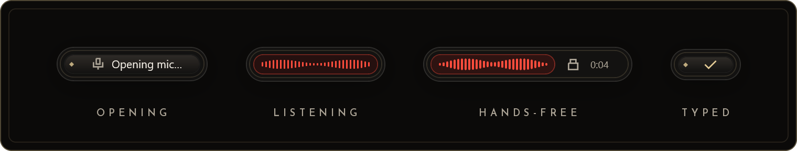
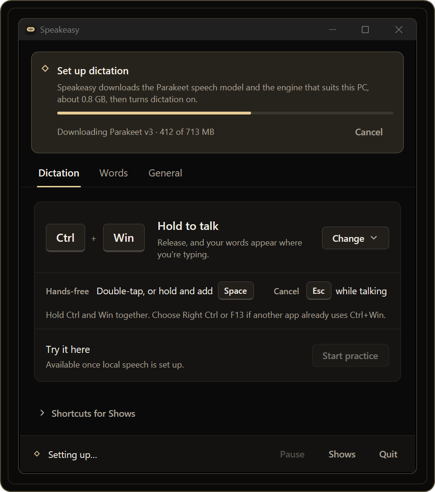
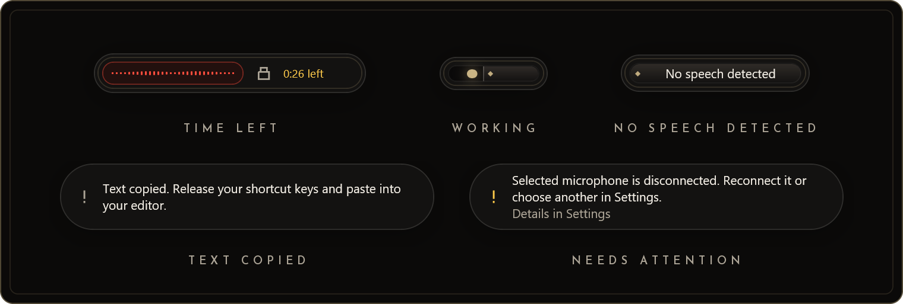
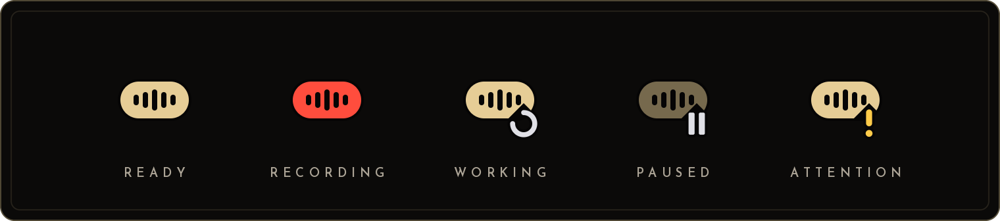
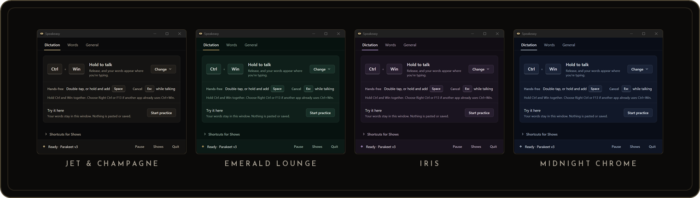
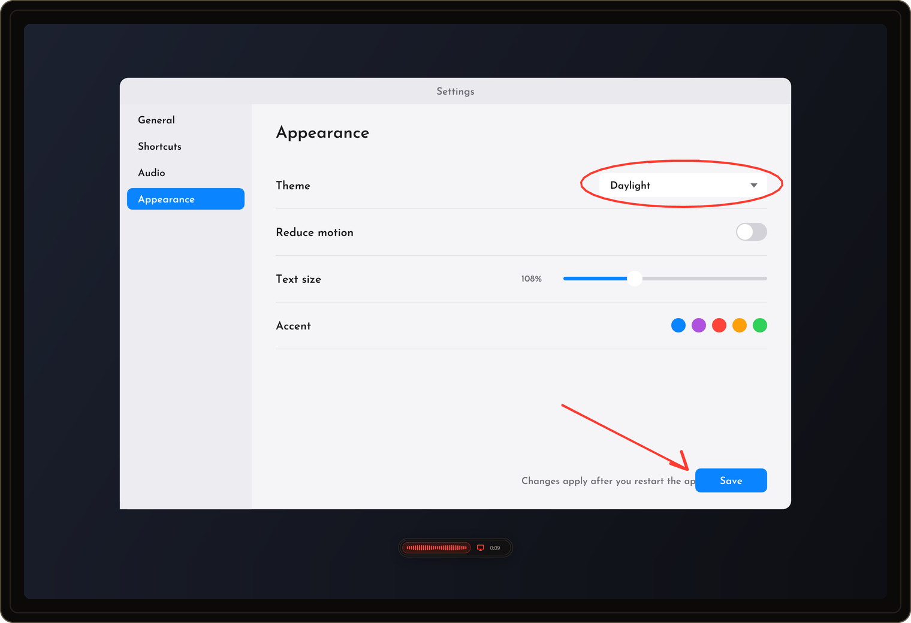
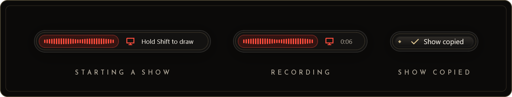
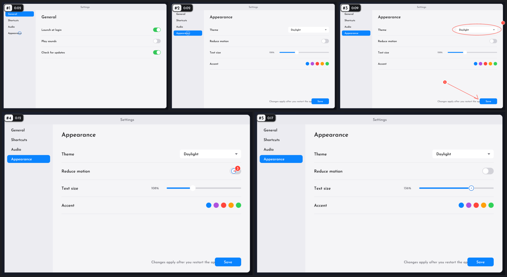

<https://github.com/user-attachments/assets/d0b50077-69d2-487a-b177-7a9b5ed1f6e9>

<p align="center">
  <strong>Private dictation for Windows, macOS, and Linux.</strong><br>
  Hold a shortcut, speak, and your words appear wherever you're typing.<br>
  Speech runs on your machine, with no account, automatic upload, or dictation history.
</p>

[Get started](#get-started) · [Shows](#shows-for-coding-agents) · [Linux](#linux-experimental) ·
[Build and verify](#build-and-verify)

<p align="center">
  
</p>

## Get started

Download the [latest release](https://github.com/KrishRVH/speakeasy/releases/latest). Speakeasy
supports Windows 11 x64, macOS 14 or newer on Apple silicon, and experimental Linux x86_64 with
glibc 2.35 or newer.

- **Windows.** Run the per-user installer or unpack the ZIP. If SmartScreen warns about the unsigned
  installer, use **More info → Run anyway** after checking that you got it from the release page.
  Quit from the tray before upgrading or uninstalling. Uninstall preserves settings, models, and
  Shows. Keep `speakeasy-cli.exe` beside `speakeasy.exe` to run commands from a terminal.
- **macOS.** Drag Speakeasy to Applications. Allow Microphone and Accessibility for dictation and
  Screen & System Audio Recording for Shows. macOS 27.3 and later also need **System & App
  Protection Override** to paste or type. If Gatekeeper asks, use **Privacy & Security → Open
  Anyway**. Replacing a locally signed build may require granting permissions again.
- **Linux.** See [Linux installation](#linux-experimental).

The setup guide downloads Parakeet and its local engine, helps you grant permissions, and opens a
private practice area. **Pause download** stops a download, and the next attempt resumes it. Use
**General → Setup guide → Replay** to reopen the guide while keeping your settings. To try delivery,
finish practice and dictate into an editor.

<p align="center">
  
</p>

## Everyday use

| Gesture                               | Windows                             | macOS                               | Linux                          |
| ------------------------------------- | ----------------------------------- | ----------------------------------- | ------------------------------ |
| Hold to dictate, release to finish    | Ctrl+Win                            | Fn                                  | Ctrl+Super+Space               |
| Start hands-free, tap again to finish | Double-tap or add Space during hold | Double-tap or add Space during hold | Double-tap                     |
| Cancel                                | Escape                              | Escape                              | Ctrl+Super+Escape              |
| Finish and send with Return           | Enter during hold                   | Return during hold                  |                                |
| Paste last dictation                  | V during hold or tray               | V during hold or tray               | Tray or `speakeasy paste-last` |
| Show the screen, window, or area      | S, W, or A during hold              | S, W, or A during hold              |                                |
| One-press hands-free or Show          | Record a shortcut in Settings       | Record a shortcut in Settings       |                                |

Escape still reaches the focused app on Windows and macOS, so hands-free dictation cancels only
while you hold the shortcut, or from the tray. The pill listens without taking focus, shows progress
and errors, and counts down the last 30 seconds of the five-minute limit. If the microphone drops
out after speech, use **Paste last dictation** to recover the words Speakeasy heard. It keeps one
result in memory until Pause, a dictation restart, or Quit.

<p align="center">
  
</p>

When the default conflicts with another app, or an external keyboard's Fn stays in firmware, choose
another hold-to-talk shortcut in Settings: **Right Ctrl** or **F13** on Windows, **F13**, **Right
Option**, or **Right Command** on Mac, or record any keys. Settings can also record shortcuts that
start hands-free or a screen, window, or area Show with one press and finish it with the next. A
shortcut needs a modifier unless its key types nothing, as F13 doesn't. With a single modifier, wait
a quarter-second before adding a hold key so quick chords such as Right Ctrl+C still copy. For Mac
Fn, set **System Settings → Keyboard → Press 🌐 key to** to **Do Nothing**; Settings and the pill
say so when it opens a picker, switches input, or starts Dictation. When Secure Keyboard Entry is
active, Mac modifier shortcuts still record, and shortcuts with a key, such as F13, and the hold
keys are unavailable to Speakeasy. The pill names the app that turned it on, often a terminal with
Secure Keyboard Entry enabled in its menu.

By default, text is pasted. Windows and macOS restore the prior clipboard after half a second when
they can copy it back and the clipboard is still unchanged. A paste followed by Return leaves the
dictated text there. Release the shortcut within five seconds for Return-to-send, and keep focus in
the same window on Windows or app on Mac. **Type instead of paste** keeps the clipboard untouched.
The pill reports submission to the OS. If it says **Text copied**, paste manually.

<p align="center">
  
</p>

### Settings

**Dictation** offers shortcut, practice, speech, microphone, writing, and presets. **Words** holds
recognition hints and phrase corrections. **General** holds appearance, sounds, permissions,
updates, and **Start over…**. Changes save as you make them. Closing Settings hides it to the tray
when one is available. **Pause** releases the shortcut and the model. **Start over…** resets
settings and downloads while preserving Shows.

A preset saves the speech and cleanup choices you use together. **Use** applies it to Settings. The
Windows and Mac tray or `speakeasy preset "NAME"` applies a preset while idle for the current run
without saving it; Settings tags it **This session** and offers **Keep using it**. **Dictation
style** in the tray or `speakeasy style STYLE` sets the next recording's style. Choose `prose`,
`verbatim`, `camel`, `pascal`, `snake`, `kebab`, or `constant`. Verbatim preserves fillers. Phrase
corrections apply in every style, and Prose can write spoken symbols such as “new line”,
“underscore”, or “open paren”. Shows use their usual narration.

<p align="center">
  
</p>

Use `--config PATH` for another settings file. The defaults are `%APPDATA%\speakeasy\settings.json`
on Windows and `~/Library/Application Support/speakeasy/settings.json` on Mac. Windows offers
**Start at login** for the default settings. **General → Check for updates** checks GitHub on
request. Installed Windows builds with an update key can download a verified installer and offer
**Install and restart** as a separate action.

On Windows, assistive tools can read and operate Settings' main controls and text fields. Full
screen-reader navigation and page scrolling remain unfinished.

### Scripts

Commands control a running app. On Windows invoke the packaged console executable, for example
`& 'PATH\speakeasy-cli.exe' status` in PowerShell.

```sh
speakeasy status
speakeasy dictation start --style snake
speakeasy dictation stop "TOKEN_FROM_START"
speakeasy dictation cancel "TOKEN_FROM_START"
speakeasy paste-last
speakeasy style prose
speakeasy preset "Coding"
```

Pass `--config PATH` for the selected instance. The JSON commands exit 0 for acknowledgement, 1 for
refusal, and 2 for unavailable or uncertain. Usage errors also exit 2 and print to stderr. Read
status after an uncertain result. The start token applies to that ordinary dictation only.

Enable **Let scripts receive dictations** under **Dictation → Writing** to use
`speakeasy dictation start --print` followed by `speakeasy dictation stop TOKEN --print`. This
capture delivers its result in the reply's `text` field instead of pasting. The stop command waits
up to two minutes. The switch limits the feature to explicit script captures. Shows, practice, and
keyboard dictation have separate destinations.

## Speech engines

- **Parakeet** is the default. It detects language automatically and starts recognition during
  pauses in long dictations. Setup chooses the local NeMo-Speech.cpp build. **Prefer GPU** lets you
  switch between GPU and CPU.
- **Nemotron** is an optional download in the model picker. It recognizes continuously during
  dictation or practice and delivers text once at the end. A failed stream retries the whole
  recording with the same model.
- **Your own engine** accepts a program and model from a local
  [whisper.cpp](https://github.com/ggml-org/whisper.cpp) or
  [NeMo-Speech.cpp](https://github.com/NVIDIA/NeMo-Speech.cpp) installation. For Whisper on Windows,
  extract the full runtime and select `whisper-server.exe`. CPU-only builds need **Prefer GPU** off.

Recognition hints guide Nemotron and Whisper toward names and jargon. Corrections replace whole
words or phrases in the output and apply to Show narration too. **Remove um and uh** applies to
English in Nemotron and Whisper. With Parakeet, turn it on to opt into English cleanup.

## Shows for coding agents

A Show records a screen, window, or area with your narration. On Windows and Mac, hold the dictation
shortcut and press **S** for the display under the pointer, **W** for its window, or **A** to drag
an area. Release the shortcut and keep speaking. Hold **Shift** and move the pointer to draw
numbered marks, or double-tap **Shift** to drop a pin. A fresh hold and release finishes. The tray
can start screen or area Shows and finish or cancel them. To cancel with the keyboard, hold the
shortcut and press Escape.

<p align="center">
  
</p>

Speakeasy leaves its windows out of capture, saves keyframes, contact sheets, `summary.md`, and
`show.json`, and copies the summary. Screen Shows frame the area you worked in. Window and area
Shows use your chosen framing. Windows Shows and Mac screen and area Shows also save silent video. A
Show that ends early can still save its footage and report missing or partial narration.

<p align="center">
  
</p>

### Read saved Shows

Open **Shows** to review keyframes, **Every saved frame**, **Video** where available, and
**Summary** or **Narration**. A timed mark or clause jumps to its position. When the actual sample
differs from the requested time, the caption shows both. Video annotations may end before recovered
video does.

<p align="center">
  
</p>

On Windows and Mac, **Send to agent** copies paths and the ID in a prompt you can paste into an
agent. **Copy image, summary, and narration** copies the displayed image with its time, your edited
summary, and the recorded words. **Copy last Show** in the tray rereads the latest Show's summary,
including edits, until you quit or the Show is removed. A Windows summary can include the path under
the default WSL distribution's drive mount.

Managed Shows and their saved audio expire seven days after recording unless you choose **Keep
Show**. **Stop keeping** restores the original expiry date, so a Show already past it goes at the
next cleanup. **Delete Show…**, or the trash button on a Show in the list, removes that bundle after
confirmation, with exported copies and any pending recovery audio left in place.

- **Export ZIP…** writes a portable copy of the evidence and edited summary. Saved audio and
  recovery audio stay in Speakeasy.
- **Export video…** writes a new MP4 with saved ink, audio, and optional captions where available.
  Install FFmpeg 5.1 or later with H.264 and AAC support, put `ffmpeg` on PATH, then restart
  Speakeasy. On Mac, a Homebrew or MacPorts install also works.
- **Recover Show** restores surviving footage and audio from an interrupted recording as a new
  bundle, using your configured engine and the original language. It keeps the original expiry.
  **Transcribe narration** retries pending audio and saves a new copy. Pending audio follows its
  original seven-day expiry even if you keep the earlier bundle.

### Show commands and MCP

```sh
speakeasy show list --json
speakeasy show wait --timeout 900 --json
speakeasy show inspect "PATH_OR_SHOW_ID" --json
speakeasy show frames "PATH_OR_SHOW_ID" --phrase "save button" --json
speakeasy show frame "PATH_OR_SHOW_ID" --at 0:12.500 --out new-frame.png --json
speakeasy show frame "PATH_OR_SHOW_ID" --video --mark 2 --out new-video-frame.png --json
speakeasy show keep "PATH_OR_SHOW_ID"
speakeasy show export "PATH_OR_SHOW_ID" --out new-show.zip
speakeasy show video "PATH_OR_SHOW_ID" --captions --out new-show.mp4
speakeasy show skill --install /path/to/agent/skills
speakeasy show mcp --setup
```

`wait` waits for the first Show saved after it starts. `inspect` gives current paths and maps
contact sheets and marks to their frames. It reports an unreadable manifest or movie timing in
`error` with `status: "unreadable"`, then exits 1. Images are opened when viewed or exported. Choose
a full managed ID from `list` or an explicit path for a moved bundle. `show keep --off` restores
expiry, and `show discard "interrupted:ID"` discards an explicit checkpoint. `speakeasy show --help`
lists all options. The [agent reading guide](skills/speakeasy-show/SKILL.md) covers evidence
retrieval, sampling gaps, and export.

`show mcp --setup` prints client configuration. Run the stdio server with one or more `--root PATH`
arguments to expose specific Shows or folders of Shows to `show_list`, `show_read`, and
`show_image`. From WSL, the Windows console executable takes Windows roots and Show paths. Content
requested by an agent may reach its model provider.

## Linux (experimental)

Use the x86_64 AppImage or bundled tar. The app needs a working Vulkan driver, desktop audio, and a
layer-shell Wayland compositor or X11/Xwayland. The Wayland dictation adapter also uses Xwayland for
focus. See [Linux implementation](docs/linux-implementation.md) for desktop support and pending
acceptance.

Put `speakeasy` on PATH, linking to the executable AppImage or to `Speakeasy.AppDir/AppRun` from the
tar. Install [the desktop file](packaging/linux/io.github.krvh.speakeasy.desktop) under
`~/.local/share/applications` or its XDG equivalent for the desktop portals. Source builds can use
`mise run linux:install`.

Wayland asks the desktop to approve shortcut and keyboard access. Settings shows the accepted
bindings. Other desktops can use **General → Desktop → Shortcuts → Desktop bindings**. Assign the
displayed `speakeasy --toggle` and `speakeasy --cancel` commands to shortcuts in your desktop
settings. This mode provides hands-free dictation.

**Insert text by** offers paste, terminal paste, direct typing, or manual copy. Automatic paste uses
EI on Wayland and XTest on X11. X11 needs the first keyboard layout with an unshifted V. Typing
requires EI direct text support. Choose **Copy for manual paste** if your desktop lacks those
capabilities. After rebinding shortcuts in the desktop or changing the keyboard map, pause and
resume. Closing Settings quits when there's no tray host. Linux can read saved Shows. Show recording
is available on Windows and Mac.

## Build and verify

```sh
mise install
mise run standards:check
mise run app:demo
mise run app:run
mise run app:show-demo
```

Build on Windows with the Visual Studio C++ Build Tools and Windows SDK, or on macOS with Xcode
command line tools. Linux needs `pkg-config` and development packages for ALSA, fontconfig,
FreeType, X11/XCB, xkbcommon, and Vulkan. On Ubuntu:

```sh
sudo apt-get install libasound2-dev libfontconfig1-dev libfreetype6-dev libx11-dev libxcb1-dev \
  libxkbcommon-dev libxkbcommon-x11-dev libvulkan-dev pkg-config
```

`app:demo` previews simulated dictation and Shows. `mise run app:demo-tray` previews tray and window
behavior with dictation disabled. Use `mise tasks` for focused checks and `mise run rust:explore`
when changing the session machine. See
[the change and test map](docs/architecture.md#change-and-test-map).

<details>
<summary>Packaging and signing</summary>

- Run `scripts/package-windows.ps1` with Inno Setup 6 for an installer and ZIP,
  `bash scripts/package-macos.sh` for a DMG and ZIP, or `bash scripts/package-linux.sh` for an
  AppImage and tar. Linux distribution builds target Ubuntu 22.04's glibc 2.35. Use `--native-tar`
  for an unbundled local build. Outputs go in `artifacts/`.
- For Windows publisher signing, provision a certificate with private-key access in
  `CurrentUser\My`. Set `SPEAKEASY_WINDOWS_SIGN_CERT_SHA1` and `SPEAKEASY_WINDOWS_SIGN_TIMESTAMP` to
  its thumbprint and HTTPS RFC 3161 endpoint. The script signs and checks the packages. For Mac
  distribution, set `SPEAKEASY_MAC_SIGN_IDENTITY` to a Developer ID Application identity and
  `SPEAKEASY_MAC_NOTARY_PROFILE` to a stored notarytool profile. The script signs, notarizes, and
  checks both the app and disk image. Release CI uses unsigned Windows packages and locally signed
  Mac packages.
- Verified Windows updates use a separate Ed25519 key. Commit the 32-byte hexadecimal public key in
  `packaging/update-key.pub`. Store the PKCS#8 PEM private key in `SPEAKEASY_UPDATE_PRIVATE_KEY` as
  an Actions secret. Release CI checks the key matches before tagging and signs the exact
  `update.json` bytes, including the installer size and SHA-256. Keep signing credentials out of Git
  and logs. Ship a replacement public key in a separately distributed build if the key changes.
- `bash scripts/check-package.sh <package>` checks the actual portable package without devices or a
  display. CI checks the Windows installer on a fresh runner with
  `scripts/check-installer.ps1 -Installer <setup.exe>`.

</details>

<details>
<summary>Native checks</summary>

- Run `mise run native:rendering` for owned-window rendering. On Windows or Linux, use
  `mise run native:settings` and `mise run native:review` for Settings and synthetic Show
  interactions, and `mise run native:pill` for the pill's frame rate. Linux uses private Xvfb.
  `mise run linux:demo` checks the release preview and `bash scripts/check-rendering-linux.sh`
  checks rendering in a Docker container.
- On Windows, `mise run windows:accessibility` checks a static UI Automation fixture.
  `scripts/check-demo-windows.ps1 -Executable <speakeasy.exe>` checks the simulated pill and
  Settings. `scripts/check-tray-windows.ps1 -Executable <speakeasy.exe>` checks hide and reopen.
  `mise run windows:clipboard` uses a private window station.
- On Mac, `bash scripts/check-update-macos.sh` checks shutdown with owned windows.
  `bash scripts/check-movie-macos.sh` uses FFmpeg to generate synthetic codec fixtures. The Check
  workflow's `mac_updates` and `movie` inputs exercise these paths.
- For Windows codec acceptance, run `mise run windows:movie:encode` with
  `SPEAKEASY_MOVIE_PROBE_DIRECTORY` set to an empty folder. Pass that folder as
  `SPEAKEASY_MOVIE_FIXTURES` to `mise run movie:prefixes` and set `SPEAKEASY_MOVIE_PREFIX_OUT` to a
  new output folder. Set `SPEAKEASY_MOVIE_READ_DIRECTORY` to the recovered prefixes for
  `windows:movie:read`, `windows:movie:review`, or `windows:movie:crops`. For crops also set
  `SPEAKEASY_MOVIE_GEOMETRY_DIRECTORY` to the original encode folder.
- The remaining movie tasks name their synthetic fixture directories in `mise tasks`.
  `mise run windows:geometry` checks an owned window without recording pixels.
  `mise run windows:capture` and `mise run macos:capture` explicitly opt into screen capture with
  owned windows. Mac capture needs Screen Recording permission.
- Live microphone and editor behavior require native acceptance. See
  [performance and acceptance](docs/performance.md#native-acceptance).

</details>

## Versions

Speakeasy is a preview. Until 1.0, support the current version of settings, CLI, MCP, and Shows,
including the current Show format, 3. Replace obsolete readers and report unsupported formats as
errors.

The public surface includes gestures, CLI and MCP commands and replies, saved settings, Show formats
and retention, and supported platforms and packages. Bump **MINOR** for a breaking change to that
surface, and **PATCH** for additions, fixes, and performance. A breaking bundle reader change also
raises the Show format version. Use `0.MINOR.PATCH` without suffixes and keep released versions and
tags fixed.

## Documentation

- [Architecture](docs/architecture.md) and [native contracts](docs/native-contracts.md) for changes
  to owners, interfaces, and OS resource lifetimes.
- [Interaction design](docs/interaction-design.md) for gestures, feedback, and presentation.
- [Performance](docs/performance.md) for profiling and fixture replay.
- [Remote dictation](docs/remote-dictation.md) for routing a microphone to a Windows host.

## License

[MIT](LICENSE). Packages include the [font license](crates/app/assets/JosefinSans-OFL.txt), the
[Show notice](crates/show/NOTICE.md), and third-party crate notices. Cues come from
[CC0 kalimba recordings](https://freesound.org/people/hollandm/packs/38696/), and the patched
dependencies retain their [upstream licenses](vendor/README.md).
