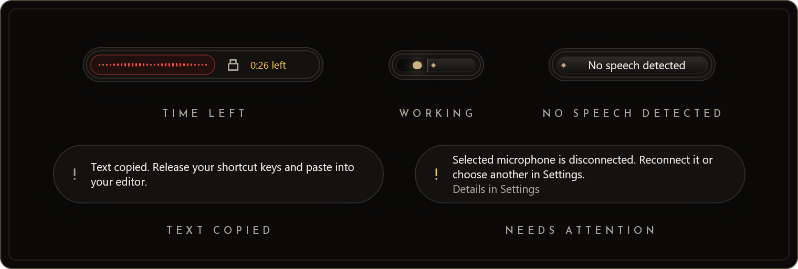
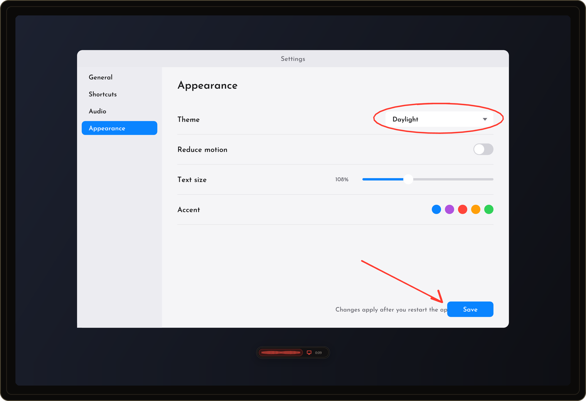
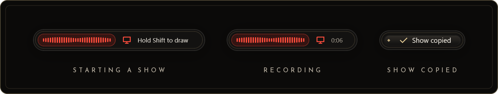
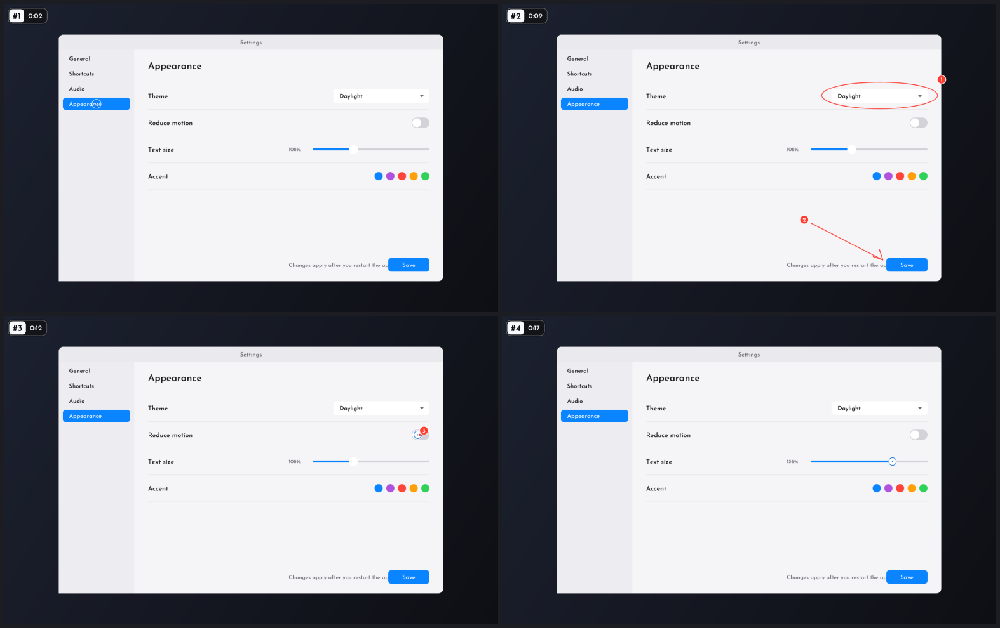
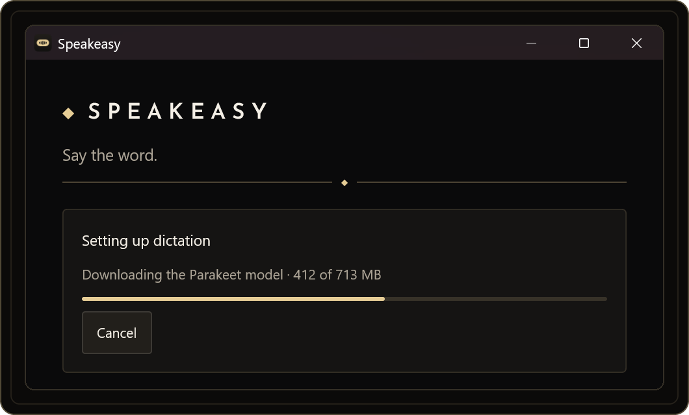
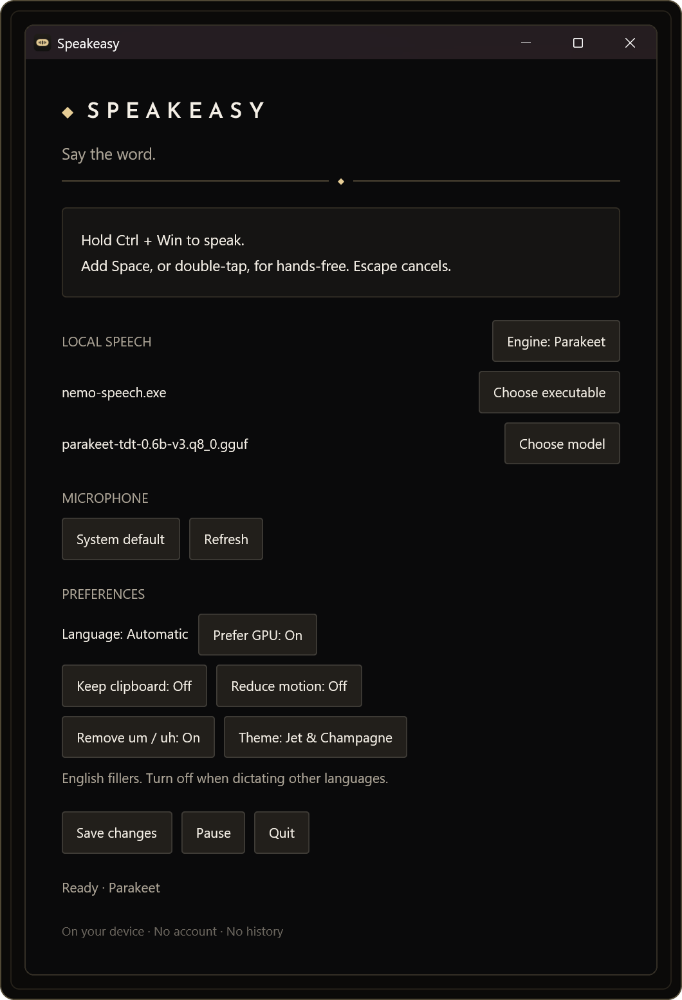
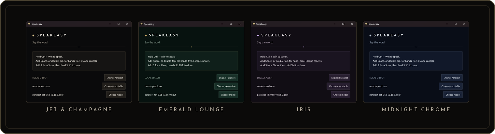

<https://github.com/user-attachments/assets/d0b50077-69d2-487a-b177-7a9b5ed1f6e9>

<p align="center">
  <strong>Private dictation for Windows, macOS, and Linux.</strong><br>
  Hold a shortcut, speak, and your words appear wherever you are typing.<br>
  Local speech engines. No account, no upload, no dictation history.
</p>

<p align="center">
  <a href="#show-your-coding-agent">Shows</a>&nbsp;&nbsp;◆&nbsp;&nbsp;
  <a href="#get-started">Get started</a>&nbsp;&nbsp;◆&nbsp;&nbsp;
  <a href="#speech-engines">Speech engines</a>&nbsp;&nbsp;◆&nbsp;&nbsp;
  <a href="#everyday-use">Everyday use</a>&nbsp;&nbsp;◆&nbsp;&nbsp;
  <a href="#build-and-verify">Build and verify</a>&nbsp;&nbsp;◆&nbsp;&nbsp;
  <a href="docs/architecture.md">Architecture</a>
</p>

## Say the word

A speakeasy was a room behind an ordinary door. You spoke at a small slot, the door opened, and what
was said inside stayed inside. Speakeasy works the same way: it waits in the tray, opens a small
slot on screen while you speak, and keeps every word on your machine.

<p align="center">
  
</p>

| Gesture                                          | Windows                                                     | Mac                                                         |
| ------------------------------------------------ | ----------------------------------------------------------- | ----------------------------------------------------------- |
| Dictate while held; release to type              | <kbd>Ctrl</kbd> + <kbd>Win</kbd>                            | <kbd>Fn</kbd>                                               |
| Hands-free; press the shortcut again to finish   | <kbd>Ctrl</kbd> + <kbd>Win</kbd> + <kbd>Space</kbd>         | <kbd>Fn</kbd> + <kbd>Space</kbd>                            |
| Cancel dictation; the key still reaches your app | <kbd>Escape</kbd>                                           | <kbd>Escape</kbd>                                           |
| Show the screen, a window, or an area; see below | <kbd>S</kbd>, <kbd>W</kbd>, or <kbd>A</kbd> during the hold | <kbd>S</kbd>, <kbd>W</kbd>, or <kbd>A</kbd> during the hold |

The shortcuts match Wispr Flow's defaults, and double-tapping the shortcut also starts hands-free.
On Mac, set **System Settings › Keyboard › Press 🌐 key to** to **Do Nothing** so Fn only dictates.
**Remove um / uh** is on by default and removes standalone English hesitation words locally before
insertion. Speech containing only these fillers sends nothing. Turn it off for non-English Parakeet
dictation or literal transcription; Whisper removes fillers only when its language is set to
English.

### Reading the pill

The pill sits at the bottom of the screen, never takes focus, and lets clicks through to the app
underneath. Hold the shortcut and the slot opens; the red waveform follows your voice. Hands-free
adds a lock and the elapsed time. Near the five-minute limit, while it works, and once you finish,
the pill shows:

<p align="center">
  
</p>

- **Time left.** Recordings stop at five minutes. The last 30 seconds count down in gold, and at
  zero the recording finishes and its text is delivered as usual.
- **Working.** The lamp slides through the slot while your speech is transcribed on this machine.
- **Typed.** A check, shown above, means the text was submitted to your app.
- **No speech detected.** Nothing was sent.
- **Text copied.** The text is on the clipboard but was not pasted, for example because the shortcut
  keys were still held or Speakeasy itself had focus. Paste it where you want it.
- **Needs attention.** An error says what to do next and stays in Settings after the pill fades.

Soft kalimba notes mark the moments you may not be watching: a high note once Speakeasy is
listening, a lower one when you finish or the five-minute limit does, a muted low note when you
cancel, two rising notes when a Show starts, and a short chord when text or a Show is copied.
Speakeasy listens beneath its own cues, so a recording that hears only a cue sends nothing, while a
word said over one still counts. Turn them off with **Play sounds** in Settings.

### Show your coding agent

A Show is a narrated screen recording a coding agent can read. While holding the shortcut, press
<kbd>S</kbd> to record the display under the pointer, <kbd>W</kbd> for the window under the pointer,
followed as it moves, or <kbd>A</kbd> to drag out an area of the display; a click there instead
cancels. Speakeasy records it along with your voice, keeping what you said since you pressed the
shortcut, and a thin red line marks the window or area while it records. The pill shows a red screen
mark and **Hold Shift to draw**, then the elapsed time. Release the shortcut and keep talking. To
draw circles and arrows, hold <kbd>Shift</kbd> and move the pointer without clicking; double-tap
<kbd>Shift</kbd> to drop a pin where the pointer is. Each mark and pin is numbered ① ② ③ beside it,
on screen and in the bundle, so you and the agent can refer to it by number. The ink fades as you
go. Click through your app as usual, then press and release the shortcut to finish. Without the
shortcut, for example on a Mac keyboard with no Fn key, choose **Show screen** or **Show area…** in
the tray to start a Show and **Finish Show** to end it. Escape alone stays with your app: to cancel,
hold the shortcut and press <kbd>Escape</kbd>, or choose **Cancel Show** in the tray. Pressing
another shortcut while you hold Speakeasy's, locking the screen, or sleeping finishes the Show
rather than discarding it. Once you finish, the Show is saved even if you press Escape.

In this example, a Show reports bugs in a made-up settings app, and `speakeasy show demo` writes the
same bundle.

<p align="center">
  
</p>

<p align="center">
  
</p>

Speakeasy picks the keyframes your ink, clicks, and words point at, annotates them, and writes a
bundle of keyframes, contact sheets, `summary.md`, and `show.json`. A Show keeps up to 36 keyframes
spread across the whole recording, at most six to a sheet, and the summary names each sheet's
frames. The pill says **Show copied** and the summary is on the clipboard: paste it into your agent,
and the summary tells the agent how to read the Show. Shows record on Windows, and experimentally on
Mac, but not on Linux. On Windows, streaming and screen-sharing apps such as Sunshine, OBS, or a
video-call app don't see Speakeasy's windows or ink while a Show records; the keyframes still carry
the ink.

<p align="center">
  
</p>

On Windows, the summary for that contact sheet reads as follows:

```text
Screen recording (0:20, 4 keyframes): `…\speakeasy\shows\20261020T143205Z`
Before acting, open the contact sheet, then the full-size frames that matter: they show what the words leave out. Speech recognition can mishear a name; where the screen spells it differently, trust the screen. Cite frames as #N and marks by their circled numbers.
Contact sheet: `…\speakeasy\shows\20261020T143205Z\contact-sheet.png`
- #1 (0:02) [clicked] “Here's the settings window. When I open Appearance,”
- #2 (0:09) [① circled, ② drew an arrow] “the theme picker is here, but look, this label runs under the save button.”
- #3 (0:12) [③ pinned, clicked] “Now I click reduce motion and nothing happens.”
- #4 (0:17) [dragged right] “Dragging the text size slider works, though.”
Full-size keyframes: `…\speakeasy\shows\20261020T143205Z\frames\frame-01.png` to `…\speakeasy\shows\20261020T143205Z\frames\frame-04.png`. Timeline: `…\speakeasy\shows\20261020T143205Z\show.json`.
```

A Show records only what you name. With no window to record under the pointer, or if you finish
before dragging out an area, it is cancelled, narration and all: nothing is pasted or saved, and the
pill says why. If screen capture stops before you finish, or the window closes or goes off screen,
the Show ends there with what it recorded: the pill says why, and the summary's second line says why
and when. A microphone that stops after it starts listening ends the Show there too. Then, or when
your speech can't be transcribed, the Show is saved without narration rather than lost: the pill
says **Show copied without narration** and what went wrong, the summary tells your agent why, and no
audio is kept to try again.

On Windows and Mac, the menu's **Copy last Show** copies the latest Show's `summary.md` again as it
reads now, edits included, and **Open last Show** opens its folder. Speakeasy remembers only that
one Show, and only until it quits. Once that Show expires or is deleted, either entry says so and
both turn off until your next Show; neither reaches for an older one. If a finished Show cannot be
copied, it stays saved and the pill points you to Copy last Show.

### Read saved Shows

Open **Shows** in Settings, or **Shows…** in the Windows/Mac tray, to review saved Shows across
restarts. Choose a Show to see its keyframes, numbered marks, current summary, and retention status.
Use Up/Down to choose a Show, Left/Right to step through frames, Home/End to jump to the first/last
frame, and Escape to close. Missing frames, early endings, and lost narration stay visible; the
viewer never substitutes another Show when the selected one expires or is deleted.

**Refresh** rereads the library; returning to the window rereads the selected summary and retention.
**Open folder** reveals its files, and **Copy summary** on Windows/Mac copies the current file,
including your edits, between recordings. Summary text is plain text; its links do not execute. The
viewer does not change which Show the tray remembers. **Keep Show** prevents the selected Show from
expiring. **Allow expiry** restores its original expiry date, seven days after recording; for an
already overdue Show the button says **Allow cleanup**, and cleanup can remove it on its next pass.
Keeping a Show changes only its `.pinned` marker, including when the manifest or a frame is damaged.
Linux can review saved Shows, although it cannot record them yet.

An agent on the same machine can inspect a Show without launching the app or opening the microphone:

```sh
speakeasy show list --json
speakeasy show inspect "PATH_TO_SHOW" --json
speakeasy show inspect 20261020T143205Z --json
speakeasy show keep 20261020T143205Z
speakeasy show keep 20261020T143205Z --off --json
speakeasy show skill
```

`list` finds saved Shows across app restarts, newest first, including damaged or unsupported ones.
It lists the timestamp-named folders in Speakeasy's Shows folder; use `inspect` with an explicit
path for a moved or exported Show. A bare timestamp name, including a same-second suffix such as
`-2`, is an exact Show ID in Speakeasy's Shows folder. IDs never fall back to another folder or a
partial name; use `./ID` to force a relative path. These commands also work on Linux, where
recording Shows is unavailable. `list` and `inspect` leave files, edits, permissions, and retention
unchanged. There is no implicit latest Show.

`keep` accepts an ID or an explicit path directly inside Speakeasy's Shows folder. `--off` allows
expiry at the original date; it does not grant another seven days. These actions never recreate a
missing Show, change the tray's last Show, or modify summaries and manifests. An exported or moved
folder outside managed storage does not expire and cannot be kept through this command. `--json`
reports the resulting `pinned` flag and `expiresAt` date.

`inspect` maps each contact sheet to its frames and each numbered mark to its saved frame. Its paths
point to the bundle's current location, even if the summary still names the original folder. Read
every contact sheet, then the user's current `summary.md`, then the relevant full-size frames.
Inspection prints metadata and paths, never narration, spoken cues, or screen content. It checks the
manifest and expected files without decoding images; `ok` means those structural checks passed, not
that every image decodes. Missing files remain visible beside the frames that survived. A mark with
no saved frame is reported without substituting another image.

`list` and `inspect` offer readable text without `--json`. JSON reports `ok`, `damaged`, or
`unsupported` status, plus `id` and `expiresAt`. An ID is non-null only when the directory is
confirmed to be a managed Show. `expiresAt` is the UTC time the Show becomes eligible for cleanup,
or null when kept, unmanaged, or unavailable; deletion occurs during a later cleanup pass. The
`pinned` field describes retention, not numbered pin marks. If the manifest cannot be read,
duration, counts, and pin status are null, and inspection omits its detail fields and frame tables.
Inspection exits with status 1 for damage or an unsupported format, after printing its findings. A
listing succeeds even when individual Shows are damaged. An unreadable Shows folder fails the
command; a missing one is an empty listing. Manifests are limited to 16 MiB and summaries to 1 MiB.
Only format 2 is read; unknown fields are ignored.

`show skill` prints the [agent reading guide](skills/speakeasy-show/SKILL.md) embedded in the
installed binary. Save it as `SKILL.md` in a skill folder your agent loads. It explains the reading
order, numbered references, private-file handling, and the limits of selected keyframes. These
commands cannot retrieve discarded frames or retry lost narration. `speakeasy show --help` lists
their options.

Recording-crash recovery is not available: frames stay in memory during capture and transcription,
and only selected keyframes survive a successful save. A crash before saving loses the Show and its
narration. A save failure reports a local error; a copy failure leaves the saved Show available in
the library. Hidden incomplete saves are removed once they are at least an hour old. Cleanup hides
expired Shows before deleting their files and retries interrupted deletions on its next pass.

## What's said here stays here

- Speech runs in a local NeMo-Speech.cpp or whisper.cpp process that Speakeasy owns and stops. Setup
  downloads the engine and model once; nothing is uploaded.
- The microphone opens only while you dictate. Audio, transcripts, and engine output are never
  logged.
- The screen is recorded only during a Show you start, and Speakeasy's own windows stay out of it. A
  Show is written to the `shows` folder beside the engine and model, readable only by you. Speakeasy
  deletes Shows over seven days old when it starts and hourly while it runs; a file named `.pinned`
  in a Show's folder keeps it. Cancelling leaves nothing behind.
- Windows clipboard history and cloud clipboard skip what Speakeasy puts on the clipboard, pasted
  dictation and Show summaries alike, as do Universal Clipboard and Mac clipboard managers that
  honor transient data.
- There are no accounts, cloud providers, telemetry, or dictation history.

## Get started

Download the Windows or Mac zip from the
[latest release](https://github.com/KrishRVH/speakeasy/releases/latest), unzip it, and open
Speakeasy. Linux's experimental AppImage and tar packages are described below.

On a Mac, allow Microphone and Accessibility access when asked, and Screen & System Audio Recording
for Shows. If macOS says it cannot verify Speakeasy, open **System Settings › Privacy & Security**
and choose **Open Anyway**. After each update, macOS forgets the Accessibility and Screen & System
Audio Recording grants: remove Speakeasy from those lists with − and add it again.

The first launch sets everything up. Speakeasy checks the machine, downloads the matching
[NeMo-Speech.cpp](https://github.com/NVIDIA/NeMo-Speech.cpp) build and NVIDIA's Parakeet v3 model,
about 0.8 GB in all, and turns dictation on:

| Machine                                         | Engine build                                    | Speech runs on |
| ----------------------------------------------- | ----------------------------------------------- | -------------- |
| Windows, NVIDIA GPU with 6 GB or more           | CUDA                                            | GPU            |
| Windows, another discrete GPU with 6 GB or more | Vulkan                                          | GPU            |
| Any other Windows PC                            | Vulkan, or CPU without a Vulkan driver          | CPU            |
| Mac with Apple silicon                          | Metal                                           | GPU            |
| Linux x86_64                                    | CUDA, Vulkan, or CPU after compatibility checks | GPU or CPU     |

Then hold <kbd>Ctrl</kbd> + <kbd>Win</kbd> (Windows), <kbd>Fn</kbd> (Mac), or <kbd>Ctrl</kbd> +
<kbd>Super</kbd> + <kbd>Space</kbd> (Linux) in an editor and speak.

Downloads come from pinned GitHub and Hugging Face URLs and are checked against their SHA-256 before
use. They live in `%LOCALAPPDATA%\speakeasy` on Windows and
`~/Library/Application Support/speakeasy` on Mac. **Cancel** pauses setup, and the next attempt
resumes where it stopped.

<p align="center">
  
</p>

<details>
<summary>Build from source</summary>

<br>

Speakeasy targets Windows 11 x64, macOS 14+ on Apple silicon, and experimental Linux x86_64 builds
with glibc 2.35 or later. Use the pinned nightly Rust toolchain in `rust-toolchain.toml`. Windows
builds need the Visual Studio C++ Build Tools and the Windows SDK; macOS builds need the Xcode
command line tools.

```sh
cargo run --locked -p speakeasy -- --demo     # simulated preview
cargo run --locked -p speakeasy               # the app
cargo run --locked -p speakeasy -- show demo  # a scripted Show bundle
```

`--demo` uses simulated audio without the microphone, global shortcut, model, or clipboard. It
previews hands-free, the countdown, submission, a Show with its ink on Windows and Mac, interrupted
dismissal, cancellation, silence, copied text, and an error. `--demo-tray` adds the tray and the
Settings hide-and-reopen behavior with dictation disabled. Both modes use a temporary synthetic Show
library and leave saved Shows alone. `--demo` opens that library automatically; `--demo-tray` opens
it through Shows. `show demo` writes a scripted Show bundle and prints its summary. Linux has
experimental desktop support; see the Linux instructions below. Linux builds need `pkg-config` and
the ALSA, fontconfig, FreeType, X11/XCB, xkbcommon, and Vulkan development packages. On Ubuntu:

```sh
sudo apt-get install libasound2-dev libfontconfig1-dev libfreetype6-dev libx11-dev libxcb1-dev \
  libxkbcommon-dev libxkbcommon-x11-dev libvulkan-dev pkg-config
```

</details>

## Linux (experimental)

Download the x86_64 AppImage or tar archive from the release. The application targets glibc 2.35 or
later and needs X11 or Xwayland, Vulkan, and desktop audio support. It shares audio, engines, the
session owner, Settings and the pill with Windows and Mac. Native GNOME/KDE/X11 acceptance is
pending; see [implementation and acceptance](docs/linux-implementation.md) for support limits.

The defaults are **Ctrl+Super+Space** to hold or double-tap for hands-free and **Ctrl+Super+Escape**
to cancel. Linux's cancel chord is reserved; bare Escape is not globally captured. Wayland requests
desktop shortcut and keyboard permissions; Settings shows the actual accepted bindings. Install the
supplied `io.github.krvh.speakeasy.desktop` file in `~/.local/share/applications` (or the
corresponding XDG data directory), and make the executable available as `speakeasy` on your PATH.
Portals use this installed launcher identity. For source builds:

```sh
cargo build --release --locked -p speakeasy
mkdir -p "$HOME/.local/bin"
ln -s "$PWD/target/release/speakeasy" "$HOME/.local/bin/speakeasy"
install -Dm644 packaging/linux/io.github.krvh.speakeasy.desktop \
  "${XDG_DATA_HOME:-$HOME/.local/share}/applications/io.github.krvh.speakeasy.desktop"
```

For the tar package, link its absolute `Speakeasy.AppDir/AppRun` path instead, and install the
desktop file from `usr/share/applications` inside that directory. For AppImage, make it executable,
link its absolute path as `speakeasy`, and install the desktop file from this repository or its
`--appimage-extract` output. The executable stays in the chosen location. On Wayland, automatic
paste needs compositor modifier feedback and libei, and typing needs EI direct text support; X11
pastes through XTest and cannot type. Settings' **Insert** control chooses **Paste (Ctrl+V)**,
**Paste (Ctrl+Shift+V)** for terminals, **Type (Keep clipboard)**, or **Copy for manual paste** if
automatic insertion is unavailable. X11 automatic paste needs the first keyboard layout active and
an unshifted V key in it; otherwise Speakeasy copies the text and explains how to paste it.

For a desktop without suitable shortcut permissions, choose **Shortcuts: Desktop bindings** and
assign the two commands Settings shows in your desktop's shortcut settings: `speakeasy --toggle` and
`speakeasy --cancel`, with `--config` when you use another settings file. This mode starts/finishes
hands-free. Choose **Insert: Copy for manual paste** as well to avoid requesting keyboard-control
access. The optional `linux` settings object holds the `shortcut` and `cancel` chords in portal
syntax, such as `CTRL+LOGO+space`: X11 grabs them, and Wayland requests them as preferred triggers.
It also holds the `terminal_paste`, `manual_paste`, and `external_shortcut` flags that Insert and
Shortcuts set. Save and resume after changing bindings or keyboard maps.

A tray host is optional: without one, closing Settings quits and the launcher reopens the app.
Configuration lives under `$XDG_CONFIG_HOME/speakeasy`, downloads under `$XDG_DATA_HOME/speakeasy`,
and private portal restore credentials under `$XDG_STATE_HOME/speakeasy`, with standard home
directory defaults. Some CPUs without AVX-512 cannot run the pinned Linux CPU engine; Speakeasy
checks before readiness and explains how to choose another engine in Settings
([details](docs/linux-implementation.md#setup-and-distribution)).

## Speech engines

**Parakeet** is the default: NVIDIA's Parakeet TDT 0.6B v3, run by NeMo-Speech.cpp. It detects the
language automatically and needs microphone audio at 8–96 kHz. Setup chooses its build, and **Prefer
GPU** switches between the GPU and the CPU. After a five-minute recording the GPU worker holds about
3.8 GB of memory until **Pause** releases it. The model is by NVIDIA, under
[CC BY 4.0](https://creativecommons.org/licenses/by/4.0/).

**Whisper** runs a local whisper.cpp server with a GGML model. Switch the engine under **Local
speech**, choose its executable and model, and save; switching is always explicit. The known-good
Windows build is [whisper.cpp b5130](https://github.com/ggml-org/whisper.cpp/releases/tag/b5130):
extract the complete runtime and choose `Release/whisper-server.exe`. Turn off **Prefer GPU** for a
CPU-only build. The `threads` setting applies to Whisper and defaults to four. On shared Linux
machines, prefer Parakeet: other accounts can read Whisper's
[request route](docs/architecture.md#local-recognition-and-privacy).

The worker stays warm on loopback. With a GPU, one silent request initializes its kernels before the
first dictation; Linux CPU workers also validate inference before readiness. Cancelling GPU work
keeps a healthy worker and replaces it if a two-second recovery check fails. Cancelling active CPU
inference replaces the worker. On Mac and Linux, force-quitting Speakeasy can leave the worker
running; quit from its menu instead. Relative engine and model paths resolve beside the settings
file.

## Everyday use

### Settings

<p align="center">
  
</p>

Settings shows the shortcuts and the engine and model in use, and lets you choose the microphone,
Whisper's language, GPU use, filler removal, how text is delivered, reduced motion, sounds, theme,
and on Windows whether Speakeasy starts at login. The buttons and the status line stay at the bottom
while the rest scrolls. The status says whether dictation is ready, or shows the latest error or
notice; problems show in the attention color.

Changes apply when you save. Theme, reduced-motion, and Start at login changes keep a recording
running; microphone, language, filler removal, delivery, and sound changes end it but keep the model
loaded. On Linux, Shortcuts changes and most Insert changes restart dictation, which reloads the
model. Saving stays responsive and preserves edits made while the save is running. Pausing during a
save keeps dictation paused; Quit finishes requested saves.

<p align="center">
  
</p>

The theme colors Settings, the pill, and the Windows and Linux tray icon: **Jet & Champagne**,
**Emerald Lounge**, **Iris**, or **Midnight Chrome**.

On Windows, **Start at login** opens Speakeasy in the tray when you sign in; it is off by default.
While it is on, each launch registers the copy you run, so a moved or updated Speakeasy keeps
starting; turn it off before you delete Speakeasy. If Windows' Startup apps page, in Settings or
Task Manager, has turned Speakeasy off, Settings says so beside the switch: turn it on there. Start
at login belongs to the default settings file, which sign-in opens, so a launch with `--config`
neither shows nor changes it.

Settings live in `%APPDATA%\speakeasy\settings.json` on Windows and
`~/Library/Application Support/speakeasy/settings.json` on Mac. The Windows and Mac packages include
`settings.example.json`, the settings a first launch starts from; pass `--config <path>` to use
another file. Speakeasy reads settings files from other releases, and saving writes only the
settings you changed, so edits you make to the file by hand stay. On Windows and Mac, configured
launches go straight to the tray or menu bar; Linux opens Settings at startup. Closing Settings
hides it and keeps unsaved edits; Windows minimize also hides it. Reopening Speakeasy or choosing
**Settings…** in the tray brings it back.

### Tray

<p align="center">
  
</p>

The tray icon shows whether Speakeasy is ready, recording, working (for example loading the model or
transcribing), paused, or needs attention. The Mac menu bar icon is monochrome, so it marks
recording with a badge instead of red. The menu pauses or resumes dictation, starts or finishes a
recording, cancels, opens Settings, and quits; on Windows and Mac it also starts a Show of the
screen or of an area and opens the Shows library. **Pause dictation**, or **Pause** in Settings,
releases the shortcut and the model until you resume.

### Text delivery

By default the text is pasted through the clipboard and stays there. **Keep clipboard** types the
text as direct input instead, which some editors reject. Protected fields and elevated Windows apps
may refuse either method, and no OS submission can confirm that an editor accepted the text.

## Build and verify

```sh
mise install
mise run standards:check
```

The pinned toolchain and lockfiles make local checks reproducible. `mise run standards` applies safe
formatters and autofixes, and `mise tasks` lists the focused checks.

Default tests drive the real session owner with mocked microphone, inference, and insertion, and a
paused clock exercises gesture deadlines and the five-minute cap.
[AGENTS.md](AGENTS.md#tests-and-review) sets what they may touch. See the
[architecture change and test map](docs/architecture.md#change-and-test-map), and
[verification](docs/architecture.md#verification) for opt-in tests and their fixtures.

<details>
<summary>Packaging and native checks</summary>

<br>

- `scripts/package-windows.ps1`, `bash scripts/package-macos.sh`, and
  `bash scripts/package-linux.sh` package the app into `artifacts/`; `--native-tar` makes an
  unbundled Linux archive for the current machine. Each script generates the package's third-party
  notices with the `cargo about` that `mise install` provides. Packages carry no engine or model;
  setup downloads them on first launch. The Mac bundle carries its microphone usage declaration and
  a local signature; grant its permissions as [Get started](#get-started) describes. Distribution
  needs Developer ID signing and notarization.
- `bash scripts/check-package.sh <package>` unpacks a package and checks, with no display or model,
  that it prints its version and help, answers a mistyped option on stderr with status 2, and that
  `show demo` writes a bundle with its summary and contact sheet. It inspects the bundle, prints the
  embedded agent skill, and checks that a missing frame produces findings and a failure status. The
  release workflow runs it on every package before upload.
- `scripts/check-demo-windows.ps1 -Executable <speakeasy.exe>` checks that the demo pill stays
  non-activating and passes clicks through, and that closing Shows keeps Settings open.
  `scripts/check-tray-windows.ps1 -Executable <speakeasy.exe>` checks minimize, close, relaunch, and
  configuration preservation with owned `--demo-tray` windows. `mise run ps:syntax` parses the
  Windows scripts on a native PowerShell host.
- On Linux, `mise exec -- python scripts/check_demo_linux.py target/release/speakeasy` opens a
  private Xvfb display, checks rendered Settings and Shows, and checks that the preview shows and
  then hides the pill. It needs Xvfb, x11-utils, and a Vulkan driver.
  `bash scripts/check-rendering-linux.sh` runs, in an Ubuntu 26.04 Docker container with stock Mesa,
  the opt-in `idle_native_pill_` tests of the pill's window hints, input shape, and visibility, the
  Show review acceptance, the native rendering example, and that demo check on a release binary it
  builds; `--packages` checks the AppImage and tar launchers that `package-linux.sh` builds instead.
  [Linux implementation](docs/linux-implementation.md#setup-and-distribution) explains the Mesa
  requirement.
- `cargo run --locked -p speakeasy --example check_native_rendering -- --native-gui` opens an owned
  non-activating window, renders an embedded SVG and paths, resizes, and repeats show/hide. It runs
  on the process main thread for AppKit. Linux needs a private display, such as `xvfb-run -a`;
  Windows and Mac use their native desktop. It accesses no microphone, global hook, or clipboard.
- `cargo test --locked -p speakeasy native_show_review_ -- --ignored --test-threads=1` on Windows,
  or with `xvfb-run -a` on Linux, checks synthetic Show navigation, damage, edited summaries,
  expiry, and image cleanup on close. Linux also checks the owned window's rendered frame pixels. It
  uses no microphone, global input, screen capture, or clipboard.

Live microphone, editor, and screen acceptance is tracked under
[verification](docs/architecture.md#verification).

</details>

## Versions

Speakeasy is a preview, versioned `0.MINOR.PATCH` under [SemVer](https://semver.org) as
[Cargo reads](https://doc.rust-lang.org/cargo/reference/semver.html) major version zero: MINOR marks
breaking changes. The version reaches 1.0.0 only when the maintainer declares the public surface
stable.

The public surface is what people, scripts, and coding agents rely on from one release to the next:

- the gestures: hold-to-talk, double-tap hands-free, cancelling, and a Show's S, W, A, and Shift;
- the command line: `speakeasy` options and `speakeasy show` commands;
- saved settings and what each one means;
- Show bundles: their files, the `show.json` format with its `version`, and their retention;
- the supported platforms, their requirements, and the release packages.

The look and sound of the app, its timings, messages, performance, and Rust crates are not part of
it. Each release raises one number of the latest release, by its largest change since that tag:

- **MINOR**, as in 0.5.2 to 0.6.0, when the surface loses something or changes meaning: a gesture,
  option, or command is removed or does something else; a saved setting is no longer honored as
  written; a `show.json` reader must change, which also raises the format's `version`; or a platform
  or package is dropped or a requirement raised.
- **PATCH**, as in 0.5.2 to 0.5.3, for every other release: added gestures, options, settings, and
  bundle fields that existing readers can ignore, fixes, and performance.

Versions carry no pre-release or build suffix, and a released version and its tag never change.

## Documentation

- [Architecture](docs/architecture.md): the change and test map, cross-module invariants,
  recognition, privacy, and verification.
- [Interaction design](docs/interaction-design.md): the brand, the pill, sounds, the tray and
  Settings, and interaction contracts.
- [Linux implementation](docs/linux-implementation.md): desktop adapters, packaging, and the native
  acceptance Linux still needs.
- [Performance](docs/performance.md): constraints, profiling methods, and native measurement limits.
- [Remote dictation](docs/remote-dictation.md): routing a remote microphone to Speakeasy.

## License

Speakeasy is free and open source under the [MIT License](LICENSE). Josefin Sans is under the
[SIL Open Font License](crates/app/assets/JosefinSans-OFL.txt), the cue sounds are cut from
hollandm's CC0 [kalimba recordings](https://freesound.org/people/hollandm/packs/38696/) on
Freesound, `speakeasy-show` adapts MIT-licensed code credited in its
[notice](crates/show/NOTICE.md), and the patched GPUI under `vendor/` keeps its
[Apache 2.0 license](vendor/gpui/LICENSE-APACHE). Every package includes `LICENSE`, the font
license, that notice, and `THIRD-PARTY-NOTICES.txt`, which packaging generates with `cargo about`
from the crates built for that platform and the licenses
[packaging/about.toml](packaging/about.toml) accepts.
