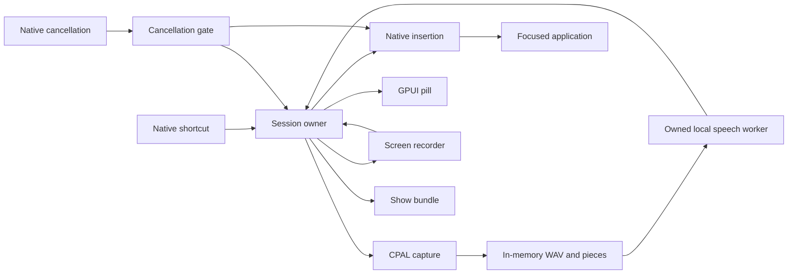

# Architecture

Speakeasy is a Rust desktop app for Windows, macOS, and Linux. GPUI renders Settings, the Show
library, one non-activating dictation pill, and a Show's click-through ink overlay. A session owner
coordinates native input, CPAL capture, a local speech worker, and insertion into the focused
application; a Show adds a screen recorder and publishes a bundle instead of inserting. Linux
support is experimental; [Linux implementation](linux-implementation.md) records its limits and
remaining checks.

## Change and test map

Every source file opens with a `//!` summary, and the owning file's summary is its contract;
`rg -m1 '^//!' crates` lists them. [AGENTS.md](../AGENTS.md#ownership-and-interfaces) maps the
crates. Find the area you are changing, read its owners, and run their tests, which live in each
module unless a test file is named.

- **Gestures and deadlines**: [core/src/gesture.rs](../crates/core/src/gesture.rs) turns timestamped
  shortcut transitions into actions and deadlines, and decides what each cancel or interruption does
  to a Show. [runtime/tests/dictation.rs](../crates/app/src/runtime/tests/dictation.rs) and
  [shows.rs](../crates/app/src/runtime/tests/shows.rs) drive the owner on paused Tokio time with
  production deadlines.
- **Session owner**: [runtime.rs](../crates/app/src/runtime.rs),
  [runtime/owner.rs](../crates/app/src/runtime/owner.rs),
  [session.rs](../crates/app/src/runtime/session.rs),
  [device.rs](../crates/app/src/runtime/device.rs),
  [worker.rs](../crates/app/src/runtime/worker.rs),
  [recognition.rs](../crates/app/src/runtime/recognition.rs), and the
  [ports.rs](../crates/app/src/runtime/ports.rs) seam own a session's authority, devices, and
  worker. [runtime/tests.rs](../crates/app/src/runtime/tests.rs) hosts the owner on fakes;
  [tests/model.rs](../crates/app/src/runtime/tests/model.rs) checks device and worker release, and
  that text reaches only the session that spoke it, over generated input, settings changes and
  engine faults included. [tests/recognition.rs](../crates/app/src/runtime/tests/recognition.rs)
  checks early recognition, stale piece results, Show promotion, and cleanup across boundaries.
  [tests/streaming.rs](../crates/app/src/runtime/tests/streaming.rs) covers continuous cancellation,
  worker reuse, promotion, and private delivery;
  [tests/practice.rs](../crates/app/src/runtime/tests/practice.rs) checks practice destination and
  lifetime.
- **Audio capture**: [audio.rs](../crates/app/src/audio.rs) with
  [control.rs](../crates/app/src/audio/control.rs), [stream.rs](../crates/app/src/audio/stream.rs),
  [pcm.rs](../crates/app/src/audio/pcm.rs), [speech.rs](../crates/app/src/audio/speech.rs), and
  [cuts.rs](../crates/app/src/audio/cuts.rs), and [live.rs](../crates/app/src/audio/live.rs)
  capture, meter, and seal a trimmed WAV before driver teardown;
  [microphones.rs](../crates/app/src/audio/microphones.rs) lists the input devices Settings offers.
  [audio/tests.rs](../crates/app/src/audio/tests.rs) and
  [stream/tests.rs](../crates/app/src/audio/stream/tests.rs) use synthetic samples; microphones.rs
  checks that a scan the driver blocks serves the next request.
- **Sound cues**: [sounds.rs](../crates/app/src/sounds.rs) plays the cues the owner asks for through
  `Ports::cue` on an owned output thread, which `Ports::hold_cues` keeps open through each session.
  A recording may overhear a cue, so [speech.rs](../crates/app/src/audio/speech.rs) hears only the
  voice band beneath it, through [lowpass.rs](../crates/app/src/lowpass.rs).
  [sounds/tests.rs](../crates/app/src/sounds/tests.rs) drives the player against a fake device and,
  opt-in, plays every cue on the default output;
  [speech/tests.rs](../crates/app/src/audio/speech/tests.rs) runs the real cues through the gate at
  full scale; [runtime/tests/cues.rs](../crates/app/src/runtime/tests/cues.rs) checks which moments
  sound and when the output is held.
- **Local speech**: [local_speech.rs](../crates/app/src/local_speech.rs),
  [child.rs](../crates/app/src/child.rs), [http.rs](../crates/app/src/http.rs), and
  [platform/src/process.rs](../crates/platform/src/process.rs) start, query, and reap engines.
  [local_speech/tests.rs](../crates/app/src/local_speech/tests.rs) drives startup and requests
  against fake engines; [runtime/fixture.rs](../crates/app/src/runtime/fixture.rs) profiles the real
  owner and worker on public audio, opt-in.
  [local_speech/streaming.rs](../crates/app/src/local_speech/streaming.rs) owns the authenticated
  loopback WebSocket and bounded final wait. Its tests cover final-only delivery, abandoned feeds,
  malformed replies, authentication, and listener ownership.
- **Model choices and hints**: [models.rs](../crates/app/src/models.rs) owns curated identities and
  engine language adaptation. [recognition_terms.rs](../crates/app/src/recognition_terms.rs)
  validates bounded recognition hints independently of transcript corrections. Hints travel per
  request; editing them cancels the session but keeps the worker.
- **Transcript cleanup**: [transcript.rs](../crates/app/src/transcript.rs), with the filler policy
  in `Config::fillers` ([config.rs](../crates/app/src/config.rs)).
  [vocabulary.rs](../crates/app/src/transcript/vocabulary.rs) validates and compiles per-request
  phrase corrections after filler removal, preserving timed-word spans. Its tests cover word
  boundaries, non-chaining replacements, duplicate validation, and timing.
- **Insertion**: [platform/src/insertion.rs](../crates/platform/src/insertion.rs) with the Windows
  and macOS commit protocol in [insertion/commit.rs](../crates/platform/src/insertion/commit.rs),
  [input.rs](../crates/platform/src/input.rs),
  [windows/insertion.rs](../crates/platform/src/windows/insertion.rs),
  [macos.rs](../crates/platform/src/macos.rs), [linux/x11/](../crates/platform/src/linux/x11),
  [linux/portal/](../crates/platform/src/linux/portal), and
  [linux/ei.rs](../crates/platform/src/linux/ei.rs) own delivery, the permit commit, and clipboard
  checks. On Windows and macOS, `copy_text` writes a Show's summary through the paste's own
  clipboard write, so both carry the same private markers.
  [clipboard.rs](../crates/platform/src/clipboard.rs) prepares bounded PNG/bitmap representations
  from the displayed BGRA pixels and checks copy authorization after native acquisition.
  [macos/clipboard.rs](../crates/platform/src/macos/clipboard.rs) serializes native writes with a
  process-local lease because AppKit has no exclusive clipboard lease; one pasteboard item carries
  every format. Windows holds its native lease through every format and removes partial writes on
  failure. [clipboard/tests.rs](../crates/platform/src/clipboard/tests.rs) checks image channels,
  orientation, transparency, bounds, failure reporting, and a newer recording during acquisition.
  [insertion/tests.rs](../crates/platform/src/insertion/tests.rs),
  [insertion/commit/tests.rs](../crates/platform/src/insertion/commit/tests.rs), and the input, X11,
  portal, and EI modules test them; an opt-in test in windows/insertion.rs checks pasted and copied
  text, images, and cancellation on a private window station's clipboard.
- **Shortcuts and desktop adapters**: [keyboard.rs](../crates/platform/src/keyboard.rs),
  [desktop.rs](../crates/platform/src/desktop.rs), [monitor.rs](../crates/platform/src/monitor.rs),
  [owned_thread.rs](../crates/platform/src/owned_thread.rs),
  [windows.rs](../crates/platform/src/windows.rs) and [windows/](../crates/platform/src/windows),
  [macos.rs](../crates/platform/src/macos.rs), and [linux.rs](../crates/platform/src/linux.rs) with
  [linux/](../crates/platform/src/linux) observe shortcuts and present native windows.
  [keyboard/tests.rs](../crates/platform/src/keyboard/tests.rs) checks the pure key decisions on
  every host; owned-window and private-Xvfb checks are opt-in, and the hooks need native acceptance.
- **Pill and motion**: [pill.rs](../crates/app/src/pill.rs) and [pill/](../crates/app/src/pill),
  [core/src/motion.rs](../crates/core/src/motion.rs), [gpui_ext.rs](../crates/app/src/gpui_ext.rs),
  [icons.rs](../crates/app/src/icons.rs), and [theme.rs](../crates/app/src/theme.rs) animate the
  latest snapshot, and [shell/demo.rs](../crates/app/src/shell/demo.rs) scripts the `--demo`
  preview. [pill/native_tests.rs](../crates/app/src/pill/native_tests.rs) is opt-in on a private
  display, and the [check_native_rendering](../crates/app/examples/check_native_rendering.rs)
  example checks owned-window rendering on each platform.
- **Settings and the settings file**: [shell/settings.rs](../crates/app/src/shell/settings.rs) and
  [settings/render.rs](../crates/app/src/shell/settings/render.rs) edit a draft;
  [navigation.rs](../crates/app/src/shell/settings/navigation.rs) owns page selection and keyboard
  focus without changing that draft, and ends private practice when its page is hidden.
  [config.rs](../crates/app/src/config.rs) and [paths.rs](../crates/app/src/paths.rs) own the file
  contract and where it lives. [text_field.rs](../crates/app/src/shell/settings/text_field.rs) owns
  native selection and IME composition; its pure edit state tests Unicode boundaries, and
  [native_tests.rs](../crates/app/src/shell/settings/native_tests.rs) checks owned-window
  composition and save draining. The
  [native interaction test](../crates/app/src/shell/settings/native_interaction.rs) checks language
  navigation, focus restoration, and private practice cleanup through the borrowed-window close
  callback. [config/tests.rs](../crates/app/src/config/tests.rs) pins the file contract.
- **Private practice and readiness**:
  [settings/practice.rs](../crates/app/src/shell/settings/practice.rs) owns the receipt and
  transient rendered text. The session fixes its destination at admission; practice commits the same
  cancellation permit before sending text through a private channel and never calls native
  insertion. Closing the receipt cancels its recording, and hiding or deactivating Settings clears
  the receipt and text. [runtime/tests/practice.rs](../crates/app/src/runtime/tests/practice.rs)
  covers private delivery, cancellation, configuration, and Show exclusion.
  [status.rs](../crates/app/src/status.rs) derives readiness from observed resources without probing
  devices or claiming external delivery.
  [platform/src/permissions.rs](../crates/platform/src/permissions.rs) reads macOS consent without
  prompting; [settings/permissions.rs](../crates/app/src/shell/settings/permissions.rs) refreshes
  that separate observation on window activation. The native interaction test uses fake observations
  to check permission changes and preservation of unsaved settings.
- **Update discovery**: [updates.rs](../crates/app/src/updates.rs) owns one cancellable check, with
  system TLS, a deadline, no redirects, and bounded input. Only a numeric release version forms a
  link to this repository; returned URLs are ignored. Settings starts it explicitly and shutdown
  awaits its thread. [updates/tests.rs](../crates/app/src/updates/tests.rs) covers version ordering,
  hostile tags, redirects, and oversized responses.
- **Pause, reconfigure, quit, and saves**: [shell.rs](../crates/app/src/shell.rs),
  [services.rs](../crates/app/src/shell/services.rs),
  [lifecycle.rs](../crates/app/src/shell/lifecycle.rs),
  [shutdown.rs](../crates/app/src/shell/shutdown.rs), [save.rs](../crates/app/src/shell/save.rs),
  [window.rs](../crates/app/src/shell/window.rs), and [main.rs](../crates/app/src/main.rs).
  [save/tests.rs](../crates/app/src/shell/save/tests.rs) checks ordered writes and edits made during
  one; lifecycle.rs's tests check terminal Quit and Pause or a resume check around Save.
- **Start at login**: [windows/login.rs](../crates/platform/src/windows/login.rs) writes or deletes
  the Windows Run value and reads Windows' Startup apps approval of it;
  [main.rs](../crates/app/src/main.rs) decides which launches touch it, and
  [services.rs](../crates/app/src/shell/services.rs) registers each save of the default settings.
  Login.rs's tests quote the command and decode the approval on Windows, and an opt-in test
  exercises both through a scratch key under `HKCU\Software\Speakeasy-tests`.
- **Setup**: [setup.rs](../crates/app/src/setup.rs) and [setup/](../crates/app/src/setup) choose,
  download, verify, and unpack engines; a full install is opt-in.
- **Tray and status**: [tray.rs](../crates/app/src/tray.rs), [tray/](../crates/app/src/tray),
  [status.rs](../crates/app/src/status.rs), and
  [platform/src/linux/tray.rs](../crates/platform/src/linux/tray.rs) mirror service state;
  [shell/recovery.rs](../crates/app/src/shell/recovery.rs) copies or opens the last Show off the UI
  thread.
- **Instance and relaunch**: [instance.rs](../crates/app/src/instance.rs) owns the lock and the
  secret-gated loopback commands.
- **Command line**: [main.rs](../crates/app/src/main.rs) parses options and routes what they ask
  for, and [show/command.rs](../crates/app/src/show/command.rs) parses `show` commands. Its
  [output.rs](../crates/app/src/show/command/output.rs) projects metadata without private text,
  including exact managed IDs and expiry dates. `show keep` changes retention for one explicit
  managed Show; inspection stays read-only.
  [command/tests.rs](../crates/app/src/show/command/tests.rs) inspects simulated Shows, checks
  failure output, and exercises the embedded [agent skill](../skills/speakeasy-show/SKILL.md). The
  Windows package's [console entry](../crates/app/src/bin/speakeasy-cli.rs) relays only Show
  commands and version requests to the sibling app, with inherited handles, arguments, and working
  directory, and waits for its exit. [cli.rs](../crates/app/tests/cli.rs) checks the process
  boundary without opening devices or the app. Help and refused launch options never spawn a child.
  [check-package.sh](../scripts/check-package.sh) launches every release package before upload.
- **Show recording and publication**: [show.rs](../crates/app/src/show.rs),
  [show/recorder.rs](../crates/app/src/show/recorder.rs),
  [show/publish.rs](../crates/app/src/show/publish.rs), and the session owner.
  [runtime/tests/shows.rs](../crates/app/src/runtime/tests/shows.rs) drives Shows with a fake
  screen, and [runtime/tests/last_show.rs](../crates/app/src/runtime/tests/last_show.rs) checks
  which saved Show the owner remembers;
  [show/recorder/tests.rs](../crates/app/src/show/recorder/tests.rs) drives the area choice and a
  take on synthetic frames and pointer samples;
  [show/publish/tests.rs](../crates/app/src/show/publish/tests.rs) checks every published file, a
  refused copy, and the cancel path.
- **Show review**: [show/review.rs](../crates/app/src/show/review.rs) owns the native library view,
  selection, background reads, and one decoded frame. Its
  [library.rs](../crates/app/src/show/review/library.rs) projects content-free rows through the
  shared store reader, without CLI output types; only the selected summary and bounded recorded
  clauses remain in memory. [narration.rs](../crates/app/src/show/review/narration.rs) distinguishes
  timed, untimed, silent, lost, and unavailable narration. The Summary/Narration switch preserves
  summary edits. Explicit clause and mark requests keep their timestamp across frame modes and clear
  on manual navigation, refresh, or another Show.
  [navigation.rs](../crates/app/src/show/review/navigation.rs) describes earlier/later samples
  honestly and formats Copy moment without transcript text. Selection revisions reject stale Show
  and frame results. Closing cancels reads and releases the image directly, bypassing GPUI's asset
  cache. Services owns accepted Keep/Discard writes through
  [edits.rs](../crates/app/src/show/edits.rs); Quit awaits them, and an immutable fixture lease
  keeps preview storage alive until completion. Recovery enters the session owner's shielded
  publication stage through a bounded request lane, without microphone, inference, or clipboard
  work. [frame.rs](../crates/app/src/show/review/frame.rs) caps PNG files at 32 MiB and dimensions
  at 4096 pixels per side before decoding off the UI thread. Decoder errors never include content.
  [review/tests.rs](../crates/app/src/show/review/tests.rs) checks navigation, damage, and private
  text boundaries. Opt-in [native_tests.rs](../crates/app/src/show/review/native_tests.rs) exercises
  the real view with synthetic files, including rendering on a private Linux display, retention
  actions, stale completion notices, and cleanup on close. Retention writes run off the UI thread
  and stay bound to their original Show; activation rereads the summary and pin. The shell supplies
  copy availability and routes accepted writes and recovery while the view owns result receipts.
  [copy.rs](../crates/app/src/show/copy.rs) owns explicit review/tray copies through native cleanup.
  It retains the displayed image snapshot, reads or encodes off the UI thread, and rejects dropped
  receipts, lifecycle cancellation, and any newer input generation before native replacement. Copies
  made while paused are cancelled before an owner starts. Quit drains the worker, and a replacement
  waits for its predecessor to finish. [copy/tests.rs](../crates/app/src/show/copy/tests.rs) checks
  those races with fake native access; the owned-window review test checks the actual visual request
  through an injected copy action without touching the clipboard.
- **Show composition**: [crates/show/src](../crates/show/src), notably
  [locate.rs](../crates/show/src/locate.rs) resolves phrases and marks to exact recorded spans;
  [locate/evidence.rs](../crates/show/src/locate/evidence.rs) renders bounded source sheets and mark
  crops with actual sample times. The source CLI and native mark navigation share this lookup. Query
  properties, sampling gaps, private output, crops, and export ownership are checked in
  [locate/tests.rs](../crates/show/src/locate/tests.rs) and
  [command/source/tests.rs](../crates/app/src/show/command/source/tests.rs). Composition also
  includes [select.rs](../crates/show/src/select.rs) and [select/](../crates/show/src/select),
  [journal.rs](../crates/show/src/journal.rs), [tracker.rs](../crates/show/src/tracker.rs),
  [marks.rs](../crates/show/src/marks.rs) and [marks/](../crates/show/src/marks),
  [align.rs](../crates/show/src/align.rs), [sheet.rs](../crates/show/src/sheet.rs), and
  [demo.rs](../crates/show/src/demo.rs), tested in their modules,
  [select/tests.rs](../crates/show/src/select/tests.rs),
  [marks/tests.rs](../crates/show/src/marks/tests.rs), and
  [journal/tests.rs](../crates/show/src/journal/tests.rs); `speakeasy show demo` writes a bundle to
  view. [align/tests.rs](../crates/show/src/align/tests.rs) also replays narration from Scrawl's
  public recordings, trimmed beside it to timed words and marks in `show.json`'s shape. Timed
  narration rows reuse alignment's clause boundaries with ten-second display splits; they expose the
  first word's reported onset, never alignment's inferred silence intervals.
- **Show bundle format**: [bundle.rs](../crates/show/src/bundle.rs) and
  [describe.rs](../crates/show/src/describe.rs).
  [bundle/tests.rs](../crates/show/src/bundle/tests.rs) checks paginated sheets and pins
  `show.json`; the demo's summary in demo.rs pins what agents read. Retrieval notes take an explicit
  command and ID. The store writes source frames before rendering the summary, so a failed optional
  source write never advertises retrieval. [paths.rs](../crates/app/src/paths.rs) finds the console
  sibling on Windows, the original AppImage on Linux, or a durable app executable; temporary mounts
  and unavailable commands are omitted. Existing summaries are never regenerated.
  [bundle/read.rs](../crates/show/src/bundle/read.rs) validates format versions and references
  without I/O, exposes sheet membership, and strips private decoder messages from failures. Its
  [tests](../crates/show/src/bundle/read/tests.rs) reject broken references and exercise generated
  manifest mutations and sheet sizes.
- **Show store**: [show/store.rs](../crates/app/src/show/store.rs) names, writes, and expires
  bundles, and [store/recall.rs](../crates/app/src/show/store/recall.rs) reads a saved one back; it
  also discovers and inspects saved Shows without changing them.
  [store/export.rs](../crates/app/src/show/store/export.rs) streams a format-owned inventory into a
  new ZIP, preserves the edited summary, and adds a relative-path guide. It excludes audio and
  retention markers, bounds input to 2 GiB, reports failed staging cleanup, and publishes with
  `persist_noclobber` after flush. The CLI and review window use the same exporter; accepted GUI
  exports use the app's [edit owner](../crates/app/src/show/edits.rs), so closing review cannot
  cancel them. [export/tests.rs](../crates/app/src/show/store/export/tests.rs) checks portability,
  source retrieval after moving, exclusions, links, size limits, and failure cleanup.
  [store/tests.rs](../crates/app/src/show/store/tests.rs) checks publication, expiry, and edited
  summaries; [recall/tests.rs](../crates/app/src/show/store/recall/tests.rs) checks discovery, read
  limits, damage, links, and moved bundles. [age.rs](../crates/app/src/show/store/age.rs) parses the
  folder timestamp for review and property-checks it against naming and expiry boundaries.
  [address.rs](../crates/app/src/show/store/address.rs) resolves exact IDs independently from paths;
  moved or linked bundles never advertise a managed ID.
  [retention.rs](../crates/app/src/show/store/retention.rs) owns Keep changes and an OS file lock
  shared with cleanup across app and CLI processes. Cleanup holds it from the final pin check
  through renaming an expired Show out of the visible library, then removes files without the lock.
  Hidden expired directories survive interrupted deletion for the next cleanup pass. Its
  [tests](../crates/app/src/show/store/retention/tests.rs) exercise ordering, original expiry dates,
  interrupted deletion, moved bundles, links, and preserved edits.
  [checkpoint.rs](../crates/app/src/show/store/checkpoint.rs) owns private live logs and exclusive
  cross-process locks. The session owns a
  [keeper](../crates/app/src/show/store/checkpoint/keeper.rs) from explicit Show promotion. One
  writer drains independent bounded frame and audio lanes; a stream failure leaves the other usable.
  Frame close acknowledges its flush without waiting for audio; the checkpoint lock releases only
  after both producers close and the native movie lease acknowledges file closure, including on
  unwind. The independent movie lane durably saves the original-session origin before accepting
  capture; frame or audio failure cannot release its lock. The frame lane queues at most 512
  events/64 MiB and its log caps at 1 GiB/200,000 events. The audio lane queues at most 64 events/8
  MiB and its checksummed PCM log caps at 128 MiB; a backlog stays in capture's existing PCM buffer.
  [Audio checkpointing](../crates/app/src/audio/checkpoint.rs) preserves cue boundaries before and
  after promotion, so recovery seals through the same speech gate and trimming. Narration is
  atomically written and synced before audio deletion. Publication binds durable checkpoint and
  bundle markers before rename; untranscribed audio keeps a published checkpoint visible as
  Narration pending. A retry creates a new bundle. Unfinished cancellation records discard before
  deletion; private audio, narration, frame, and movie files are removed before the lock, so blocked
  deletion remains available to cleanup. Audio retains the original seven-day expiry regardless of a
  saved bundle's Keep marker. Discovery isolates damaged checkpoints so healthy entries remain
  visible and saved bundles still expire.
  [checkpoint/tests.rs](../crates/app/src/show/store/checkpoint/tests.rs) exercises damaged
  siblings, expiry, lock ownership, and durable discard/publication markers.
  [journal/log.rs](../crates/show/src/journal/log.rs) shares live/replay admission, thinning, and
  pointer folding; checksums and bounded records stop replay at its first damaged event. Property
  tests compare replayed frames, timing, and annotations with live state.
  [journal/source.rs](../crates/show/src/journal/source.rs) streams optional retained frames into
  `source.frames` (512 MiB maximum), with checksummed tiles and an index capped at 64 MiB/4096
  frames. [store/source.rs](../crates/app/src/show/store/source.rs) performs bounded range reads;
  the viewer and CLI decode only the requested frame. Source exports require explicit time/path and
  never overwrite. Older bundles remain readable without this optional file. Source writes use a
  temporary file; failure saves selected keyframes with a nonfatal notice.
  [publish/tests/recovery.rs](../crates/app/src/show/publish/tests/recovery.rs) covers this
  fallback, publication failure, revocation, original expiry, and duplicate recovery prevention.
- **Screen capture and overlay**: [platform/src/screen.rs](../crates/platform/src/screen.rs),
  [screen/geometry.rs](../crates/platform/src/screen/geometry.rs),
  [windows/screen.rs](../crates/platform/src/windows/screen.rs) with
  [windows/screen/](../crates/platform/src/windows/screen), and
  [macos/screen.rs](../crates/platform/src/macos/screen.rs) capture a display, a window as it moves
  until it closes or goes off screen, or an area, and
  [show/overlay.rs](../crates/app/src/show/overlay.rs) shows ink, mark numbers, and the area picker.
  Geometry, overlay timing, and the area drag run on every host; native capture is opt-in, and
  window lookup and the picker's clicks need native acceptance. On Windows, an opt-in acceptance
  test stops an owned window's capture as it hides, minimizes, cloaks, moves away, and closes. The
  [movie adapter](../crates/platform/src/windows/movie.rs) writes silent H.264 fragments from the
  same admitted, cropped Windows frames. Its non-cloneable [lease](../crates/platform/src/movie.rs)
  waits for a durable origin acknowledgment before opening the file and closes only after native
  file handles release. It bounds its canvas to 2560 pixels per edge, its reported native input
  queue to 64 MiB, and actual file writes to 384 MiB. Those bounds do not cover memory allocated
  internally by the system codec. Resized windows fit inside a cleared fixed canvas; a quiet tail
  holds the last image through capture's observed end. The original session deadline bounds
  admission and the held tail. Windows Shows save this video beside their sampled lossless frames;
  Mac Shows currently retain only sampled frames. [show/src/movie.rs](../crates/show/src/movie.rs)
  validates bounded, single-track fragment metadata and returns only the complete prefix. It checks
  sample byte ranges and timing, not compressed picture decoding.
  [store/movie.rs](../crates/app/src/show/store/movie.rs) copies that prefix before publication
  commits, records the separate annotation horizon, and checks finalized native timing against the
  fragments. Failed copy or sync preserves the checkpoint. A missing or incomplete first fragment
  permits still-only publication with an explicit video-loss notice; other damaged video stays
  recoverable with a concrete manual remedy. Saved-bundle inspection and export remain strict. The
  viewer opens video in the system player; its marks and narration remain separate. Explicit
  `show frame --video` queries use the [native reader](../crates/platform/src/windows/movie/read.rs)
  on Windows. Validation and decoding share one open file with writes denied. The synchronous reader
  releases its decoder and native I/O before returning; cancellation is checked between native
  calls. It checks canvas and buffer bounds and returns top-down opaque BGRA with the actual decoded
  timestamp. The [video command](../crates/app/src/show/command/source/video.rs) reports
  session-relative time and separate annotation coverage, including recovered tails. It refuses
  crops until timed content geometry is available. Opt-in synthetic checks cover seek direction,
  orientation, cancellation, file replacement, and exports beyond the annotation journal.
- **Scripts and packaging**: [scripts/](../scripts) and [packaging/](../packaging) profile, check,
  package, and launch the app, [app/build.rs](../crates/app/build.rs) embeds the Windows resources,
  and `mise run hygiene` runs [check_repository.py](../scripts/check_repository.py).
  [tests/test_profiling.py](../tests/test_profiling.py) checks the Linux profiler, and
  [tests/test_launchers.py](../tests/test_launchers.py) the Linux demo check's process ownership,
  `AppRun`, and script arguments.
- **Dependency patches**: the root Cargo patch selects a narrowly patched GPUI 0.2.2;
  [vendor/gpui](../vendor/gpui/README.speakeasy.md) and
  [vendor/gpui_media](../vendor/gpui_media/README.speakeasy.md) record each patched contract and the
  checks that cover it, and [platform/tests/](../crates/platform/tests) runs the portable ones.

## Cross-module invariants

No single module owns these rules; a change to any party keeps them.

- **Revoke before cleanup.** Escape, the Linux cancel chord, a settings change the session reads,
  Pause, and Quit revoke the recording's insertion permit before any cleanup is awaited, even while
  a clipboard call is blocked. `commit()` runs immediately before the irreversible effect, and an
  obsolete permit never authorizes newer work. A Show pastes nothing, so its permit is shielded:
  Escape, the tray, and an interruption reach the owner, which may keep the Show, while a settings
  change, Pause, and Quit still revoke it at once.
- **Stale results cannot reach a newer session.** A capture event applies only after one lookup
  matches its `SessionId` and a capturing stage, and footage only to its own session. Abandoning a
  session first detaches its transcription or delivery from it; at most, a late result makes the
  Show it saved the last Show, so a late callback cannot stop a newer recording, overwrite its
  state, or deliver stale text.
- **Pieces are disposable; the recording is authoritative.** Pause-aligned Parakeet pieces carry
  both session and piece identity, including failures. The session keeps at most one queued piece
  and never starts a worker merely to recognize early. Missing, failed, or overloaded pieces fall
  back to the full sealed audio; any failed worker is replaced, including a detached piece's. A
  failed final request retries that audio once. Raw text joins before filler removal and phrase
  correction, and insertion waits for capture to seal. Promotion discards pieces and uses
  whole-recording timed narration without changing its clock.
- **Retire before reopening.** A microphone, screen recorder, worker, insertion thread, or desktop
  service acknowledges native teardown before its replacement opens. Retiring work stays owned until
  then, and abandoning a session never waits for it.
- **Snapshots only present.** The owner decides from owned state and presents coalesced snapshots;
  views never read PCM, and their timers cannot present session state. Meter levels travel on their
  own lane, applied only to the matching epoch and recording.
- **The snapshot epoch fences presenters.** Each status the shell announces advances it. An owner
  takes the current epoch before its thread starts and presents only while that epoch is current, so
  a retiring owner cannot replace a newer pause or quit notice; it can only add the last Show,
  below.
- **Quit drains without a timeout.** Every application-owned Quit route awaits audio teardown, a
  microphone scan, process reaping, insertion, setup, recovery, checkpoint cleanup, and accepted
  Settings/Show edits while rendering continues. The instance lock is released after the last
  Settings writer.
- **Reports go through the owner.** Background failures, such as a failed retention sweep, and the
  menu's notices about the last Show reach a running owner's report lane and never interrupt a
  recording; without an owner, Services shows them while idle. Each report shown advances the
  snapshot's report count, so one that repeats the last still shows again, except a recurring
  failure, such as each sweep's, which shows again only when it changes.
- **A Show appears only after commit.** Publishing composes and stages the bundle off the owner's
  thread in a private `.partial-*` directory. The bundle appears and its summary is copied only once
  the permit commits; a Show cancelled first leaves no bundle and no clipboard change. A saved Show
  stays saved when the clipboard refuses its summary.
- **Finished Shows remain recoverable.** Quit, Pause, and reconfiguration revoke unfinished
  publication without deleting its checkpoint. The same holds while finished footage awaits
  transcription. The session decides checkpoint disposition; stale reports hold only in-memory
  footage. Cancelling unfinished capture, choosing no target, or a screen failure before the first
  frame discards its checkpoint. A recorder unwind preserves a finished session's checkpoint because
  it may contain surviving frames. Recovery waits for an idle session, reopens files off the owner
  thread, and uses the existing local worker with the original language and current text
  corrections. It opens no capture devices and has no clipboard action. Quit or reconfiguration
  retains a recovery checkpoint.
  [runtime/tests/recovery.rs](../crates/app/src/runtime/tests/recovery.rs) tests ownership and
  revocation; [recorder/tests/checkpoint.rs](../crates/app/src/show/recorder/tests/checkpoint.rs)
  tests durable frame handoff, independent storage failure, and invalid-event prefix preservation.
- **The last Show outlives each owner.** Only a saved Show replaces the one the owner remembers,
  only a report that finds that same Show gone forgets it, and every snapshot presents it. The
  shell's announcements keep it and a new owner starts from the one presented, so Pause and
  reconfiguration keep it and Quit forgets it. A Show that commits before Pause or a settings change
  abandons its session is still saved and copied, so it becomes the last Show unless a later
  session's has, and the abandoned session still reads as cancelled.
- **Insertion is never repeated.** Validation precedes the single commit. After it, a native failure
  reports a partial, unavailable, or manual-paste outcome. Submission cannot prove that an editor
  accepted the text, and Escape cannot retract input already submitted.
- **Private content stays out of diagnostics.** No module logs or reports what
  [AGENTS.md](../AGENTS.md#app-contracts) keeps private; join failures and panics report fixed
  messages.

### Session ownership

Capture starts on the first shortcut press, and the five-minute cap holds whatever the UI animates;
[interaction design](interaction-design.md#interaction-contracts) owns the gestures. Each wake of
`owner.rs` handles one message, advances ready work, and presents a snapshot. A `Session` holds its
permit and one stage. A failure or a settings change ends it from any stage, and so does
cancellation, except for a finished Show being saved. A Show whose microphone has listened outlives
losing its narration: when audio capture stops, the model fails to load, or transcription fails its
one retry, it goes on to its footage with no narration and the reason beside it, where dictation
fails:

```mermaid
stateDiagram-v2
    state "AwaitingFootage(Narration, loss)" as AwaitingFootage
    [*] --> Queued
    [*] --> Reopening: idle owner accepts recovery
    Reopening --> Recognizing: recovered audio
    Reopening --> AwaitingFootage: stored narration or no recoverable audio
    Queued --> Opening: microphone free
    Opening --> Recording: first samples
    Opening --> Stopping: first samples after finish
    Recording --> Recording: recognize pause-aligned pieces; retain whole audio
    Recording --> Stopping: release / next press / limit
    Stopping --> Recognizing: audio sealed; retire microphone
    Stopping --> [*]: no speech
    Recognizing --> Recognizing: await worker / pieces / final request / retry
    Recognizing --> Delivering: complete dictation text; insert
    Recognizing --> [*]: no speech
    Stopping --> AwaitingFootage: silent Show; empty narration
    Recognizing --> AwaitingFootage: Show narration
    Recording --> AwaitingFootage: Show audio stops; narration lost
    Stopping --> AwaitingFootage: Show audio stops; narration lost
    Recognizing --> AwaitingFootage: Show model or retry fails; narration lost
    AwaitingFootage --> Delivering: footage recorded; publish
    Delivering --> [*]: Done / Copied / Cancelled / Error
    Recording --> [*]: cancel; retire microphone and discard pieces
    Recognizing --> [*]: cancel; revoke permit and recover active final request
```

## Local recognition and privacy

Remote microphone routing belongs to the OS and the user's audio bridge; see
[remote dictation](remote-dictation.md).

The speech worker listens on loopback only. On Linux and Windows, Speakeasy declares the worker
ready, and sends each request, only after checking that the worker's own process group, a job object
on Windows, holds its listener. macOS has no listener lookup, so each request there checks only that
the worker still runs. Each worker gets a fresh random key. The NeMo engine receives it in its
owner-only environment, but whisper-server accepts its route only on the command line, so on Linux
other local accounts can read it through `/proc` unless `/proc` is mounted with `hidepid`. That
route is the only guard on Whisper's `/inference` and model-loading `/load` requests, so prefer
Parakeet on shared Linux machines; automatic setup installs it.

Nemotron's continuous stream opens only when the worker is ready and speech passes the audio gate.
The drain thread offers bounded PCM chunks without blocking capture. Backpressure leaves its cursor
for the next drain; completion hands over the remaining tail. Whole audio remains available until
final delivery. Closing a feed abandons optional inference; a successful silent probe acknowledges
engine cleanup before reuse. Cancellation revokes the session before closing its request. Show
promotion abandons the stream and recognizes the whole narration with timing.

Only final events enter the session, and text waits for capture to seal. The pinned NeMo 0.2.0
server emits final results before its commit acknowledgement. Malformed or interrupted streams fall
back to the same model's whole-recording request. HTTP and WebSocket requests share listener checks,
language adaptation, and hint snapshots; neither logs private engine responses.

## Verification

The local gate, `mise run standards:check`, type-checks `speakeasy-platform` for Windows and macOS
as well as the host, but the app's platform code and all native runtime behavior need checks on
their own platform.

Default checks use fake capture and insertion; opt-in public-audio fixtures drive the real session
owner and local worker, and `--demo` uses the actual views with scripted levels.
[AGENTS.md](../AGENTS.md#tests-and-review) sets what default tests may touch. Use explicit gates for
fake cleanup, closing them when a failed test disposes its harness. Timer timeouts inside fakes
change paused-time behavior; bound the test's own waits with
[testing.rs](../crates/app/src/testing.rs) instead. Add a port only for an actual side effect. Keep
native mechanics in the adapter and deterministic decisions in portable code.

Opt-in checks are `#[ignore = "..."]` tests whose reason says what each touches, and
`rg -A1 '#\[ignore =' crates` lists them. Run one at a time with
`cargo test -p <package> <test name> -- --ignored`; for `profile_*`, add `--release` before `--` and
`--nocapture` after it. Never run `--ignored` without a name filter: unfiltered, it records the real
screen on Windows and macOS, opens windows on Linux's current display, and with
`SPEAKEASY_FIXTURE_WAV` set downloads about 0.8 GB. Fixture tests read `SPEAKEASY_FIXTURE_CONFIG`, a
settings file, and `SPEAKEASY_FIXTURE_WAV`, public audio such as whisper.cpp's `samples/jfk.wav`.
`profile_recording_dictation` also reads `SPEAKEASY_FIXTURE_REFERENCE`, a public reference text
file, and requires a canonical mono PCM16 WAV. Alternatively, `SPEAKEASY_FIXTURE_CORPUS` names a
[public corpus manifest](performance.md#public-corpus-replay); it replaces the WAV/reference
variables. `SPEAKEASY_FIXTURE_SEGMENT=1` admits segmentation for Parakeet; otherwise it measures
whole-clip inference. `SPEAKEASY_FIXTURE_SPEED` defaults to one (real time); larger integers
accelerate quality replays. The [README](../README.md#build-and-verify) lists packaging scripts and
native checks.

Default checks cannot establish live microphone, screen capture, overlay placement, hooks, clipboard
and editor acceptance, compositor behavior, or mixed-display frame pacing.
[Native acceptance](performance.md#native-acceptance) and the
[Linux matrix](linux-implementation.md#native-acceptance-still-required) track them. Releases follow
[AGENTS.md](../AGENTS.md#tests-and-review); release notes use absolute
`https://github.com/KrishRVH/speakeasy/blob/main/...` links, because relative links break in a
GitHub release body.
