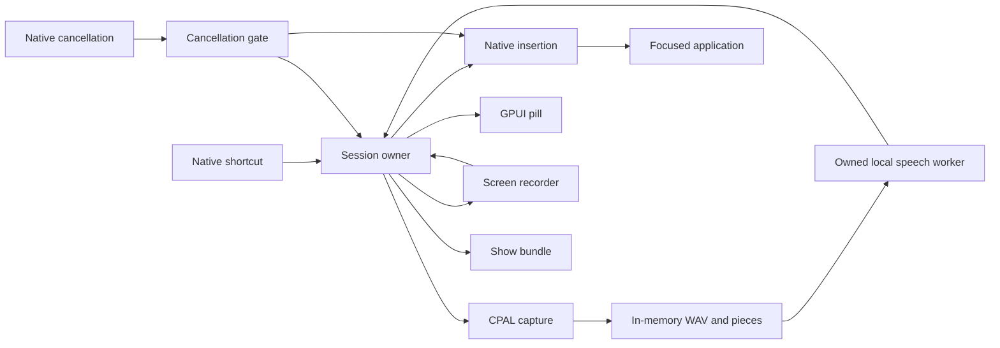

# Architecture

Speakeasy is a Rust desktop app for Windows, macOS, and Linux. GPUI renders Settings, the Show
library, one non-activating dictation pill, and a Show's click-through ink overlay. A session owner
coordinates native input, CPAL capture, a local speech worker, and insertion into the focused
application; a Show adds a screen recorder and publishes a bundle instead of inserting. Linux
support is experimental; [Linux implementation](linux-implementation.md) records its limits and
remaining checks.

## Change and test map

[AGENTS.md](../AGENTS.md#ownership-and-interfaces) maps the crates. This map records their
contracts; [native contracts](native-contracts.md) covers FFI, callback lifetimes, and native-thread
ownership. Find the area you are changing, read its owners, and run their tests, which live in each
module unless a test file is named.

- **Gestures and deadlines**: [core/src/gesture.rs](../crates/core/src/gesture.rs) turns timestamped
  shortcut transitions into actions and deadlines, and decides what each cancel or interruption does
  to a Show. [runtime/tests/dictation.rs](../crates/app/src/runtime/tests/dictation.rs) and
  [shows.rs](../crates/app/src/runtime/tests/shows.rs) drive the owner on paused Tokio time with
  production deadlines.
- **Session owner**: [runtime.rs](../crates/app/src/runtime.rs),
  [runtime/owner.rs](../crates/app/src/runtime/owner.rs),
  [session.rs](../crates/app/src/runtime/session.rs),
  [device.rs](../crates/app/src/runtime/device.rs),
  [worker.rs](../crates/app/src/runtime/worker.rs),
  [recognition.rs](../crates/app/src/runtime/recognition.rs), and the
  [ports.rs](../crates/app/src/runtime/ports.rs) seam own a session's authority, devices, and
  worker. [runtime/tests.rs](../crates/app/src/runtime/tests.rs) hosts the owner on fakes;
  [tests/model.rs](../crates/app/src/runtime/tests/model.rs) checks device and worker release, and
  that text reaches only the session that spoke it, over generated input, settings changes and
  engine faults included. [tests/recognition.rs](../crates/app/src/runtime/tests/recognition.rs)
  checks early recognition, stale piece results, Show promotion, and cleanup across boundaries.
  [tests/streaming.rs](../crates/app/src/runtime/tests/streaming.rs) covers continuous cancellation,
  worker reuse, promotion, and private delivery;
  [tests/practice.rs](../crates/app/src/runtime/tests/practice.rs) checks practice destination and
  lifetime. [tests/replay.rs](../crates/app/src/runtime/tests/replay.rs) defends the single
  memory-only last-result slot: completed ordinary insertion attempts promote their exact final
  text, cancelled or stale work cannot replace it, and each explicit replay obtains a new permit.
  Pause, runtime restart, and Quit erase it; in-place settings changes preserve the exact result for
  recovery. Style is frozen at session admission;
  [transcript/style.rs](../crates/app/src/transcript/style.rs) applies deterministic local casing
  after corrections, while Verbatim bypasses filler removal. Show narration keeps its own policy.
  [shell/choices.rs](../crates/app/src/shell/choices.rs) routes control commands and owns
  saved-preset selection; Services holds the transient style. Tray and command presets validate off
  the UI thread, leave saved settings unchanged, and require owner confirmation while idle.
  Generation, saved-configuration epoch, session counter, and caller lifetime reject stale results.
  The runtime keeps its saved configuration baseline separate from effective preset choices,
  including after Resume. Text-only choices reuse the worker; engine changes reload it.
- **Audio capture**: [audio.rs](../crates/app/src/audio.rs) with
  [control.rs](../crates/app/src/audio/control.rs), [stream.rs](../crates/app/src/audio/stream.rs),
  [pcm.rs](../crates/app/src/audio/pcm.rs), [speech.rs](../crates/app/src/audio/speech.rs), and
  [cuts.rs](../crates/app/src/audio/cuts.rs), and [live.rs](../crates/app/src/audio/live.rs)
  capture, meter, and seal a trimmed WAV before driver teardown;
  [microphones.rs](../crates/app/src/audio/microphones.rs) lists the input devices Settings offers.
  [audio/tests.rs](../crates/app/src/audio/tests.rs) and
  [stream/tests.rs](../crates/app/src/audio/stream/tests.rs) use synthetic samples; microphones.rs
  checks that a scan the driver blocks serves the next request. The energy gate retains audio after
  100 ms of audible windows, with a floor near −70 dBFS for quiet microphones. PCM stays unchanged.
  Background noise above the floor can also qualify. The gate measures energy around each window's
  mean, so a microphone's DC offset never counts as sound. A recording long enough to seal whose
  every sample was exactly zero, judged before PCM16 rounding, fails with `SilentMicrophone`, which
  names the mute switch, privacy settings, and the microphone choice. Callbacks count themselves as
  publishing before reading the capture mode. Finish/cancel and that count share sequentially
  consistent ordering; the drain advances the mode, then waits for publishing callbacks before
  sealing audio. Mode only advances, so a late finish cannot undo cancellation.
- **Sound cues**: [sounds.rs](../crates/app/src/sounds.rs) plays the cues the owner asks for through
  `Ports::cue` on an owned output thread, which `Ports::hold_cues` keeps open through each session.
  A recording may overhear a cue, so [speech.rs](../crates/app/src/audio/speech.rs) hears only the
  voice band beneath it, through [lowpass.rs](../crates/app/src/lowpass.rs), which starts settled at
  the first window's mean rather than its first sample, so an offset is no step and a cue already
  sounding still starts from rest. Strong voice-band energy qualifies directly; quieter voice must
  also contribute at least one percent of the whole-band energy. Both bands must exceed the quiet
  floor, so filter ringing alone cannot qualify through that relative test.
  [sounds/tests.rs](../crates/app/src/sounds/tests.rs) drives the player against a fake device and,
  opt-in, plays every cue on the default output;
  [speech/tests.rs](../crates/app/src/audio/speech/tests.rs) runs the real cues through the gate at
  full scale; [runtime/tests/cues.rs](../crates/app/src/runtime/tests/cues.rs) checks which moments
  sound and when the output is held.
- **Local speech**: [local_speech.rs](../crates/app/src/local_speech.rs),
  [child.rs](../crates/app/src/child.rs), [http.rs](../crates/app/src/http.rs), and
  [platform/src/process.rs](../crates/platform/src/process.rs) start, query, and reap engines.
  [local_speech/tests.rs](../crates/app/src/local_speech/tests.rs) drives startup and requests
  against fake engines; [runtime/fixture.rs](../crates/app/src/runtime/fixture.rs) profiles the real
  owner and worker on public audio, opt-in.
  [local_speech/streaming.rs](../crates/app/src/local_speech/streaming.rs) owns the authenticated
  loopback WebSocket and bounded final wait. Its tests cover final-only delivery, abandoned feeds,
  and malformed replies; local_speech/tests.rs covers authentication and listener ownership.
- **Model choices and hints**: [models.rs](../crates/app/src/models.rs) owns curated identities and
  engine language adaptation. [recognition_terms.rs](../crates/app/src/recognition_terms.rs)
  validates bounded recognition hints independently of transcript corrections. Hints travel per
  request; editing them cancels the session but keeps the worker.
- **Transcript cleanup**: [transcript.rs](../crates/app/src/transcript.rs), with the filler policy
  in `Config::fillers` ([config.rs](../crates/app/src/config.rs)). `for_dictation` composes filler
  removal, phrase corrections, and the session's output style for insertion and paired replay.
  [vocabulary.rs](../crates/app/src/transcript/vocabulary.rs) validates and compiles per-request
  phrase corrections after filler removal, preserving timed-word spans. Its tests cover word
  boundaries, non-chaining replacements, duplicate validation, and timing.
- **Insertion**: [platform/src/insertion.rs](../crates/platform/src/insertion.rs) with the Windows
  and macOS commit protocol in [insertion/commit.rs](../crates/platform/src/insertion/commit.rs),
  [input.rs](../crates/platform/src/input.rs),
  [windows/insertion.rs](../crates/platform/src/windows/insertion.rs),
  [macos.rs](../crates/platform/src/macos.rs), [linux/x11/](../crates/platform/src/linux/x11),
  [linux/portal/](../crates/platform/src/linux/portal), and
  [linux/ei.rs](../crates/platform/src/linux/ei.rs) own delivery, the permit commit, and clipboard
  checks. Settings and Shows report their activation through `report_focus` in
  [shell/window.rs](../crates/app/src/shell/window.rs) to a `FocusReport`, and every platform
  refuses input while its `OwnFocus` is held, whatever the OS reports about focus; on a layer-shell
  Wayland desktop that report is the only way to tell Speakeasy's windows from another
  application's. On Windows and macOS, `copy_text` writes a Show's summary through the paste's own
  clipboard write, so both carry the same private markers.
  [clipboard.rs](../crates/platform/src/clipboard.rs) prepares bounded PNG/bitmap representations
  from the displayed BGRA pixels and checks copy authorization after native acquisition.
  [macos/clipboard.rs](../crates/platform/src/macos/clipboard.rs) serializes native writes with a
  process-local lease because AppKit has no exclusive clipboard lease; one pasteboard item carries
  every format. Windows holds its native lease through every format and removes partial writes on
  failure. [clipboard/tests.rs](../crates/platform/src/clipboard/tests.rs) checks image channels,
  orientation, transparency, bounds, failure reporting, and a newer recording during acquisition.
  [insertion/tests.rs](../crates/platform/src/insertion/tests.rs),
  [insertion/commit/tests.rs](../crates/platform/src/insertion/commit/tests.rs), and the input, X11,
  portal, and EI modules test them; an opt-in test in windows/insertion.rs checks pasted and copied
  text, images, and cancellation on a private window station's clipboard.
- **Shortcuts and desktop adapters**: [keyboard.rs](../crates/platform/src/keyboard.rs),
  [desktop.rs](../crates/platform/src/desktop.rs), [monitor.rs](../crates/platform/src/monitor.rs),
  [owned_thread.rs](../crates/platform/src/owned_thread.rs),
  [windows.rs](../crates/platform/src/windows.rs) and [windows/](../crates/platform/src/windows),
  [macos.rs](../crates/platform/src/macos.rs), and [linux.rs](../crates/platform/src/linux.rs) with
  [linux/](../crates/platform/src/linux) observe shortcuts and present native windows.
  [gpui_ext.rs](../crates/app/src/gpui_ext.rs)'s `present` shows, hides, or raises the pill,
  Settings, and Shows through the platform crate on Windows and macOS, and through GPUI's
  `Window::set_window_visible` on Linux, where the platform crate only checks that a window is X11
  or Wayland. [keyboard/tests.rs](../crates/platform/src/keyboard/tests.rs) checks the pure key
  decisions on every host; owned-window and private-Xvfb checks are opt-in, and the hooks need
  native acceptance. Mac F13 uses key events and physical key-state reconciliation; Fn and the right
  modifiers use modifier events. Only right modifiers defer quick application combinations.
  Insertion waits for the configured shortcut through the same native adapter that rechecks it
  before delivery; selecting F13 never reserves it for another shortcut setting.
- **Pill and motion**: [pill.rs](../crates/app/src/pill.rs) and [pill/](../crates/app/src/pill),
  [core/src/motion.rs](../crates/core/src/motion.rs), [gpui_ext.rs](../crates/app/src/gpui_ext.rs),
  [icons.rs](../crates/app/src/icons.rs), and [theme.rs](../crates/app/src/theme.rs) animate the
  latest snapshot, and [shell/demo.rs](../crates/app/src/shell/demo.rs) scripts the `--demo`
  preview. [pill/native_tests.rs](../crates/app/src/pill/native_tests.rs) is opt-in on a private
  display, and the [check_native_rendering](../crates/app/examples/check_native_rendering.rs)
  example checks owned-window rendering on each platform.
- **Settings and the settings file**: [shell/settings.rs](../crates/app/src/shell/settings.rs)
  applies each change as it is made: once the speech files are chosen, an edit enters the save
  queue, and a validated save updates the running services.
  [settings/render.rs](../crates/app/src/shell/settings/render.rs) and its page modules present
  Dictation, Words, and General; [navigation.rs](../crates/app/src/shell/settings/navigation.rs)
  owns page selection and keyboard focus and ends private practice when its page is hidden.
  [settings/menu.rs](../crates/app/src/shell/settings/menu.rs) owns the one open dropdown, its
  keyboard cursor, and focus return to its trigger. While the microphone menu is open, refresh keeps
  offered devices in place and appends new devices. Disconnected rows stay labeled and inert until
  reopening compacts them. [controls.rs](../crates/app/src/controls.rs) draws the themed controls
  Settings and Shows share, and the jewels and tracked capitals the pill borrows.
  [config.rs](../crates/app/src/config.rs) and [paths.rs](../crates/app/src/paths.rs) own the file
  contract and where it lives. Missing fields use the same NeMo/auto defaults as a new install.
  Unsupported fields and values stop loading and saving without replacing the file; saves preserve
  concurrent edits to current settings. One `text_delivery` choice controls insertion.
  [settings/speech.rs](../crates/app/src/shell/settings/speech.rs) reads the settings as a managed
  model or the user's own engine, and switching engines clears the inactive engine's files.
  [config/presets.rs](../crates/app/src/config/presets.rs) stores bounded named dictation choices,
  validates them without opening inactive model paths, loads them into the settings, and matches
  them against the current settings. Its snapshot excludes microphone, delivery, shortcuts, sound,
  and presentation options. [settings/presets.rs](../crates/app/src/shell/settings/presets.rs) uses,
  updates, and stores presets by position, and ignores those changes during model setup or file
  selection. The save queue applies used choices; library-only changes leave sessions running.
  [text_field.rs](../crates/app/src/shell/settings/text_field.rs) owns native selection and IME
  composition; its pure edit state tests Unicode boundaries, and
  [native_tests.rs](../crates/app/src/shell/settings/native_tests.rs) checks owned-window
  composition and save draining. The
  [native interaction test](../crates/app/src/shell/settings/native_interaction.rs) checks dropdown
  keyboard navigation, focus restoration, Parakeet's English cleanup switch, presets, and private
  practice cleanup through the borrowed-window close callback.
  [config/tests.rs](../crates/app/src/config/tests.rs) pins the file contract.
- **Accessibility**: Settings owns accessible names, roles, switch/page state, and bounded field
  edits; GPUI builds the AccessKit tree and routes native actions to element handlers. The
  [text field](../crates/app/src/shell/settings/text_field.rs) publishes a text input whose bounds
  are its visible paint clip, with its selection.
  [accessible.rs](../crates/app/src/shell/settings/text_field/accessible.rs) publishes the shaped
  line as runs of at most 255 graphemes whose ids change with each edit revision, so every
  replacement retires retained ranges, including replacement with identical text. Native selections
  map grapheme positions back to byte offsets in the current revision. The editor refuses them
  during IME composition, and a caret inside a grapheme or a cluster beyond AccessKit's 255-byte
  character limit keeps the value but publishes no text ranges. A run accepts `ScrollIntoView` only
  with a text range of the current revision; the
  [viewport](../crates/app/src/shell/settings/text_field/viewport.rs) reveals that range from the
  layout it paints with the least movement, aligns the requested end when the range is wider than
  the field, keeps it revealed across resizes, and follows the caret again once the text or
  selection changes. Scrolling changes neither selection nor focus, and requests that name no range,
  such as AT-SPI scroll hints, are ignored. The
  [accessible tests](../crates/app/src/shell/settings/text_field/accessible/tests.rs) and the
  viewport's own tests cover these boundaries. The
  [Windows lifecycle patch](../vendor/gpui-pre-windows/src/accessibility.rs) empties the tree on
  hide or minimize, restores it after committed visibility, and empties and disconnects it before
  destroying its HWND. The [Windows text adapter](../vendor/accesskit_windows/src/text.rs) retires a
  range with the provider that created it, turns `ScrollIntoView` into a request that names the
  range, and [clips](../vendor/accesskit_windows/src/text/geometry.rs) native rectangles and visible
  ranges without removing document text. [Windows acceptance](../scripts/check-demo-windows.ps1)
  drives the demo and a
  [static owned fixture](../crates/app/src/shell/settings/native_accessibility.rs) through UI
  Automation. GPUI's unpatched macOS and Linux bridges publish the same tree without native
  acceptance. Outer Settings scrolling and complete app semantics remain unimplemented.
- **Private practice and readiness**:
  [settings/practice.rs](../crates/app/src/shell/settings/practice.rs) owns the receipt and
  transient rendered text. The session fixes its destination at admission; practice commits the same
  cancellation permit before sending text through a private channel and never calls native
  insertion. Closing the receipt cancels its recording, and hiding or deactivating Settings clears
  the receipt and text. [runtime/tests/practice.rs](../crates/app/src/runtime/tests/practice.rs)
  covers private delivery, cancellation, configuration, and Show exclusion.
  [status.rs](../crates/app/src/status.rs) derives status from observed resources without probing
  devices or claiming external delivery.
  [platform/src/permissions.rs](../crates/platform/src/permissions.rs) reads macOS consent without
  prompting; [settings/permissions.rs](../crates/app/src/shell/settings/permissions.rs) refreshes
  that separate observation on window activation. The native interaction test uses fake observations
  to check permission changes without disturbing settings.
- **Updates**: [updates.rs](../crates/app/src/updates.rs) owns cancellable discovery and Windows
  preparation. Discovery uses system TLS, a deadline, no redirects, and bounded input; only a
  numeric release version forms a repository link.
  [install.rs](../crates/app/src/updates/install.rs) authenticates signed metadata before a bounded
  download, restricts HTTPS redirects to release hosts, and retains a verified file that Windows
  cannot write or replace. The per-user cache lease excludes other preparations; later explicit
  preparation reclaims only abandoned known files.
  [settings/updates.rs](../crates/app/src/shell/settings/updates.rs) owns the operation and requires
  separate installation consent. Shutdown hands the installer to main only after work and saves
  drain; main releases the instance and exits GPUI before launching it. The installer waits for that
  process to exit, protects both running images, and relaunches only after success. Tests beside
  discovery and preparation cover hostile metadata, signatures, replay, byte caps, corruption,
  cancellation, and cache/file lifetime. Owned-window
  [shutdown tests](../crates/app/src/shell/shutdown/native_tests.rs) hold an accepted Show write to
  check graceful handoff and forced teardown. `scripts/check-installer.ps1` exercises installation
  on disposable runners. [Build and verify](../README.md#build-and-verify) owns signing setup.
- **Pause, reconfigure, quit, and saves**: [shell.rs](../crates/app/src/shell.rs),
  [services.rs](../crates/app/src/shell/services.rs),
  [lifecycle.rs](../crates/app/src/shell/lifecycle.rs),
  [shutdown.rs](../crates/app/src/shell/shutdown.rs), [save.rs](../crates/app/src/shell/save.rs),
  [window.rs](../crates/app/src/shell/window.rs), and [main.rs](../crates/app/src/main.rs). Mac
  native quit requests enter the same drain through GPUI's termination delegate. A pending request
  cannot bypass cleanup by arriving again; only the drained owner approves termination.
  [application.rs](../crates/app/src/application.rs) turns off GPUI's quit after the last window
  closes, so a compositor closing the pill cannot skip the drain. Requests nested inside a
  foreground task or application borrow are canceled before draining, so their native call can
  return. This can cancel a macOS logout request. The opt-in
  [Mac acceptance](../crates/app/src/shell/shutdown/mac_acceptance.rs) holds an accepted Show write
  across external, nested, repeated, and app-owned quit, checking foreground frames and instance
  release without devices or input. [save/tests.rs](../crates/app/src/shell/save/tests.rs) checks
  ordered writes and edits made during one; lifecycle.rs's tests check terminal Quit and Pause or a
  resume check around Save.
- **Start at login**: [windows/login.rs](../crates/platform/src/windows/login.rs) writes or deletes
  the Windows Run value and reads Windows' Startup apps approval of it;
  [main.rs](../crates/app/src/main.rs) decides which launches touch it, and
  [services.rs](../crates/app/src/shell/services.rs) registers each save of the default settings.
  Login.rs's tests quote the command and decode the approval on Windows, and an opt-in test
  exercises both through a scratch key under `HKCU\Software\Speakeasy-tests`.
- **First run**: [settings/onboarding.rs](../crates/app/src/shell/settings/onboarding.rs) owns the
  guide's four steps; [its view](../crates/app/src/shell/settings/render/onboarding.rs) presents
  local setup, dictation permissions, private practice, and completion. Saved model configuration
  unlocks permission assistance even when native shortcut access prevents the runtime from starting.
  A nonblank private result unlocks completion; leaving practice clears its receipt and text. The
  guide never asks for Show permissions or claims to verify external text delivery. Skip and Finish
  write an empty marker, the selected settings file's name plus `.onboarded`, beside it on an owned
  worker, without saving or replacing settings. Failed writes remain visible and retryable; shutdown
  drains an accepted write. Startup opens an unfinished guide even after automatic model setup saved
  a valid configuration. Replay preserves settings. Demo replay uses synthetic text without
  microphone access or a completion write. State and file tests cover blocked transitions and marker
  failures; the Settings native interaction test walks the simulated guide and checks text cleanup
  and preservation of edits.
- **Setup**: [setup.rs](../crates/app/src/setup.rs) and [setup/](../crates/app/src/setup) choose,
  download, verify, and unpack engines and report which managed models are already downloaded; a
  full install is opt-in.
- **Reset**: [reset.rs](../crates/app/src/reset.rs) holds `setup.lock` and `updates.lock` in the
  data root through deletion, refuses while another copy holds either, and deletes engines, models,
  downloads, and updates folders, and deletes the settings file last, following a settings symlink
  to its target. A linked folder loses only its link; Shows and the finished-guide marker stay, and
  a repeated purge succeeds. Services pauses dictation, retires the runtime, and purges on an owned
  thread that Quit drains; nothing resumes until it exits, and a failed purge restores the previous
  settings. Settings refuses reset during setup, saves, or a held Windows update and refuses setup
  while settings are unreadable or a reset runs. On success it adopts default settings as its saved
  baseline and starts automatic setup; as on a new install, the first complete save enables
  dictation, even if it was paused. [reset/tests.rs](../crates/app/src/reset/tests.rs) covers what
  stays, refusals, failure order, and linked folders. Update preparation holds the same
  `updates.lock` outside its removable cache; deleting payloads cannot replace a live lease.
- **Tray and status**: [tray.rs](../crates/app/src/tray.rs), [tray/](../crates/app/src/tray),
  [status.rs](../crates/app/src/status.rs),
  [platform/src/linux/tray.rs](../crates/platform/src/linux/tray.rs), and
  [platform/src/macos/status_item.rs](../crates/platform/src/macos/status_item.rs) mirror service
  state. Windows and macOS share one muda menu; Windows shows it through `tray-icon`, where a
  double-click opens Settings, and macOS assigns it to its own status item, so AppKit opens it from
  the user's click instead of the synthesized click `tray-icon` sends. The tray follows runtime
  snapshots and observes `Services` itself, so settings such as the theme need no snapshot to reach
  it; tray.rs's tests check that and when each menu entry acts.
  [shell/recovery.rs](../crates/app/src/shell/recovery.rs) copies or opens the last Show off the UI
  thread.
- **Instance and relaunch**: [instance.rs](../crates/app/src/instance.rs) owns the lock and the
  secret-gated loopback commands. Shortcut opcodes 0–2 serve relaunch and Linux desktop bindings.
  Opcode 3 carries versioned JSON in a length-prefixed 4 KiB frame. An owned server thread bounds
  authentication and owns up to eight concurrent control receipts, each with a two-second deadline.
  Shortcut cancel/toggle bindings remain responsive while a receipt waits; shutdown drains every
  task. [control.rs](../crates/app/src/control.rs) rejects malformed commands without echoing input.
  [owner/commands.rs](../crates/app/src/runtime/owner/commands.rs) admits actions only for live
  callers and acknowledges actual owner decisions. Stop/cancel tokens combine the runtime
  incarnation with the session ID and exclude Shows and practice. Style is acknowledged by its
  Services owner without inventing a session-status observation; ordinary status is observed by the
  session owner. A lost receipt is unknown, never proof of refusal.
  [tests/control.rs](../crates/app/src/runtime/tests/control.rs) covers stale authority, busy
  admission, per-session style, and preset adoption.
- **Command line**: [main.rs](../crates/app/src/main.rs) parses options and routes what they ask
  for, and [show/command.rs](../crates/app/src/show/command.rs) parses `show` commands. Its
  [output.rs](../crates/app/src/show/command/output.rs) projects metadata without private text,
  including exact managed IDs and expiry dates. `show keep` changes retention for one explicit
  managed Show and `show discard` permanently removes one interrupted checkpoint; inspection stays
  read-only. [command/tests.rs](../crates/app/src/show/command/tests.rs) inspects simulated Shows,
  checks failure output, and exercises the embedded
  [agent skill](../skills/speakeasy-show/SKILL.md). The Windows package's
  [console entry](../crates/app/src/bin/speakeasy-cli.rs) relays Show and control commands and
  version requests to the sibling app, with inherited handles, arguments, and working directory, and
  waits for its exit. [cli.rs](../crates/app/tests/cli.rs) checks the process boundary without
  opening devices or the app. Help and refused launch options never spawn a child.
  [check-package.sh](../scripts/check-package.sh) launches every release package before upload.
- **Agent evidence**: [show/evidence.rs](../crates/app/src/show/evidence.rs) shares inspection and
  temporal queries between CLI and [show/mcp.rs](../crates/app/src/show/mcp.rs). MCP exposes three
  read-only tools within explicit launch roots, refuses child symlinks, bounds lines/content/images,
  and reports actual source sample times. It serves the 2026-07-28 stateless protocol and the
  2025-11-25 initialized protocol used by current external clients. No tool exports, sends, or reads
  ordinary dictation. Setup resolves the durable installed launcher and only prints client stanzas.
- **Show recording and publication**: [show.rs](../crates/app/src/show.rs),
  [show/recorder.rs](../crates/app/src/show/recorder.rs),
  [show/publish.rs](../crates/app/src/show/publish.rs), and the session owner.
  [runtime/tests/shows.rs](../crates/app/src/runtime/tests/shows.rs) drives Shows with a fake
  screen, and [runtime/tests/last_show.rs](../crates/app/src/runtime/tests/last_show.rs) checks
  which saved Show the owner remembers;
  [show/recorder/tests.rs](../crates/app/src/show/recorder/tests.rs) drives the area choice and a
  take on synthetic frames and pointer samples;
  [show/publish/tests.rs](../crates/app/src/show/publish/tests.rs) checks every published file, a
  refused copy, and the cancel path.
- **Show review**: [show/review.rs](../crates/app/src/show/review.rs) owns the native library view,
  selection, cancellable read receipts, and one decoded frame. Its
  [library.rs](../crates/app/src/show/review/library.rs) projects content-free rows through the
  shared store reader, without CLI output types; only the selected summary and bounded recorded
  clauses remain in memory. [narration.rs](../crates/app/src/show/review/narration.rs) distinguishes
  timed, untimed, silent, lost, and unavailable narration. The Summary/Narration switch preserves
  summary edits. Explicit clause and mark requests keep their timestamp across frame modes and clear
  on manual navigation, refresh, or another Show.
  [navigation.rs](../crates/app/src/show/review/navigation.rs) describes earlier/later samples
  honestly and formats the retrieval pointer without transcript text.
  [handoff.rs](../crates/app/src/show/review/handoff.rs) combines that pointer, the displayed
  summary, and bounded original narration for an explicit evidence copy, keeping their meanings
  separate. A labeled summary excerpt keeps the combined text inside the clipboard byte limit
  without dropping narration or changing the bundle. Selection revisions reject stale Show and frame
  results. A separate listing revision rejects row actions offered before a refresh or deletion;
  selecting a frame or changing retention does not invalidate those actions. The
  [preview owner](../crates/app/src/show/preview.rs) retains one blocking reader through native
  cleanup; a replacement waits for that acknowledgement, and the view keeps only its latest pending
  seek. Closing cancels its receipt; Quit cancels and drains the owner.
  [preview/frame.rs](../crates/app/src/show/preview/frame.rs) caps PNG files at 32 MiB and
  dimensions at 4096 pixels per side. It decodes off the UI thread, leaves private pixels out of
  GPUI's asset cache, and passes source and video BGRA directly to the renderer. `Image` owns
  premultiplied RGBA; `into_bgra` consumes it into straight-alpha BGRA, reusing opaque pixel
  storage. GPUI's `RenderImage` expects BGRA bytes inside `image::Frame` despite the buffer's RGBA
  type. Decoder errors never include content. Services owns accepted Keep/Discard/Delete writes
  through [edits.rs](../crates/app/src/show/edits.rs); Quit awaits them, and an immutable fixture
  lease keeps preview storage alive until completion. Recovery enters the session owner's shielded
  publication stage through a bounded request lane. Recovering retained audio uses the configured
  local speech worker; recovery opens no microphone and performs no clipboard work. The
  [video timeline](../crates/app/src/show/review/timeline.rs) uses complete fragment sample times
  for stepping and seeking. Lookups and captions preserve the decoder's clock: 100 ns on Windows and
  nanoseconds on macOS; Evidence copying emits a retrieval query only when a whole millisecond lies
  inside the displayed sample. During seeking, the previous video image stays visible and copying is
  disabled. [review/tests.rs](../crates/app/src/show/review/tests.rs) checks navigation, damage, and
  private text boundaries. Opt-in [native_tests.rs](../crates/app/src/show/review/native_tests.rs)
  exercises the real view with synthetic files, including rendering on a private Linux display,
  retention actions, stale completion notices, and cleanup on close. Retention writes run off the UI
  thread and stay bound to their original Show; activation rereads the summary and pin.
  [deletion.rs](../crates/app/src/show/review/deletion.rs) binds saved-Show confirmation to the
  offered row, invalidates it on selection or refresh, and waits for preview completion before
  accepting deletion. It clears the removed Show's pixels without selecting a substitute or changing
  another Show's notice. The shell supplies copy availability and routes accepted writes and
  recovery while the view owns result receipts. [copy.rs](../crates/app/src/show/copy.rs) owns
  explicit review/tray copies through native cleanup, including the Send to agent prompt, which
  names the folder, each manifest contact sheet in order, and `summary.md` but carries no Show text.
  It retains the displayed image snapshot, reads or encodes off the UI thread, and rejects dropped
  receipts, lifecycle cancellation, and any newer input generation before native replacement. Copies
  made while paused are cancelled before an owner starts. Quit drains the worker, and a replacement
  waits for its predecessor to finish. [copy/tests.rs](../crates/app/src/show/copy/tests.rs) checks
  those races with fake native access; the owned-window review test checks the actual visual request
  through an injected copy action without touching the clipboard, and keyboard routing in the More
  actions menu, where Escape closes the menu rather than the window. That menu relies on GPUI's
  dispatch order: the root's capture-phase mouse-down runs before the popover's mouse-down-out, so
  pressing the trigger of an open menu closes it, and a capture-phase key-up activates the
  highlighted action and stops propagation before the focused trigger's keyboard click.
- **Show composition**: [crates/show/src](../crates/show/src), notably
  [locate.rs](../crates/show/src/locate.rs) resolves phrases and marks to exact recorded spans;
  [locate/evidence.rs](../crates/show/src/locate/evidence.rs) renders bounded source sheets and mark
  crops with actual sample times. The source CLI and native mark navigation share this lookup. Query
  properties, sampling gaps, private output, crops, and export ownership are checked in
  [locate/tests.rs](../crates/show/src/locate/tests.rs) and
  [command/source/tests.rs](../crates/app/src/show/command/source/tests.rs). Composition also
  includes [select.rs](../crates/show/src/select.rs) and [select/](../crates/show/src/select),
  [journal.rs](../crates/show/src/journal.rs), [tracker.rs](../crates/show/src/tracker.rs),
  [marks.rs](../crates/show/src/marks.rs) and [marks/](../crates/show/src/marks),
  [align.rs](../crates/show/src/align.rs), [sheet.rs](../crates/show/src/sheet.rs), and
  [demo.rs](../crates/show/src/demo.rs), tested in their modules,
  [select/tests.rs](../crates/show/src/select/tests.rs),
  [marks/tests.rs](../crates/show/src/marks/tests.rs), and
  [journal/tests.rs](../crates/show/src/journal/tests.rs); `speakeasy show demo` writes a bundle to
  view. [align/tests.rs](../crates/show/src/align/tests.rs) also replays narration from Scrawl's
  public recordings, trimmed beside it to timed words and marks in `show.json`'s shape. Timed
  narration rows reuse alignment's clause boundaries with ten-second display splits; they expose the
  first word's reported onset, never alignment's inferred silence intervals. Keyframes show actual
  sample times; narration anchors describe when their action or drawing began. Alignment partitions
  timed words once, in order. Clause pauses use word onsets because recognizers can extend word ends
  through silence. Finished clauses reach at most 700 ms past the last word's onset; unfinished
  thoughts can resume within four seconds. An anchor in silence can take a clause beginning within a
  second unless the next anchor is nearer. Resumed clauses carry the unfinished thought; text starts
  remain increasing and punctuation stays attached. Marks take selection priority; ordinary frames
  add coverage or a changed screen. An opening frame is added only when it differs and narration
  precedes the first chosen anchor. Selection caps at 36 keyframes, merges crowded mark groups, and
  spreads remaining frames across the recording. Float-to-pixel conversions saturate outside their
  integer range and map NaN to zero.
- **Show framing**: [framing.rs](../crates/show/src/framing.rs) crops screen-Show keyframes; window
  and area Shows record `Framing::Chosen` in the checkpoint header and keep their frames whole. A
  screen Show's platform window watch records window layouts, front to back: bounds as fractions of
  the screen, an opaque window and app number per Show, and a layer: normal, floating (always on
  top), menu, or bar. The checkpoint journal keeps them for recovery; `show.json` never does. Each
  keyframe's slice runs halfway to its neighbors. Its input is the drawn ink and pins plus clicks
  and drags in the slice, and the click focus joins its extent. Each stroke, pin, click, and drag
  casts one vote, shared by its points. A click or drag point votes for the window under it at its
  time, ink and pins at the keyframe's time. A menu votes for its app's front window and passes
  through to the window beneath when its app has none; a bar votes for the front normal window,
  which floating windows never are. When one or two windows hold 80% of the votes, the keyframe
  frames them where they stand at its time, with their app's menus and the app's windows in front
  that overlap them, such as dialogs, and any input outside them, padded by 12 points; the frame is
  fixed, so nothing beside a control falls out. When those windows cover 90% of the screen or more,
  as a maximized window does, the crop covers only the input and the changes it caused, inside the
  windows. With no input, the front window frames the keyframe, joined by the normal window with the
  most changed area, each with its app's menus and overlapping windows in front. Without windows,
  the input joins changed regions within 40 points of it; with no input, any changed region frames
  the keyframe. That crop pads the activity by 0.28 of the screen's geometric mean side, grows to
  320 by 200 points and to a quarter of the screen's width or height, and stays whole at 85%
  coverage. A keyframe without activity takes the nearest earlier crop, else the next. Neighbors
  whose union overlaps by 60% share one crop. Geometry is the only input; no window titles or app
  names. [signature.rs](../crates/show/src/signature.rs) supplies changed regions from pooled
  samples, ignoring pointer-sized changes. Composition grows a crop to everything drawn, then
  [framing/content.rs](../crates/show/src/framing/content.rs) moves edges outward, never inward and
  never past the planned window, into empty gutters and past lines and borders that cross them,
  within 120 points or 60% of the crop. The cut covers whole pixels, and `show.json` records the
  exact part cut. [framing/tests/corpus.rs](../crates/show/src/framing/tests/corpus.rs) scores the
  planner on Hex's 13 simulated captures with and without their window layouts: every must-see
  target stays in frame and no capture scores below its uncropped frames. The neighboring tests
  check window attribution, crop invariants, and snapping.
- **Show bundle format**: [bundle.rs](../crates/show/src/bundle.rs) and
  [describe.rs](../crates/show/src/describe.rs).
  [bundle/tests.rs](../crates/show/src/bundle/tests.rs) checks paginated sheets and pins
  `show.json`; the demo's summary in demo.rs pins what agents read. Retrieval notes take an explicit
  command and ID. The store writes source frames before rendering the summary, so a failed optional
  source write never advertises retrieval. [paths.rs](../crates/app/src/paths.rs) finds the console
  sibling on Windows, the original AppImage on Linux, or a durable app executable; temporary mounts
  and unavailable commands are omitted. Existing summaries are never regenerated.
  [bundle/read.rs](../crates/show/src/bundle/read.rs) validates format versions and references
  without I/O, accepts only the current format, exposes sheet membership, and strips private decoder
  messages from failures. A keyframe `crop` must be a proper part of the unit square. Its
  [tests](../crates/show/src/bundle/read/tests.rs) reject broken references and exercise generated
  manifest mutations and sheet sizes.
- **Show store**: [show/store.rs](../crates/app/src/show/store.rs) names, writes, and expires
  bundles, and [store/recall.rs](../crates/app/src/show/store/recall.rs) reads a saved one back; it
  also discovers and inspects saved Shows without changing them.
  [store/export.rs](../crates/app/src/show/store/export.rs) streams a format-owned inventory into a
  new ZIP, preserves the edited summary, and adds a relative-path guide. It excludes audio and
  retention markers, bounds input to 2 GiB, reports failed staging cleanup, and publishes with
  `persist_noclobber` after flush. The CLI and review window use the same exporter; accepted GUI ZIP
  exports use the app's [edit owner](../crates/app/src/show/edits.rs), so closing review cannot
  cancel them. [export/tests.rs](../crates/app/src/show/store/export/tests.rs) checks portability,
  source retrieval after moving, exclusions, links, size limits, and failure cleanup.
  [store/video.rs](../crates/app/src/show/store/video.rs) composes a separate MP4 through local
  FFmpeg. It copies the validated source prefix into private staging, checks decoded frame count,
  paints annotations at 30 Hz output ticks using each source frame's geometry, and aligns original
  PCM and optional subtitles to the selected session interval. Full exports preserve voice before
  screen promotion and after the last captured image by holding the boundary frame. Clipped captions
  contain only intersecting words. The plain-text subtitle decoder receives neutral style resets
  after braces and backslashes so markup-like narration stays literal through `mov_text` encoding.
  Missing voice and annotation coverage are reported. The
  [`show video` command](../crates/app/src/show/command/video.rs) and Review share this exporter;
  cancellation kills and reaps both FFmpeg children before staging is removed. Raw audio, captions,
  and source copies use the managed Shows folder's private staging; the existing one-hour sweep
  reclaims crash leftovers. Only the final MP4 stages beside its chosen destination for publication
  without overwriting. The CLI registers Ctrl-C before staging and awaits its blocking export worker
  on cancellation. Review owns its cancel sender; closing cancels video export, while Quit drains
  the edit owner. FFmpeg diagnostics are never exposed. Output is synced and published without
  overwriting. [video/tests.rs](../crates/app/src/show/store/video/tests.rs) checks timing and
  refusal; its opt-in FFmpeg fixture verifies actual ink, voice and subtitle tracks without devices.
  [voice.rs](../crates/app/src/show/store/voice.rs) retains checksummed audio with an immutable
  original expiry, refuses expired reads, and erases expired voice under the retention lock even
  when the Show is kept. Moving the folder does not reset its voice deadline.
  [store/tests.rs](../crates/app/src/show/store/tests.rs) checks publication, expiry, and edited
  summaries; [recall/tests.rs](../crates/app/src/show/store/recall/tests.rs) checks discovery, read
  limits, damage, links, and moved bundles. [age.rs](../crates/app/src/show/store/age.rs) parses the
  folder timestamp for review and property-checks it against naming and expiry boundaries.
  [address.rs](../crates/app/src/show/store/address.rs) resolves exact IDs independently from paths;
  moved or linked bundles never advertise a managed ID.
  [retention.rs](../crates/app/src/show/store/retention.rs) owns Keep changes and an OS file lock
  shared with cleanup across app and CLI processes. Cleanup holds it from the final pin check
  through renaming an expired Show out of the visible library, then removes files without the lock.
  Explicit deletion validates a managed directory under the same lock, including kept or damaged
  Shows. It first discards associated recovery data only after bounded reciprocal publication
  markers agree and checkpoint ownership is available. Missing checkpoints need no cleanup; damaged
  or active ownership refuses deletion. The bundle is renamed without replacing an existing cleanup
  directory, then its files are removed outside the lock. A cleanup failure reports the hidden state
  and remains retryable; exported copies and unrelated checkpoints are untouched. Hidden expired
  directories survive interrupted deletion for the next cleanup pass. Its
  [tests](../crates/app/src/show/store/retention/tests.rs) exercise ordering, original expiry dates,
  interrupted deletion, moved bundles, links, and preserved edits.
  [checkpoint.rs](../crates/app/src/show/store/checkpoint.rs) owns private live logs and exclusive
  cross-process locks. The session owns a
  [keeper](../crates/app/src/show/store/checkpoint/keeper.rs) from explicit Show promotion. One
  writer drains independent bounded frame and audio lanes; a stream failure leaves the other usable.
  Frame close acknowledges its flush without waiting for audio; the checkpoint lock releases only
  after both producers close and the native movie lease acknowledges file closure, including on
  unwind. The independent movie lane durably saves the original-session origin before accepting
  capture; frame or audio failure cannot release its lock. The frame lane queues at most 512
  events/64 MiB and its log caps at 1 GiB/200,000 events. The audio lane queues at most 64 events/8
  MiB and its checksummed PCM log caps at 128 MiB; a backlog stays in capture's existing PCM buffer.
  [Audio checkpointing](../crates/app/src/audio/checkpoint.rs) preserves cue boundaries before and
  after promotion, so recovery seals through the same speech gate and trimming. Narration is
  atomically written and synced while audio remains recoverable. Successful transcription copies
  voice into the staged bundle before checkpoint retirement. Publication binds durable checkpoint
  and bundle markers before rename; the marker distinguishes narrated publication so a crash before
  checkpoint deletion cannot offer duplicate recovery. If checkpoint storage never opens, in-memory
  footage remains publishable. A lost checkpoint completion stops publication; an unknown checkpoint
  state cannot become an apparently complete bundle. Untranscribed audio keeps a published
  checkpoint visible as Narration pending; a silent microphone's audio holds nothing to retry or
  export, so its checkpoint retires without keeping voice. A retry creates a new bundle. Unfinished
  cancellation records discard before deletion; private audio, narration, frame, and movie files are
  removed before the lock, so blocked deletion remains available to cleanup. Audio retains the
  original seven-day expiry regardless of a saved bundle's Keep marker. Discovery isolates damaged
  checkpoints so healthy entries remain visible and saved bundles still expire.
  [checkpoint/tests.rs](../crates/app/src/show/store/checkpoint/tests.rs) exercises damaged
  siblings, expiry, lock ownership, and durable discard/publication markers.
  [journal/log.rs](../crates/show/src/journal/log.rs) shares live/replay admission, thinning, and
  pointer folding; its header records the budget, surface, and framing, so recovery crops as the
  live Show would; checksums and bounded records stop replay at its first damaged event. Property
  tests compare replayed frames, timing, and annotations with live state. The journal stores
  lossless changed tiles and thins samples and tiles together, retaining the first and last held
  frames. Each thinning doubles admission stride; skipped arrivals need no pixel preparation. Its
  compressed budget is a target with a two-frame exception, not a strict resident-memory cap.
  Sealing drops only the comparison image. A lookup returns the latest retained sample at or before
  the query, or the first sample for an earlier query. Callers report its actual timestamp; retained
  samples do not establish what appeared in the gaps.
  [journal/source.rs](../crates/show/src/journal/source.rs) streams optional retained frames into
  `source.frames` (512 MiB maximum), with checksummed tiles and an index capped at 64 MiB/4096
  frames. [store/source.rs](../crates/app/src/show/store/source.rs) performs bounded range reads;
  the viewer and CLI decode only the requested frame. Retained source frames require a readable Show
  manifest with the same recording duration; a mismatch leaves keyframes and edits readable. Source
  exports require an explicit focus and new output path and never overwrite. Source writes use a
  temporary file; failure saves selected keyframes with a nonfatal notice.
  [publish/tests/recovery.rs](../crates/app/src/show/publish/tests/recovery.rs) covers this
  fallback, publication failure, revocation, original expiry, and duplicate recovery prevention.
- **Screen capture and overlay**: [platform/src/screen.rs](../crates/platform/src/screen.rs),
  [screen/geometry.rs](../crates/platform/src/screen/geometry.rs),
  [windows/screen.rs](../crates/platform/src/windows/screen.rs) with
  [windows/screen/](../crates/platform/src/windows/screen), and
  [macos/screen.rs](../crates/platform/src/macos/screen.rs) capture a display, a window as it moves
  until it closes or goes off screen, or an area, and
  [show/overlay.rs](../crates/app/src/show/overlay.rs) shows ink, mark numbers, and the area picker.
  Mac window screenshots reject a changed rectangle after their request. Windows pending frames
  retain the rectangle observed when polled and reject a rectangle that differs before or after GPU
  readback. These sampled observations do not establish a window's exact rectangle at composition
  time. Pointer samples carry their target geometry; queued stills cannot rewind the live overlay,
  and each sample uses its own surface for annotation coordinates and gesture distances. Unavailable
  observations and queue overflow produce explicit gaps, with one lane slot reserved for their
  delivery. Gaps preserve known ink, discard incomplete clicks and drags, and prevent pins from
  crossing an unobserved interval. Finishing drains observations through the chosen end after the
  producers stop; teardown adds no annotations. Checkpoint replay preserves these same gaps. Pointer
  events also carry their source display rectangle. The tracker retains one coordinate-space proof
  per stroke and pin: mixed strokes and groups across resizes or gaps have none. A delayed pin uses
  the actual pointer point’s proof; stroke cuts preserve the carried joint’s proof. A recording
  without spaces, such as the scripted demo, has unknown provenance. Geometry, overlay timing, and
  the area drag run on every host; native capture is opt-in, and window lookup and the picker's
  clicks need native acceptance. On Windows, an opt-in acceptance test stops an owned window's
  capture as it hides, minimizes, cloaks, moves away, and closes. The
  [recording owner](../crates/platform/src/movie/recording.rs) writes silent H.264 fragments from
  admitted frames through the [Windows codec](../crates/platform/src/windows/movie/encoder.rs) or
  [Mac codec](../crates/platform/src/macos/movie/encode.rs). Its non-cloneable
  [lease](../crates/platform/src/movie.rs) waits for a durable origin acknowledgment before opening
  the file and closes only after native file handles release. It bounds its canvas to 2560 pixels
  per edge, its reported native input queue to 64 MiB, and actual file writes to 384 MiB. Those
  bounds do not cover memory allocated internally by the system codec. Resized windows fit inside a
  cleared fixed canvas. Display size, position, or scale changes end capture, since the pointer
  coordinate grid is no longer valid. An explicit 30 Hz clock submits the latest eligible capture
  and holds it through quiet periods; contiguous input prevents the native converter from filling a
  gap with a future image. Captures sharing an unsubmitted tick coalesce. Before presenting a
  changed content or source rectangle, the encoder waits for its durable, checksummed geometry
  receipt. The first receipt starts at sample zero; coalesced inputs never create unpresented
  layouts. Cancellation after acceptance still prevents submission; failed persistence reports a
  video failure. Every read image reaches the movie before quiet advancement, including images read
  for the still lane. Cancellation is checked between submissions, and a catch-up burst stops after
  60 samples instead of monopolizing the capture thread. A failure retains the committed output
  count and presentation horizon separately from the last capture time. Finalization adds no
  samples. The original session deadline bounds capture and held output. Windows Shows and Mac
  screen and area Shows save video beside their sampled lossless frames; Mac window Shows retain
  sampled frames only. The [Mac stream](../crates/platform/src/macos/screen/stream.rs) keeps an
  immutable display crop, excludes Speakeasy's application, and copies complete BGRA frames into a
  two-slot lane. It maps native display timestamps through a bounded host-clock calibration and
  rechecks display geometry before admitting each queued frame. Native screen output has no audio or
  cursor. A separate terminal lane reports failure before cleanup waits; successful stop, an
  already-stopped native error, or the native stopped notification must acknowledge termination
  before output removal and callback-queue drainage. After an acknowledged stop, the movie lease
  stays owned through that cleanup and codec finalization. If stop fails, codec finalization
  releases the movie lease before the stream retries stop and drains its callbacks. The Mac codec
  receives no file URL: its delegate serializes complete segment writes within the file cap, syncs
  each segment, and latches failures before releasing the output lock.
  [show/src/movie.rs](../crates/show/src/movie.rs) validates bounded, single-track fragment metadata
  and returns only the complete prefix. It checks sample byte ranges and timing, not compressed
  picture decoding. Inspection also identifies Media Foundation's undeclared fragment-header
  padding. Publication and ZIP export declare that zero word as a default size only when every
  affected sample has an explicit size and no later header field can change meaning. This changes
  one flag byte per affected fragment; picture bytes, timestamps, offsets, and the source file stay
  intact. Mac reads use the published bytes directly.
  [store/movie.rs](../crates/app/src/show/store/movie.rs) copies that prefix from the validated
  handle before publication commits, records the separate annotation horizon, and checks finalized
  native timing against the fragments. Failed copy or sync preserves the checkpoint. A missing or
  incomplete first fragment permits still-only publication with an explicit video-loss notice; other
  damaged video stays recoverable with a concrete manual remedy. Saved-bundle inspection and export
  accept only movie metadata version 2. A sparse geometry table is published inside that metadata;
  the bounded checkpoint journal stays private. A required random identifier pairs the header with
  that journal; it does not authenticate MP4 bytes. A damaged journal retains geometry only through
  the last complete change’s first sample, clipping against surviving video after computing this
  bound. Missing geometry preserves uncropped video. ZIP export also copies the validated handle and
  metadata snapshot. The viewer offers Windows and macOS video scrubbing, switchable saved
  annotations, and playback in the system player. [draw/video.rs](../crates/show/src/draw/video.rs)
  renders only observed ink prefixes, completed marks, and completed actions whose coordinate proofs
  match the decoded sample. Pins retain their actual observation time; action proofs include the
  release position. Every saved pin proof includes its observation time, and nonempty proof vectors
  cover every recorded stroke, pin, and action. Unknown geometry is omitted. Continuous cut segments
  expire together. This saved-view policy does not reconstruct live overlay fades. A text-free
  immutable annotation snapshot serves repeated previews; completed pixels carry their rendering
  status through seeks and toggles. Explicit `show frame --video` queries use the
  [native reader](../crates/platform/src/windows/movie/read.rs) on Windows and the
  [Mac image generator](../crates/platform/src/macos/movie.rs) on macOS. Validation and decoding
  share one open file; Windows also denies other writers. Mac reads that handle through a private
  resource loader, rejects external references, and closes the lease after active reads finish. The
  validated sample table retains exact ticks alongside display timestamps; Mac requests its selected
  predecessor without rounding and verifies the actual rational time. Encoded pixels exclude track
  transforms and aperture cropping. Both readers release native I/O before returning; cancellation
  is checked between native calls and Mac waits for image-generation completion after cancelling.
  Canvas and buffer bounds are checked, and output is top-down opaque BGRA with the actual decoded
  timestamp. The [`show frame --video` source](../crates/app/src/show/command/source/video.rs)
  reports session-relative time and separate annotation coverage, including recovered tails.
  `--annotated` shares the preview renderer at the exact decoded session time, reports omitted
  primitives, and refuses samples without geometry or annotation coverage. Annotation rendering
  precedes cropping. It refuses crops unless the actual decoded sample’s saved source rectangle
  matches the mark’s coordinate proof. Crops expand within the fitted content, with output
  coordinates reported in the full canvas. Missing geometry permits only unannotated, uncropped
  video. Opt-in synthetic checks cover seek direction, orientation, cancellation, file replacement,
  and exports beyond the annotation journal. Synthetic encoder checks decode irregular captures
  sample by sample, reject future images, and exercise quiet fragments, same-tick coalescing,
  cancellation, and partial progress after a stall.

  Windows converts sRGB RGB32 through an explicit
  [native processor](../crates/platform/src/windows/movie/convert.rs) into limited-range BT.709
  NV12; the H.264 stream carries matching primaries, transfer, matrix, and range. Hidden sink-writer
  converters are disabled. Progressive conversion returns one sample with unchanged timing per input
  and no delayed output at finalization. The Windows reader requests sRGB output and disables
  frame-rate conversion so color processing cannot synthesize timestamps.

- **Scripts and packaging**: [scripts/](../scripts) and [packaging/](../packaging) profile, check,
  package, and launch the app, [app/build.rs](../crates/app/build.rs) embeds the Windows resources,
  and `mise run hygiene` runs [check_repository.py](../scripts/check_repository.py).
  [tests/test_profiling.py](../tests/test_profiling.py) checks the Linux profiler,
  [tests/test_launchers.py](../tests/test_launchers.py) the Linux demo check's process ownership,
  `AppRun`, and script arguments, [tests/test_macos_package.py](../tests/test_macos_package.py) that
  Mac distribution fails closed around notarization, and
  [tests/test_update_signing.py](../tests/test_update_signing.py) that signed update metadata binds
  the installer and version.
- **Dependency patches**: the root Cargo patch selects patched GPUI 0.3.12 (`gpui-pre`) crates and
  AccessKit Windows 0.34.0; [the vendor index](../vendor/README.md) records each patched contract
  and the checks that cover it, and [platform/tests/](../crates/platform/tests) runs the portable
  ones.

## Cross-module invariants

No single module owns these rules; a change to any party keeps them.

- **Revoke before cleanup.** Escape, the Linux cancel chord, a settings change the session reads,
  Pause, and Quit revoke the recording's insertion permit before any cleanup is awaited, even while
  a clipboard call is blocked. `commit()` runs immediately before the irreversible effect, and an
  obsolete permit never authorizes newer work. A Show pastes nothing, so its permit is shielded:
  Escape, the tray, and an interruption reach the owner, which may keep the Show, while a settings
  change, Pause, and Quit still revoke it at once.
- **Stale results cannot reach a newer session.** A capture event applies only after one lookup
  matches its `SessionId` and a capturing stage, and footage only to its own session. Abandoning a
  session first detaches its transcription or delivery from it; at most, a late result makes the
  Show it saved the last Show, so a late callback cannot stop a newer recording, overwrite its
  state, or deliver stale text.
- **Pieces are disposable; the recording is authoritative.** Pause-aligned Parakeet pieces carry
  both session and piece identity, including failures. The session keeps at most one queued piece
  and never starts a worker merely to recognize early. Missing, failed, or overloaded pieces fall
  back to the full sealed audio; any failed worker is replaced, including a detached piece's. A
  failed final request retries that audio once. Raw text joins before filler removal and phrase
  correction, and insertion waits for capture to seal. Promotion discards pieces and uses
  whole-recording timed narration without changing its clock.
- **Retire before reopening.** A microphone, screen recorder, worker, insertion thread, or desktop
  service acknowledges native teardown before its replacement opens. Retiring work stays owned until
  then, and abandoning a session never waits for it.
- **Snapshots only present.** The owner decides from owned state and presents coalesced snapshots;
  views never read PCM, and their timers cannot present session state. Meter levels travel on their
  own lane, applied only to the matching epoch and recording.
- **The snapshot epoch fences presenters.** Each status the shell announces advances it. An owner
  takes the current epoch before its thread starts and presents only while that epoch is current, so
  a retiring owner cannot replace a newer pause or quit notice; it can only add the last Show,
  below.
- **Quit drains without a timeout.** Every application-owned Quit route awaits audio teardown, a
  microphone scan, process reaping, insertion, setup, recovery, checkpoint cleanup, and accepted
  Settings/Show edits while rendering continues. The instance lock is released after the last
  Settings writer.
- **Reports go through the owner.** Background failures, such as a failed retention sweep, and the
  menu's notices about the last Show reach a running owner's report lane and never interrupt a
  recording; without an owner, Services shows them while idle. This low-volume event lane queues
  reports without coalescing: a later notice cannot erase a missing Show's state repair. Each report
  shown advances the snapshot's report count, so one that repeats the last still shows again, except
  a recurring failure, such as each sweep's, which shows again only when it changes.
- **A Show appears only after commit.** Publishing composes and stages the bundle off the owner's
  thread in a private `.partial-*` directory. The bundle appears and its summary is copied only once
  the permit commits; a Show cancelled first leaves no bundle and no clipboard change. A saved Show
  stays saved when the clipboard refuses its summary.
- **Finished Shows remain recoverable.** Quit, Pause, and reconfiguration revoke unfinished
  publication without deleting its checkpoint. The same holds while finished footage awaits
  transcription. A Show finishes when the user finishes it or its capture ends, including where its
  audio stopped. The session decides checkpoint disposition; stale reports hold only in-memory
  footage. Cancelling unfinished capture, choosing no target, or a screen failure before the first
  frame discards its checkpoint. A recorder unwind preserves a finished session's checkpoint because
  it may contain surviving frames. Recovery waits for an idle session, reopens files off the owner
  thread, and uses the existing local worker with the original language and current text
  corrections. It opens no capture devices and has no clipboard action. Quit or reconfiguration
  retains a recovery checkpoint.
  [runtime/tests/recovery.rs](../crates/app/src/runtime/tests/recovery.rs) tests ownership and
  revocation; [recorder/tests/checkpoint.rs](../crates/app/src/show/recorder/tests/checkpoint.rs)
  tests durable frame handoff, independent storage failure, and invalid-event prefix preservation.
- **The last Show outlives each owner.** Only a saved Show replaces the one the owner remembers,
  only a report that finds that same Show gone forgets it, and every snapshot presents it. The
  shell's announcements keep it and a new owner starts from the one presented, so Pause and
  reconfiguration keep it and Quit forgets it. A Show that commits before Pause or a settings change
  abandons its session is still saved and copied, so it becomes the last Show unless a later
  session's has, and the abandoned session still reads as cancelled.
- **Insertion is never automatically repeated.** Validation precedes the single commit. After it, a
  native failure reports a partial, unavailable, or manual-paste outcome. Submission cannot prove
  that an editor accepted the text, and Escape cannot retract input already submitted. Explicit
  Paste last is a new user request with a new permit; it reuses exact final text without recognizing
  or styling it again.
- **Private content stays out of diagnostics.** No module logs or reports what
  [AGENTS.md](../AGENTS.md#app-contracts) keeps private; join failures and panics report fixed
  messages.

### Session ownership

Capture starts on the first shortcut press, and the five-minute cap holds whatever the UI animates;
[interaction design](interaction-design.md#interaction-contracts) owns the gestures. Each wake of
`owner.rs` handles one message, advances ready work, and presents a snapshot. A `Session` holds its
permit and one stage. A failure or a settings change ends it from any stage, and so does
cancellation, except for a finished Show being saved. A Show whose microphone has listened outlives
losing its narration: when audio capture stops, the microphone sent only silence, the model fails to
load, or transcription fails its one retry, it goes on to its footage with no narration and the
reason beside it, where dictation fails:

```mermaid
stateDiagram-v2
    state "AwaitingFootage(Narration, loss)" as AwaitingFootage
    [*] --> Queued
    [*] --> Reopening: idle owner accepts recovery
    Reopening --> Recognizing: recovered audio
    Reopening --> AwaitingFootage: stored narration or no recoverable audio
    Queued --> Opening: microphone free
    Opening --> Recording: first samples
    Opening --> Stopping: first samples after finish
    Recording --> Recording: recognize pause-aligned pieces; retain whole audio
    Recording --> Stopping: release / next press / limit
    Stopping --> Recognizing: audio sealed; retire microphone
    Stopping --> [*]: no speech
    Recognizing --> Recognizing: await worker / pieces / final request / retry
    Recognizing --> Delivering: complete dictation text; insert
    Recognizing --> [*]: no speech
    Stopping --> AwaitingFootage: silent Show; empty narration
    Recognizing --> AwaitingFootage: Show narration
    Recording --> AwaitingFootage: Show audio stops; narration lost
    Stopping --> AwaitingFootage: Show audio stops or was all zeros; narration lost
    Recognizing --> AwaitingFootage: Show model or retry fails; narration lost
    AwaitingFootage --> Delivering: footage recorded; publish
    Delivering --> [*]: Done / Copied / Cancelled / Failed
    Recording --> [*]: cancel; retire microphone and discard pieces
    Recognizing --> [*]: cancel; revoke permit and recover active final request
```

### Destruction order

Field order carries resource lifetime in these owners:

- `Capture.signal` cancels before its thread joins; audio streams drop before their device and host
  handles. `Sounds.asks` closes before `_player` joins. `ScreenRecorder.finish` closes before its
  thread joins; a finish message seals footage, while channel closure cancels it.
- `LocalSpeech.group` terminates the process group before `child` drops. Setup's emergency child
  cleanup runs before its directory lock releases; the normal asynchronous path reaps the child.
- `Instance::close` closes the request lane and awaits its server body before the final join removes
  its port file and releases the lock. An exiting instance cannot delete a successor's port file.
- Settings requests setup/update cancellation and flushes accepted saves before those fields join.
  `Owners` requests both runtime and monitor stop before either joins.

Native show/window calls are deferred until GPUI releases its current window borrow: they can
synchronously request another frame. One deferred task per window lets a superseding request cancel
an older unrun call. An IME composition's selection offsets are UTF-16 relative to the inserted
text.

## Local recognition and privacy

Remote microphone routing belongs to the OS and the user's audio bridge; see
[remote dictation](remote-dictation.md).

Constructing `Ports::load` does no native work: reload and recovery create its future before waiting
for the previous worker's teardown and poll it only afterward. `Speech::transcribe_stream` returns
`Ok(None)` only after establishing that the worker is reusable; an error requires stopping it before
whole-recording fallback. A silent inference establishes responsiveness and serialization behind
abandoned work; a health endpoint does not. Completion and retirement waits in the owner's select
loop leave their owned tasks in place when another branch wins.

All reqwest clients start at [http::client_builder](../crates/app/src/http.rs). On Linux it attaches
the shared ring provider and HTTP/1.1 ALPN; internet clients use platform certificate verification,
while loopback clients need no system CA bundle. Direct constructors and `Default` bypass this setup
and can panic. Clippy catches the named constructors but cannot name those `Default`
implementations.

The speech worker listens on loopback only. On Linux and Windows, Speakeasy declares the worker
ready, and sends each request, only after checking that the worker's own process group, a job object
on Windows, holds its listener. macOS has no listener lookup, so each request there checks only that
the worker still runs. Each worker gets a fresh random key. The NeMo engine receives it in its
owner-only environment, but whisper-server accepts its route only on the command line, so on Linux
other local accounts can read it through `/proc` unless `/proc` is mounted with `hidepid`. That
route is the only guard on Whisper's `/inference` and model-loading `/load` requests, so prefer
Parakeet on shared Linux machines; automatic setup installs it.

Nemotron's continuous stream opens only when the worker is ready and speech passes the audio gate.
The drain thread offers bounded PCM chunks without blocking capture. Backpressure leaves its cursor
for the next drain; completion hands over the remaining tail. Whole audio remains available until
final delivery. Closing a feed abandons optional inference; a successful silent probe acknowledges
engine cleanup before reuse. Cancellation revokes the session before closing its request. Show
promotion abandons the stream and recognizes the whole narration with timing.

Only final events enter the session, and text waits for capture to seal. The pinned NeMo 0.2.0
server emits final results before its commit acknowledgement. Malformed or interrupted streams fall
back to the same model's whole-recording request. HTTP and WebSocket requests share listener checks,
language adaptation, and hint snapshots; neither logs private engine responses.

## Verification

The local gate, `mise run standards:check`, type-checks `speakeasy-platform` for Windows and macOS
as well as the host, but the app's platform code and all native runtime behavior need checks on
their own platform.

Default checks use fake capture and insertion; opt-in public-audio fixtures drive the real session
owner and local worker, and `--demo` uses the actual views with scripted levels.
[AGENTS.md](../AGENTS.md#tests-and-review) sets what default tests may touch. Use explicit gates for
fake cleanup, closing them when a failed test disposes its harness. Timer timeouts inside fakes
change paused-time behavior; bound the test's own waits with
[testing.rs](../crates/app/src/testing.rs) instead. Add a port only for an actual side effect. Keep
native mechanics in the adapter and deterministic decisions in portable code.

Opt-in checks are `#[ignore = "..."]` tests whose reason says what each touches, and
`rg -A1 '#\[ignore =' crates` lists them. Run one at a time with
`cargo test -p <package> <test name> -- --ignored`; for `profile_*`, add `--release` before `--` and
`--nocapture` after it. Never run `--ignored` without a name filter: unfiltered, it records the real
screen on Windows and macOS, opens windows on Linux's current display, and with
`SPEAKEASY_FIXTURE_WAV` set downloads about 0.8 GB. Fixture tests read `SPEAKEASY_FIXTURE_CONFIG`, a
settings file, and `SPEAKEASY_FIXTURE_WAV`, public audio such as whisper.cpp's `samples/jfk.wav`.
`profile_recording_dictation` also reads `SPEAKEASY_FIXTURE_REFERENCE`, a public reference text
file, and requires a canonical mono PCM16 WAV. Alternatively, `SPEAKEASY_FIXTURE_CORPUS` names a
[public corpus manifest](performance.md#public-corpus-replay); it replaces the WAV/reference
variables. `SPEAKEASY_FIXTURE_SEGMENT=1` admits segmentation for Parakeet; otherwise it measures
whole-clip inference. `SPEAKEASY_FIXTURE_SPEED` defaults to one (real time); larger integers
accelerate quality replays. `SPEAKEASY_FIXTURE_CLEANUP` selects `production` (the default) or `raw`;
only raw mode accepts `SPEAKEASY_FIXTURE_CANDIDATE`, a settings file differing only in corrections
and filler removal. The [public corpus replay](performance.md#public-corpus-replay) describes paired
scoring and its latency limits. The [README](../README.md#build-and-verify) lists packaging scripts
and native checks.

Default checks cannot establish live microphone, screen capture, overlay placement, hooks, clipboard
and editor acceptance, compositor behavior, or mixed-display frame pacing.
[Native acceptance](performance.md#native-acceptance) and the
[Linux matrix](linux-implementation.md#native-acceptance-still-required) track them. Releases follow
[AGENTS.md](../AGENTS.md#tests-and-review); release notes use absolute
`https://github.com/KrishRVH/speakeasy/blob/main/...` links, because relative links break in a
GitHub release body.
