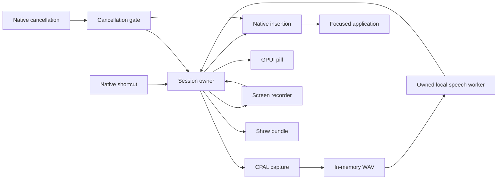

# Architecture

Speakeasy is a Rust desktop app for Windows, macOS, and Linux. GPUI renders Settings, one
non-activating dictation pill, and a Show's click-through ink overlay. A session owner coordinates
native input, CPAL capture, a local speech worker, and insertion into the focused application; a
Show adds a screen recorder and publishes a bundle instead of inserting. Linux support is
experimental; [Linux implementation](linux-implementation.md) records its limits and remaining
checks.

## Change and test map

Every source file opens with a `//!` summary, and the owning file's summary is its contract;
`rg -m1 '^//!' crates` lists them. [AGENTS.md](../AGENTS.md#ownership-and-interfaces) maps the
crates. Find the area you are changing, read its owners, and run their tests, which live in each
module unless a test file is named.

- **Gestures and deadlines**: [core/src/gesture.rs](../crates/core/src/gesture.rs) turns timestamped
  shortcut transitions into actions and deadlines, and decides what each cancel or interruption does
  to a Show. [runtime/tests/dictation.rs](../crates/app/src/runtime/tests/dictation.rs) and
  [shows.rs](../crates/app/src/runtime/tests/shows.rs) drive the owner on paused Tokio time with
  production deadlines.
- **Session owner**: [runtime.rs](../crates/app/src/runtime.rs),
  [runtime/owner.rs](../crates/app/src/runtime/owner.rs),
  [session.rs](../crates/app/src/runtime/session.rs),
  [device.rs](../crates/app/src/runtime/device.rs),
  [worker.rs](../crates/app/src/runtime/worker.rs), and the
  [ports.rs](../crates/app/src/runtime/ports.rs) seam own a session's authority, devices, and
  worker. [runtime/tests.rs](../crates/app/src/runtime/tests.rs) hosts the owner on fakes;
  [tests/model.rs](../crates/app/src/runtime/tests/model.rs) checks device and worker release, and
  that text reaches only the session that spoke it, over generated input, settings changes and
  engine faults included.
- **Audio capture**: [audio.rs](../crates/app/src/audio.rs) with
  [control.rs](../crates/app/src/audio/control.rs), [stream.rs](../crates/app/src/audio/stream.rs),
  [pcm.rs](../crates/app/src/audio/pcm.rs), and [speech.rs](../crates/app/src/audio/speech.rs)
  capture, meter, and seal a trimmed WAV before driver teardown;
  [microphones.rs](../crates/app/src/audio/microphones.rs) lists the input devices Settings offers.
  [audio/tests.rs](../crates/app/src/audio/tests.rs) and
  [stream/tests.rs](../crates/app/src/audio/stream/tests.rs) use synthetic samples; microphones.rs
  checks that a scan the driver blocks serves the next request.
- **Sound cues**: [sounds.rs](../crates/app/src/sounds.rs) plays the cues the owner asks for through
  `Ports::cue` on an owned output thread, which `Ports::hold_cues` keeps open through each session.
  A recording may overhear a cue, so [speech.rs](../crates/app/src/audio/speech.rs) hears only the
  voice band beneath it, through [lowpass.rs](../crates/app/src/lowpass.rs).
  [sounds/tests.rs](../crates/app/src/sounds/tests.rs) drives the player against a fake device and,
  opt-in, plays every cue on the default output;
  [speech/tests.rs](../crates/app/src/audio/speech/tests.rs) runs the real cues through the gate at
  full scale; [runtime/tests/cues.rs](../crates/app/src/runtime/tests/cues.rs) checks which moments
  sound and when the output is held.
- **Local speech**: [local_speech.rs](../crates/app/src/local_speech.rs),
  [child.rs](../crates/app/src/child.rs), [http.rs](../crates/app/src/http.rs), and
  [platform/src/process.rs](../crates/platform/src/process.rs) start, query, and reap engines.
  [local_speech/tests.rs](../crates/app/src/local_speech/tests.rs) drives startup and requests
  against fake engines; [runtime/fixture.rs](../crates/app/src/runtime/fixture.rs) profiles the real
  owner and worker on public audio, opt-in.
- **Transcript cleanup**: [transcript.rs](../crates/app/src/transcript.rs), with the filler policy
  in `Config::fillers` ([config.rs](../crates/app/src/config.rs)).
- **Insertion**: [platform/src/insertion.rs](../crates/platform/src/insertion.rs) with the Windows
  and macOS commit protocol in [insertion/commit.rs](../crates/platform/src/insertion/commit.rs),
  [input.rs](../crates/platform/src/input.rs),
  [windows/insertion.rs](../crates/platform/src/windows/insertion.rs),
  [macos.rs](../crates/platform/src/macos.rs), [linux/x11/](../crates/platform/src/linux/x11),
  [linux/portal/](../crates/platform/src/linux/portal), and
  [linux/ei.rs](../crates/platform/src/linux/ei.rs) own delivery, the permit commit, and clipboard
  checks. On Windows and macOS, `copy_text` writes a Show's summary through the paste's own
  clipboard write, so both carry the same private markers.
  [insertion/tests.rs](../crates/platform/src/insertion/tests.rs),
  [insertion/commit/tests.rs](../crates/platform/src/insertion/commit/tests.rs), and the input, X11,
  portal, and EI modules test them; an opt-in test in windows/insertion.rs checks pasted and copied
  text on a private window station's clipboard.
- **Shortcuts and desktop adapters**: [keyboard.rs](../crates/platform/src/keyboard.rs),
  [desktop.rs](../crates/platform/src/desktop.rs), [monitor.rs](../crates/platform/src/monitor.rs),
  [owned_thread.rs](../crates/platform/src/owned_thread.rs),
  [windows.rs](../crates/platform/src/windows.rs) and [windows/](../crates/platform/src/windows),
  [macos.rs](../crates/platform/src/macos.rs), and [linux.rs](../crates/platform/src/linux.rs) with
  [linux/](../crates/platform/src/linux) observe shortcuts and present native windows.
  [keyboard/tests.rs](../crates/platform/src/keyboard/tests.rs) checks the pure key decisions on
  every host; owned-window and private-Xvfb checks are opt-in, and the hooks need native acceptance.
- **Pill and motion**: [pill.rs](../crates/app/src/pill.rs) and [pill/](../crates/app/src/pill),
  [core/src/motion.rs](../crates/core/src/motion.rs), [gpui_ext.rs](../crates/app/src/gpui_ext.rs),
  [icons.rs](../crates/app/src/icons.rs), and [theme.rs](../crates/app/src/theme.rs) animate the
  latest snapshot, and [shell/demo.rs](../crates/app/src/shell/demo.rs) scripts the `--demo`
  preview. [pill/native_tests.rs](../crates/app/src/pill/native_tests.rs) is opt-in on a private
  display, and the [check_native_rendering](../crates/app/examples/check_native_rendering.rs)
  example checks owned-window rendering on each platform.
- **Settings and the settings file**: [shell/settings.rs](../crates/app/src/shell/settings.rs) and
  [settings/render.rs](../crates/app/src/shell/settings/render.rs) edit a draft;
  [config.rs](../crates/app/src/config.rs) and [paths.rs](../crates/app/src/paths.rs) own the file
  contract and where it lives. [config/tests.rs](../crates/app/src/config/tests.rs) pins that
  contract.
- **Pause, reconfigure, quit, and saves**: [shell.rs](../crates/app/src/shell.rs),
  [services.rs](../crates/app/src/shell/services.rs),
  [lifecycle.rs](../crates/app/src/shell/lifecycle.rs),
  [shutdown.rs](../crates/app/src/shell/shutdown.rs), [save.rs](../crates/app/src/shell/save.rs),
  [window.rs](../crates/app/src/shell/window.rs), and [main.rs](../crates/app/src/main.rs).
  [save/tests.rs](../crates/app/src/shell/save/tests.rs) checks ordered writes and edits made during
  one; lifecycle.rs's tests check terminal Quit and Pause or a resume check around Save.
- **Start at login**: [windows/login.rs](../crates/platform/src/windows/login.rs) writes or deletes
  the Windows Run value and reads Windows' Startup apps approval of it;
  [main.rs](../crates/app/src/main.rs) decides which launches touch it, and
  [services.rs](../crates/app/src/shell/services.rs) registers each save of the default settings.
  Login.rs's tests quote the command and decode the approval on Windows, and an opt-in test
  exercises both through a scratch key under `HKCU\Software\Speakeasy-tests`.
- **Setup**: [setup.rs](../crates/app/src/setup.rs) and [setup/](../crates/app/src/setup) choose,
  download, verify, and unpack engines; a full install is opt-in.
- **Tray and status**: [tray.rs](../crates/app/src/tray.rs), [tray/](../crates/app/src/tray),
  [status.rs](../crates/app/src/status.rs), and
  [platform/src/linux/tray.rs](../crates/platform/src/linux/tray.rs) mirror service state;
  [shell/recovery.rs](../crates/app/src/shell/recovery.rs) copies or opens the last Show off the UI
  thread.
- **Instance and relaunch**: [instance.rs](../crates/app/src/instance.rs) owns the lock and the
  secret-gated loopback commands.
- **Command line**: [main.rs](../crates/app/src/main.rs) parses options and routes what they ask
  for, and [show.rs](../crates/app/src/show.rs) parses `show` commands; both test their parsing.
  [check-package.sh](../scripts/check-package.sh) launches every release package before upload.
- **Show recording and publication**: [show.rs](../crates/app/src/show.rs),
  [show/recorder.rs](../crates/app/src/show/recorder.rs),
  [show/publish.rs](../crates/app/src/show/publish.rs), and the session owner.
  [runtime/tests/shows.rs](../crates/app/src/runtime/tests/shows.rs) drives Shows with a fake
  screen, and [runtime/tests/last_show.rs](../crates/app/src/runtime/tests/last_show.rs) checks
  which saved Show the owner remembers;
  [show/recorder/tests.rs](../crates/app/src/show/recorder/tests.rs) drives the area choice and a
  take on synthetic frames and pointer samples;
  [show/publish/tests.rs](../crates/app/src/show/publish/tests.rs) checks every published file, a
  refused copy, and the cancel path.
- **Show composition**: [crates/show/src](../crates/show/src), notably
  [select.rs](../crates/show/src/select.rs) and [select/](../crates/show/src/select),
  [journal.rs](../crates/show/src/journal.rs), [tracker.rs](../crates/show/src/tracker.rs),
  [marks.rs](../crates/show/src/marks.rs) and [marks/](../crates/show/src/marks),
  [align.rs](../crates/show/src/align.rs), [sheet.rs](../crates/show/src/sheet.rs), and
  [demo.rs](../crates/show/src/demo.rs), tested in their modules,
  [select/tests.rs](../crates/show/src/select/tests.rs),
  [marks/tests.rs](../crates/show/src/marks/tests.rs), and
  [journal/tests.rs](../crates/show/src/journal/tests.rs); `speakeasy show demo` writes a bundle to
  view. [align/tests.rs](../crates/show/src/align/tests.rs) also replays narration from Scrawl's
  public recordings, trimmed beside it to timed words and marks in `show.json`'s shape.
- **Show bundle format**: [bundle.rs](../crates/show/src/bundle.rs) and
  [describe.rs](../crates/show/src/describe.rs).
  [bundle/tests.rs](../crates/show/src/bundle/tests.rs) checks paginated sheets and pins
  `show.json`; the demo's summary in demo.rs pins what agents read.
- **Show store**: [show/store.rs](../crates/app/src/show/store.rs) names, writes, and expires
  bundles, and [store/recall.rs](../crates/app/src/show/store/recall.rs) reads a saved one back;
  [store/tests.rs](../crates/app/src/show/store/tests.rs) checks both.
- **Screen capture and overlay**: [platform/src/screen.rs](../crates/platform/src/screen.rs),
  [screen/geometry.rs](../crates/platform/src/screen/geometry.rs),
  [windows/screen.rs](../crates/platform/src/windows/screen.rs) with
  [windows/screen/](../crates/platform/src/windows/screen), and
  [macos/screen.rs](../crates/platform/src/macos/screen.rs) capture a display, a window as it moves
  until it closes or goes off screen, or an area, and
  [show/overlay.rs](../crates/app/src/show/overlay.rs) shows ink, mark numbers, and the area picker.
  Geometry, overlay timing, and the area drag run on every host; native capture is opt-in, and
  window lookup and the picker's clicks need native acceptance. On Windows, an opt-in acceptance
  test stops an owned window's capture as it hides, minimizes, cloaks, moves away, and closes.
- **Scripts and packaging**: [scripts/](../scripts) and [packaging/](../packaging) profile, check,
  package, and launch the app, [app/build.rs](../crates/app/build.rs) embeds the Windows resources,
  and `mise run hygiene` runs [check_repository.py](../scripts/check_repository.py).
  [tests/test_profiling.py](../tests/test_profiling.py) checks the Linux profiler, and
  [tests/test_launchers.py](../tests/test_launchers.py) the Linux demo check's process ownership,
  `AppRun`, and script arguments.
- **Dependency patches**: the root Cargo patch selects a narrowly patched GPUI 0.2.2;
  [vendor/gpui](../vendor/gpui/README.speakeasy.md) and
  [vendor/gpui_media](../vendor/gpui_media/README.speakeasy.md) record each patched contract and the
  checks that cover it, and [platform/tests/](../crates/platform/tests) runs the portable ones.

## Cross-module invariants

No single module owns these rules; a change to any party keeps them.

- **Revoke before cleanup.** Escape, the Linux cancel chord, a settings change the session reads,
  Pause, and Quit revoke the recording's insertion permit before any cleanup is awaited, even while
  a clipboard call is blocked. `commit()` runs immediately before the irreversible effect, and an
  obsolete permit never authorizes newer work. A Show pastes nothing, so its permit is shielded:
  Escape, the tray, and an interruption reach the owner, which may keep the Show, while a settings
  change, Pause, and Quit still revoke it at once.
- **Stale results cannot reach a newer session.** A capture event applies only after one lookup
  matches its `SessionId` and a capturing stage, and footage only to its own session. Abandoning a
  session first detaches its transcription or delivery from it; at most, a late result makes the
  Show it saved the last Show, so a late callback cannot stop a newer recording, overwrite its
  state, or deliver stale text.
- **Retire before reopening.** A microphone, screen recorder, worker, insertion thread, or desktop
  service acknowledges native teardown before its replacement opens. Retiring work stays owned until
  then, and abandoning a session never waits for it.
- **Snapshots only present.** The owner decides from owned state and presents coalesced snapshots;
  views never read PCM, and their timers cannot present session state. Meter levels travel on their
  own lane, applied only to the matching epoch and recording.
- **The snapshot epoch fences presenters.** Each status the shell announces advances it. An owner
  takes the current epoch before its thread starts and presents only while that epoch is current, so
  a retiring owner cannot replace a newer pause or quit notice; it can only add the last Show,
  below.
- **Quit drains without a timeout.** Every application-owned Quit route awaits audio teardown, a
  microphone scan, process reaping, insertion, setup, and requested saves while rendering continues.
  The instance lock is released after the last Settings writer.
- **Reports go through the owner.** Background failures, such as a failed retention sweep, and the
  menu's notices about the last Show reach a running owner's report lane and never interrupt a
  recording; without an owner, Services shows them while idle. Each report shown advances the
  snapshot's report count, so one that repeats the last still shows again, except a recurring
  failure, such as each sweep's, which shows again only when it changes.
- **A Show appears only after commit.** Publishing composes and stages the bundle off the owner's
  thread in a private `.partial-*` directory. The bundle appears and its summary is copied only once
  the permit commits; a Show cancelled first leaves no bundle and no clipboard change. A saved Show
  stays saved when the clipboard refuses its summary.
- **The last Show outlives each owner.** Only a saved Show replaces the one the owner remembers,
  only a report that finds that same Show gone forgets it, and every snapshot presents it. The
  shell's announcements keep it and a new owner starts from the one presented, so Pause and
  reconfiguration keep it and Quit forgets it. A Show that commits before Pause or a settings change
  abandons its session is still saved and copied, so it becomes the last Show unless a later
  session's has, and the abandoned session still reads as cancelled.
- **Insertion is never repeated.** Validation precedes the single commit. After it, a native failure
  reports a partial, unavailable, or manual-paste outcome. Submission cannot prove that an editor
  accepted the text, and Escape cannot retract input already submitted.
- **Private content stays out of diagnostics.** No module logs or reports what
  [AGENTS.md](../AGENTS.md#app-contracts) keeps private; join failures and panics report fixed
  messages.

### Session ownership

Capture starts on the first shortcut press, and the five-minute cap holds whatever the UI animates;
[interaction design](interaction-design.md#interaction-contracts) owns the gestures. Each wake of
`owner.rs` handles one message, advances ready work, and presents a snapshot. A `Session` holds its
permit and one stage. A failure or a settings change ends it from any stage, and so does
cancellation, except for a finished Show being saved. A Show whose microphone has listened outlives
losing its narration: when audio capture stops, the model fails to load, or transcription fails its
one retry, it goes on to its footage with no narration and the reason beside it, where dictation
fails:

```mermaid
stateDiagram-v2
    state "AwaitingFootage(Narration, loss)" as AwaitingFootage
    [*] --> Queued
    Queued --> Opening: microphone free
    Opening --> Recording: first samples
    Opening --> Stopping: first samples after finish
    Recording --> Stopping: release / next press / limit
    Stopping --> AwaitingWorker: audio sealed; retire microphone
    Stopping --> [*]: no speech
    AwaitingWorker --> Transcribing: worker ready
    Transcribing --> Delivering: dictation text; insert
    Transcribing --> [*]: no speech
    Stopping --> AwaitingFootage: silent Show; empty narration
    Transcribing --> AwaitingFootage: Show narration
    Recording --> AwaitingFootage: Show audio stops; narration lost
    Stopping --> AwaitingFootage: Show audio stops; narration lost
    AwaitingWorker --> AwaitingFootage: Show model fails to load; narration lost
    Transcribing --> AwaitingFootage: Show retry fails; narration lost
    AwaitingFootage --> Delivering: footage recorded; publish
    Delivering --> [*]: Done / Copied / Cancelled / Error
    Recording --> [*]: cancel; revoke permit and retire
    Transcribing --> [*]: cancel; revoke permit and recover worker
```

## Local recognition and privacy

Remote microphone routing belongs to the OS and the user's audio bridge; see
[remote dictation](remote-dictation.md).

The speech worker listens on loopback only. On Linux and Windows, Speakeasy declares the worker
ready, and sends each request, only after checking that the worker's own process group, a job object
on Windows, holds its listener. macOS has no listener lookup, so each request there checks only that
the worker still runs. Each worker gets a fresh random key. Parakeet receives it in its owner-only
environment, but whisper-server accepts its route only on the command line, so on Linux other local
accounts can read it through `/proc` unless `/proc` is mounted with `hidepid`. That route is the
only guard on Whisper's `/inference` and model-loading `/load` requests, so prefer Parakeet on
shared Linux machines; automatic setup installs it.

## Verification

The local gate, `mise run standards:check`, type-checks `speakeasy-platform` for Windows and macOS
as well as the host, but the app's platform code and all native runtime behavior need checks on
their own platform.

Default checks use fake capture and insertion; opt-in public-audio fixtures drive the real session
owner and local worker, and `--demo` uses the actual views with scripted levels.
[AGENTS.md](../AGENTS.md#tests-and-review) sets what default tests may touch. Use explicit gates for
fake cleanup, closing them when a failed test disposes its harness. Timer timeouts inside fakes
change paused-time behavior; bound the test's own waits with
[testing.rs](../crates/app/src/testing.rs) instead. Add a port only for an actual side effect. Keep
native mechanics in the adapter and deterministic decisions in portable code.

Opt-in checks are `#[ignore = "..."]` tests whose reason says what each touches, and
`rg -A1 '#\[ignore =' crates` lists them. Run one at a time with
`cargo test -p <package> <test name> -- --ignored`; for `profile_*`, add `--release` before `--` and
`--nocapture` after it. Never run `--ignored` without a name filter: unfiltered, it records the real
screen on Windows and macOS, opens windows on Linux's current display, and with
`SPEAKEASY_FIXTURE_WAV` set downloads about 0.8 GB. Fixture tests read `SPEAKEASY_FIXTURE_CONFIG`, a
settings file, and `SPEAKEASY_FIXTURE_WAV`, public audio such as whisper.cpp's `samples/jfk.wav`.
The [README](../README.md#build-and-verify) lists packaging scripts and native checks.

Default checks cannot establish live microphone, screen capture, overlay placement, hooks, clipboard
and editor acceptance, compositor behavior, or mixed-display frame pacing.
[Native acceptance](performance.md#native-acceptance) and the
[Linux matrix](linux-implementation.md#native-acceptance-still-required) track them. Releases follow
[AGENTS.md](../AGENTS.md#tests-and-review); release notes use absolute
`https://github.com/KrishRVH/speakeasy/blob/main/...` links, because relative links break in a
GitHub release body.
